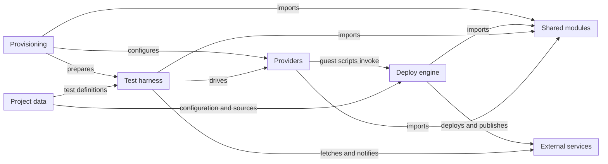

# Context and components

This view maps the current implementation to seven responsibility boundaries expanded in the component breakdown.

The [canonical architecture](../architecture.md) defines the capabilities and
deployment model. These boundaries group code responsibilities; they do not
represent seven processes or seven repository directories.

Each empty subgraph is a placeholder expanded by the identically titled section
in [Component breakdown](02-component-breakdown.md). The seven boxes cover these
current sources:

| Boundary | Source and scope |
| --- | --- |
| Provisioning | OS bootstrappers in [install/](../../install/), [setup.ps1](../../install/setup.ps1), [Yuruna.HostSetup](../../automation/Yuruna.HostSetup.psm1), host commands in [test/lab/](../../test/lab/), and service launchers in [test/service/](../../test/service/). |
| Deploy engine | [Set-Resource](../../automation/Set-Resource.ps1), [Set-Component](../../automation/Set-Component.ps1), [Set-Workload](../../automation/Set-Workload.ps1), their phase modules, validators, and [Invoke-Clear](../../automation/Invoke-Clear.ps1). |
| Test harness | [Start-TestRunner](../../test/Start-TestRunner.ps1), supervision and sequence modules in [test/modules/](../../test/modules/), [diagnostic preservation](../../test/modules/Test.DiagnosticPreservation.psm1), [test/sequences/](../../test/sequences/), [test/status/](../../test/status/), [test/pool/](../../test/pool/), and [test/extension/](../../test/extension/). |
| Providers | The shared [host contract](../../host/Yuruna.Host.Contract.psm1), platform drivers in [host/](../../host/), shared [host/modules/](../../host/modules/), and OS scripts in [guest/](../../guest/). |
| Project data | The companion repository's [layout](https://github.com/alissonsol/yuruna-project/blob/main/README.md), [template](https://github.com/alissonsol/yuruna-project/blob/main/template/README.md), [examples](https://github.com/alissonsol/yuruna-project/blob/main/example/README.md), and [test/test.runner.yml](https://github.com/alissonsol/yuruna-project/blob/main/test/test.runner.yml). |
| Shared modules | Cross-cutting [automation/](../../automation/) libraries, reusable [global/](../../global/) assets, [globalization/](../../globalization/), and [tools/](../../tools/). |
| External services | Implemented integration points in [global/resources/](../../global/resources/), [Yuruna.CredentialProvider](../../automation/Yuruna.CredentialProvider.psm1), [Yuruna.GitHubSource](../../automation/Yuruna.GitHubSource.psm1), [Yuruna.HostDownload](../../host/modules/Yuruna.HostDownload.psm1), and [notification/](../../test/extension/notification/). |

The deploy engine and shared modules occupy the same automation directory.
Provisioning owns service launch commands; the harness owns their implementations.
The host implementations are [Windows Hyper-V](../../host/windows.hyper-v/),
[Ubuntu KVM](../../host/ubuntu.kvm/), and [macOS UTM](../../host/macos.utm/).
They select scripts for [Amazon Linux 2023](../../guest/amazon.linux.2023/),
[Ubuntu Server 24](../../guest/ubuntu.server.24/),
[Ubuntu Server 26](../../guest/ubuntu.server.26/),
[Windows 11](../../guest/windows.11/), and [macOS 26](../../guest/macos.26/).
Host drivers execute on the hypervisor host; guest scripts execute in the VM.
The runner obtains project data from `repositories.projectUrl`, including
pool repository assignments, through
[Test.RunnerInnerLoop](../../test/modules/Test.RunnerInnerLoop.psm1); its runtime
project checkout is input to the harness and deploy engine.

Related module and extension families remain named aggregates to keep this view
at seven boxes. Host refresh is implemented by
[Invoke-HostRefresh](../../test/lab/Invoke-HostRefresh.ps1) and
[Test.HostRefresh](../../test/modules/Test.HostRefresh.psm1) within the provisioning
and harness boundaries. Its admission and recovery behavior is shown in
[Lifecycle](04-lifecycle-state.md). Service placement and network connections are
shown in [Deployment](06-deployment.md).

The resource directories implement localhost, AWS, and Azure; there is no
GCP resource directory or companion config/gcp deployment. Google Artifact
Registry authentication exists in the credential-provider module. It does not
establish a GCP infrastructure deployment path, so no active GCP edge is drawn.

---

[Architecture](../architecture.md) | [Design overview](README.md)
