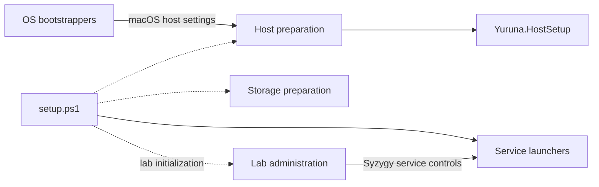
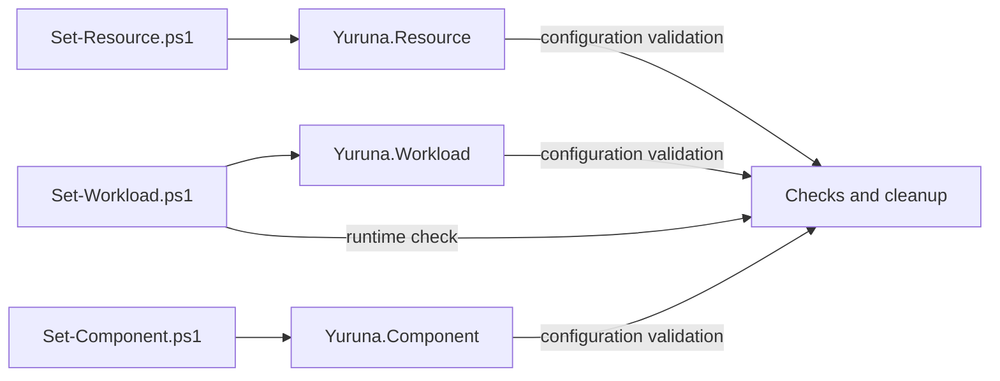
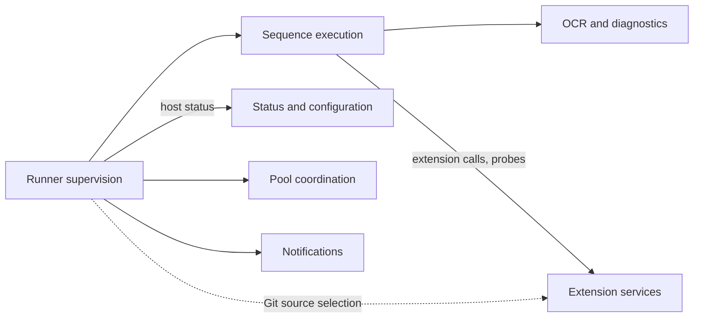
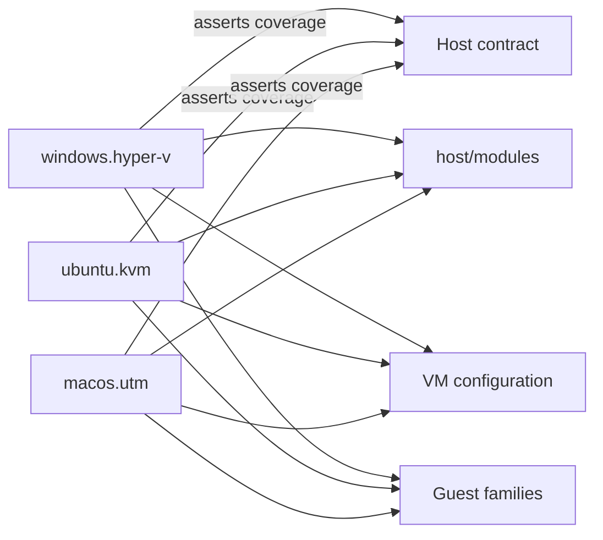
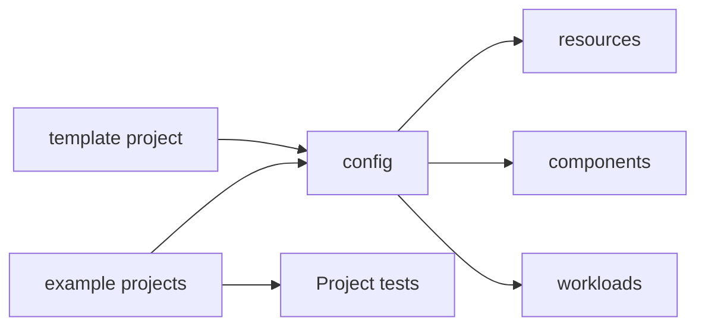
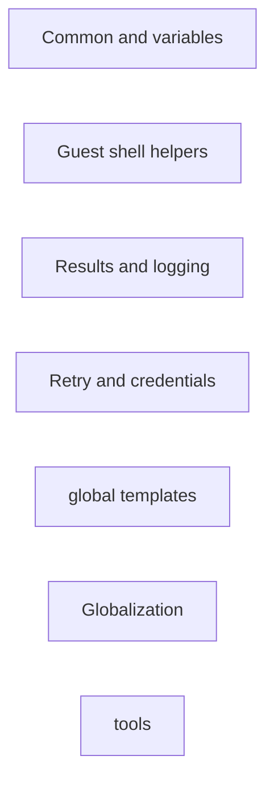
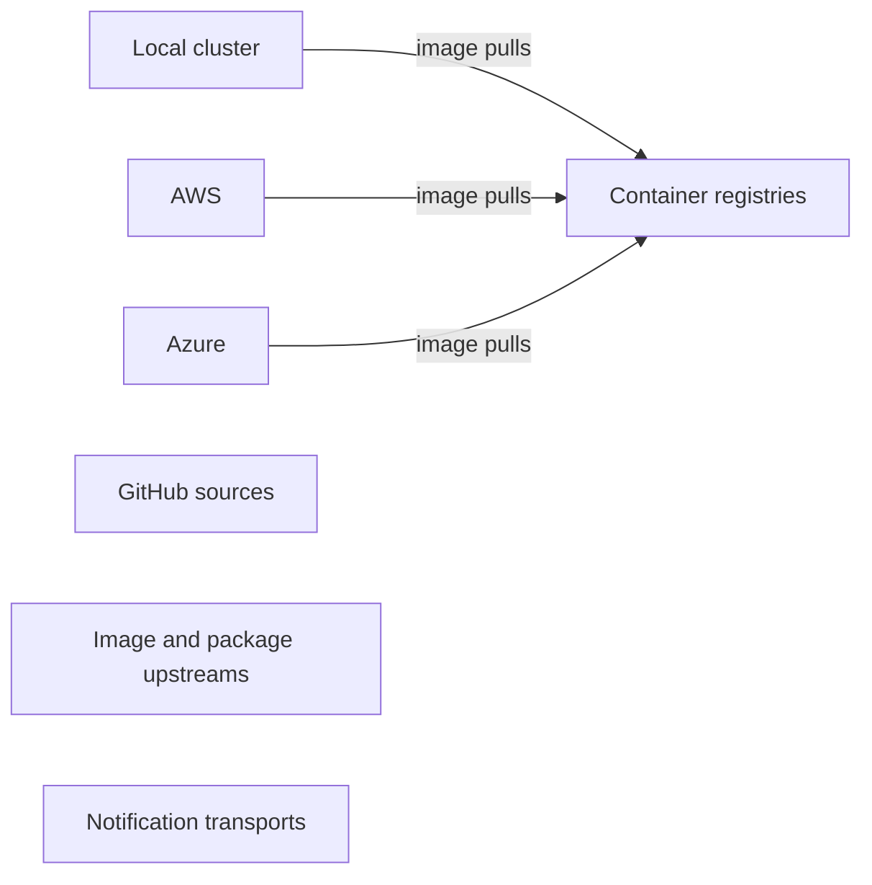

# Component breakdown

These flowcharts map each Level-1 boundary to its current public scripts, modules, and artifact families.

Section order and titles match [Context and components](01-context-and-components.md).
A family box groups the sources listed below it. Each view contains at most
seven boxes; arrows identify the stated calls or dependencies, and unconnected
boxes are inventory rather than additional execution steps.

## Provisioning

Sources: the [Windows](../../install/windows.hyper-v.ps1),
[Ubuntu](../../install/ubuntu.kvm.sh), and [macOS](../../install/macos.utm.sh)
bootstrappers install prerequisites, move each tool they manage to the newest
compatible release its own source offers, clone the repository, run a
[Test-Requirement](../../automation/Test-Requirement.ps1) check against the
[version floors](../../automation/Yuruna.Requirement.yml), and end with an
advisory "Newer versions available" report: every managed tool whose source
still offers a newer version, with the reason the run left it there, and
"unknown" for a lookup that did not answer; the report never fails the run.
PowerShell moves through its platform source, each attempt judged by the
version `pwsh` answers afterward. Ubuntu moves an apt-installed package through
its configured source unless the operator holds it, then through the release's
own `.deb`, verified against the release's `hashes.sha256` in a directory only
root can write, then through a pinned installer-owned Microsoft Ubuntu 24.04
suite for `powershell` alone, removed once another source offers it, and a
tarball last; `dpkg -V` sends an unheld package whose files no longer match
back through the `.deb`. macOS installs the brew formula over a `.pkg` copy and
links the newest `pwsh` into `/usr/local/bin`, upgrades a brew `curl` on every
run, and lets the cask take over a DMG-installed UTM unless a service VM is
running. Windows hands the PowerShell upgrade to a hidden Windows PowerShell
process that runs `winget` after the installer exits and logs beside the
install log. A powershell-yaml or PSScriptAnalyzer copy older than its pinned,
hash-checked version gets the pin installed beside it, since an import loads
the highest version; [Install-TestModule](../../tools/Install-TestModule.ps1)
holds that pinned installer, which the Windows bootstrapper also embeds.
Before they update a checkout, they save a private recovery snapshot of a
running runner's options and stop the runner and status service; when a runner
was recorded, they print the
[Start-RecordedTestRunner](../../test/lab/Start-RecordedTestRunner.ps1) command
that restarts it explicitly after setup.
The operator runs setup.ps1 separately: there is no bootstrap-to-setup
invocation. Windows and Ubuntu print an Enable-TestAutomation command; macOS
applies its host settings with -SkipPoolStorage and reports any remaining
operator action. [setup.ps1](../../install/setup.ps1) creates `test.config.yml`
from its template, refreshing an existing file only when the run supplies a
project URL or NAS storage, then orchestrates
[Enable-TestAutomation](../../test/lab/Enable-TestAutomation.ps1), storage
preparation, the caching-proxy launcher, a wait for the pool aggregator, the
stash launcher, and the Test-Config gate. The download-agent launcher and the lab
steps follow the gate; all of them are
[service VM launchers](../../test/service/) or lab scripts. After the caching
proxy starts, setup points `vmStart.cachingProxyIp` at
it and enrolls the proxy's Git mirror verification key under
`repositories.mirror` through
[Test.CachingProxyService](../../test/modules/Test.CachingProxyService.psm1),
leaving a different proxy address that the operator set unchanged.
`-AnswerFile` runs it unattended; a run without it ends by writing the
resolved values it used to `install/setup.answers.standalone.yml` or
`install/setup.answers.lab.yml`, an untracked file the operator feeds back to
set up the next machine, and `setup.runTests: false` skips host settings for a
services-only machine. The host dispatcher uses
[Yuruna.HostRedirect](../../automation/Yuruna.HostRedirect.psm1) to select the
platform script; those scripts import
[Yuruna.HostSetup](../../automation/Yuruna.HostSetup.psm1).

Storage preparation groups
[New-LocalLabStorage](../../test/lab/New-LocalLabStorage.ps1) with setup's configured
NAS path. For a NAS, setup writes the pool and stash share coordinates after a
backup and a `previous -> new` report, stores an operator-supplied NAS password
in the authentication vault, then mounts and verifies both shares;
`storage.onFailure: local` falls back to local shares. Storage is prepared
before the service guests. Lab administration
groups [test/lab/](../../test/lab/) and the [test/pool/](../../test/pool/)
administration scripts, including token initialization, pool creation,
enrollment, storage administration,
[Invoke-HostRefresh](../../test/lab/Invoke-HostRefresh.ps1), and the
[Start-Syzygy](../../test/lab/Start-Syzygy.ps1) and
[Stop-Syzygy](../../test/lab/Stop-Syzygy.ps1) controls, which run the four
service VM scripts in order and in reverse. The pool-control
service invokes the same pool scripts.
Setup always brings up the cache, and the stash when storage is configured. The
download agent defaults off in standalone mode and on in lab mode unless
`downloadAgentService.enabled` says otherwise; lab mode also enrolls the lab
token and adds a default pool and pool-control. Setup adopts any healthy service
VM, the caching proxy included, unless `-Rebuild` is set; rebuilding applies
changed provisioning settings. Whenever it runs, the caching-proxy launcher
defaults to a full rebuild and authenticated pool CA trust recovery;
`-RepairPoolCaTrust:$false` permits its healthy-VM adoption path. Recovery verifies the proxy's signed CA statement
before enrolling the builder's public mirror key through audience-bound host
control. Existing CA pins remain until the next verified CA fetch. Unreachable
hosts receive individual pending-enrollment diagnostics; an explicit
`-RepairPoolCaTrust` makes incomplete enrollment fail the launcher. An interactive
[caching-proxy launcher](../../test/service/Start-CachingProxyServiceVM.ps1)
start also offers an optional GitHub token for the Git mirror; a supplied token
is stored in the host's authentication vault and forces a rebuild, so the new
seed carries it.

## Deploy engine

Sources: [Set-Resource](../../automation/Set-Resource.ps1),
[Set-Component](../../automation/Set-Component.ps1), and
[Set-Workload](../../automation/Set-Workload.ps1) import
[Yuruna.Resource](../../automation/Yuruna.Resource.psm1),
[Yuruna.Component](../../automation/Yuruna.Component.psm1), and
[Yuruna.Workload](../../automation/Yuruna.Workload.psm1), respectively.
The seventh box groups
[Test-Configuration](../../automation/Test-Configuration.ps1),
[Test-Requirement](../../automation/Test-Requirement.ps1),
[Test-Runtime](../../automation/Test-Runtime.ps1), and
[Invoke-Clear](../../automation/Invoke-Clear.ps1), together with their
[validation](../../automation/Yuruna.Validation.psm1),
[requirement](../../automation/Yuruna.Requirement.psm1),
[deployment-kind](../../automation/Yuruna.DeploymentKind.psm1), and
[cleanup](../../automation/Yuruna.Clear.psm1) modules. Cleanup is an explicit
entry point, not an automatic fourth deployment phase.

The phase entry points do not invoke one another. The companion
[website guest script](https://github.com/alissonsol/yuruna-project/blob/main/example/website/test/ubuntu.server.26/ubuntu.server.26.workload.k8s.website.sh)
calls them in this order. The phase modules read the selected config directory,
use resource outputs, and return
[result manifests](../../automation/Yuruna.Result.psm1).
Resource templates resolve from the project first, then global/resources.
The workload module and validator share
[Yuruna.DeploymentKind](../../automation/Yuruna.DeploymentKind.psm1), whose current
built-ins are chart, kubectl, helm, and shell. Registry publication uses
[Yuruna.Component.Registry](../../automation/Yuruna.Component.Registry.psm1).
A retry skips a phase that passed before a later phase failed, when its input
hash and outputs still hold, through the
[deploy phase ledger](../../automation/Yuruna.DeployLedger.psm1); the last phase
passing deletes the ledger.
[yuruna.ps1](../../automation/yuruna.ps1) dispatches the same modules as one CLI,
and [Start-McpServer.ps1](../../test/service/Start-McpServer.ps1) exposes the entry
points as stdio MCP tools; neither adds a phase.

## Test harness

Sources and aggregate membership:

| Box | Sources |
| --- | --- |
| Runner supervision | [Start-TestRunner](../../test/Start-TestRunner.ps1), [Test.RunnerOuterLoop](../../test/modules/Test.RunnerOuterLoop.psm1), [Invoke-TestCycleRunner](../../test/modules/Invoke-TestCycleRunner.ps1), [Invoke-TestRunnerInnerLoop](../../test/modules/Invoke-TestRunnerInnerLoop.ps1), [Test.RunnerInnerLoop](../../test/modules/Test.RunnerInnerLoop.psm1), [Test.RunnerWatchdog](../../test/modules/Test.RunnerWatchdog.psm1), [Test.ConfigPreflight](../../test/modules/Test.ConfigPreflight.psm1), [Test.RunnerAttemptHistory](../../test/modules/Test.RunnerAttemptHistory.psm1), [Test.SourceSelection](../../test/modules/Test.SourceSelection.psm1), [Test.HostGit](../../test/modules/Test.HostGit.psm1), [Test.FrameworkRing](../../test/modules/Test.FrameworkRing.psm1), [Test.PrivateStateRepair](../../test/modules/Test.PrivateStateRepair.psm1), the one-shot [Invoke-TestProject](../../test/Invoke-TestProject.ps1) and [Debug-TestSequence](../../test/Debug-TestSequence.ps1) entry points, [Test.SingleInstance](../../test/modules/Test.SingleInstance.psm1), and runner identity/recovery modules in [test/modules/](../../test/modules/). |
| Sequence execution | [Test.SequenceRunner](../../test/modules/Test.SequenceRunner.psm1), [Test.SequenceEngine](../../test/modules/Test.SequenceEngine.psm1), [Test.SequenceHandler](../../test/modules/Test.SequenceHandler.psm1), [Test.SequencePlanner](../../test/modules/Test.SequencePlanner.psm1), [Test.Orchestrator](../../test/modules/Test.Orchestrator.psm1), [Test.Start-GuestOS](../../test/modules/Test.Start-GuestOS.psm1), [Test.Start-GuestWorkload](../../test/modules/Test.Start-GuestWorkload.psm1), [sequences/](../../test/sequences/), and [schemas/](../../test/schemas/). |
| OCR and diagnostics | [Test.OcrEngine](../../test/modules/Test.OcrEngine.psm1), [Test.OcrMatch](../../test/modules/Test.OcrMatch.psm1), [Test.Tesseract](../../test/modules/Test.Tesseract.psm1), [Test.Ssh](../../test/modules/Test.Ssh.psm1), [Test.Diagnostic](../../test/modules/Test.Diagnostic.psm1), [Test.DiagnosticPreservation](../../test/modules/Test.DiagnosticPreservation.psm1), the [guest](../../test/Invoke-GuestDiagnosticWorker.ps1) and [host](../../test/modules/Invoke-HostDiagnosticWorker.ps1) diagnostic workers, [Get-SystemDiagnostic](../../automation/Get-SystemDiagnostic.ps1), and the [guest stall sampler](../../automation/guest-performance-snapshot.sh). |
| Status and configuration | [Start-StatusService](../../test/service/Start-StatusService.ps1) and its listener [Invoke-StatusServiceRuntime](../../test/service/Invoke-StatusServiceRuntime.ps1), [Start-ConfigService](../../test/service/Start-ConfigService.ps1), [Repair-PrivateState.py](../../test/service/Repair-PrivateState.py), the [host address beacon](../../test/modules/Invoke-HostAddressBeacon.ps1) sidecar and [Test.HostAddressBeacon](../../test/modules/Test.HostAddressBeacon.psm1), [Test.HostMemoryMetrics](../../test/modules/Test.HostMemoryMetrics.psm1), and [status/](../../test/status/). |
| Pool coordination | [Test.PoolWorker](../../test/modules/Test.PoolWorker.psm1), [Test.PoolSync](../../test/modules/Test.PoolSync.psm1), [Test.PoolPush](../../test/modules/Test.PoolPush.psm1), [Test.PoolStorage](../../test/modules/Test.PoolStorage.psm1), [Test.PoolPlanner](../../test/modules/Test.PoolPlanner.psm1), and [Test.PoolAdmin](../../test/modules/Test.PoolAdmin.psm1). |
| Extension services | [extension/](../../test/extension/) holds authentication, digest, cache management/parser, download-agent, pool aggregator/control, stash, notification, and the shared SDK. The [caching-proxy extension](../../test/extension/caching-proxy-service/) also holds the Git mirror, and [Test.ServiceVm](../../test/modules/Test.ServiceVm.psm1) holds the start pipeline the service launchers share. The pool aggregator runs in the caching-proxy guest and splits polling, the Loki feed, rehydration, routes, extension merge, incidents, and pool state into [internal packages](../../test/extension/pool-aggregator-service/internal/). |
| Notifications | [Test.Notify](../../test/modules/Test.Notify.psm1), [Test.PoolNotifier](../../test/modules/Test.PoolNotifier.psm1), and configured providers in [notification/](../../test/extension/notification/). |

The outer runner supervises a fresh cycle process, which launches an inner
sequence process. The outer re-enters its loop after an exception escapes it,
bounds each cycle process's working time with `testCycle.maxCycleSeconds`,
applies the step watchdog's bounds itself when that watchdog stands down, and
pulls the framework with its own loaded code when cycle processes keep ending
without an outcome; [Lifecycle state](04-lifecycle-state.md) shows these paths. Each cycle
starts with the Test-Config gate; its verdict and
transcript are kept per attempt in a bounded attempt history, so the outer
runner separates gate refusals from watchdog kills and unexpected exits. The
gate resolves the framework and project revisions once through
Test.SourceSelection, and the inner process checks out the pinned project
commit from that handoff; while a network-only gate refusal holds the next
cycle, the outer runner polls source access the same way. Test.HostGit
accepts a caching-proxy Git mirror answer only with a receipt signed by an
enrolled `repositories.mirror` key. A stale signed receipt within
`repositories.mirror.mirrorOnlyMaxAgeSeconds` selects its retained pin without a
GitHub check unless that pin would roll the host back; other mirror outcomes use
GitHub according to the configured mode. A pool's `frameworkRing` block makes
non-canary members followers: each installs only the newest framework revision
the pool aggregator reports with enough canary passes, and otherwise stays where
it is. Canaries and pools without the block install the tip. The runner and
status service repair
private startup state before they start. Each runner then records how it was
started in `runtime/runner.session.json`, and its SIGHUP and SIGTERM handlers
write the signal to `runtime/runner.exit.json` before the signal ends the
process; the runner-status route reports both as `lastExit` while the runner is
gone, the next runner's boot-recovery event carries them as `previousRunner`,
and the pool aggregator shows a runner that died inside a cycle, its pid file
still present, as lost rather than stopped. These are processes on the host, rather
than additional network services. The watchdog follows the step heartbeat; OCR
and guest diagnostics supply sequence evidence. Test.Diagnostic also reads the
guest kernel's lockup, RCU stall, hung-task, oops, and panic reports from the
Hyper-V serial console and the guest recorder, and names a display driver whose
page flips time out as a display stall. That evidence adds no kernel-fault kind;
an enabled wait that ends on the serial-backed verdict is classified
`guest_display_stalled`, and an exhausted retry preserves that inner class.
The beacon's address records name the host's own moves during a failed step.
CPU-restart evidence remains advisory; its failed SSH readiness event carries
the VM, guest, phase, and caller invocation identities. An SSH banner-exchange
timeout is a `probe_timeout` cause, rather than evidence of an unreachable
network. Sequence execution also includes
[Test.Transport](../../test/modules/Test.Transport.psm1) for console input and
[Test.SequenceFailureState](../../test/modules/Test.SequenceFailureState.psm1)
for shared failure evidence; the latter reads the newest bucket an Ubuntu
installer's error hook uploaded since the step started into the record's
installer failure cause, which the inner loop also puts on the infra event a
lab stage sends to the pool. `fetchAndExecute` records envelope transfer details;
it retypes a damaged compact envelope once only when the guest confirms that the
payload was not prepared. The guest-side verifier is
[yuruna-fetch-context.sh](../../automation/yuruna-fetch-context.sh), in the shared
helpers family. [Data flows](03-data-flows.md) follows this exchange.
`startVm` and `stopVm` observe
VM state through the host driver and save console evidence when a guest stops
answering. A `retry` step with `restartVmBeforeRetry: coldPowerCycle`
power-cycles a stalled startup guest on all three hosts before its next
attempt. Text waits ask a driver that exports a console second opinion
whether the guest stopped drawing; on UTM, a sustained inactive display with
static frames ends the wait as a livelock. Login waits and uncommitted password
prompts within an admitted cold-restart retry also end early when a
`hyperv_drm` or `virtio_gpu` display stopped presenting frames, once the console has stayed
unchanged and the serial console carries repeated reports from that driver
since the wait began. Only the Hyper-V driver exports the live serial reader
this end needs, so it applies to Hyper-V guests only. The retry can then
cold-restart the guest; waits that do
not enable this exit retain the stall as failure evidence.
The host status listener also runs
when testing is idle, and serves the native Linux and macOS memory gauges
from Test.HostMemoryMetrics on its metrics endpoint. The
caching-proxy launcher starts the host status and configuration services through
[Test.Prelude](../../test/modules/Test.Prelude.psm1), and the shared service-VM
start pipeline in [Test.ServiceVm](../../test/modules/Test.ServiceVm.psm1)
ensures the configuration service before it builds a stash, download-agent, or
pool-control guest, which fetches its NAS credential there at first boot.

The extension family contains more than seven implementations and remains one
aggregate here. Sequence steps call PowerShell extension methods through
[Test.Extension](../../test/modules/Test.Extension.psm1), and the
[lab-health gate](../../test/modules/Test.LabHealth.psm1) probes each area at
step boundaries; the Go daemons keep separate launch paths. The Git mirror
runs inside the caching-proxy extension:
[gitmirror.go](../../test/extension/caching-proxy-service/gitmirror.go) gives
the same daemon worker, reader, CGI, and credential roles, so
[git-mirror-worker.service](../../test/extension/caching-proxy-service/git-mirror-worker.service)
refreshes and signs the GitHub repositories,
[git-mirror-reader.service](../../test/extension/caching-proxy-service/git-mirror-reader.service)
serves them read-only, and
[git-mirror-http-backend.sh](../../test/extension/caching-proxy-service/git-mirror-http-backend.sh)
answers Git HTTP clones. Their runtime
placement and exchanges are expanded in [Deployment](06-deployment.md) and
[Data flows](03-data-flows.md). Host refresh groups
[Test.HostRefresh](../../test/modules/Test.HostRefresh.psm1),
[Test.HostRefreshIntent](../../test/modules/Test.HostRefreshIntent.psm1),
[Test.HostRefreshTrigger](../../test/modules/Test.HostRefreshTrigger.psm1), and
[Test.HostRefreshAuth](../../test/modules/Test.HostRefreshAuth.psm1) with runner
supervision.

## Providers

Sources: [host contract](../../host/Yuruna.Host.Contract.psm1),
[Hyper-V driver](../../host/windows.hyper-v/modules/Yuruna.Host.psm1),
[KVM driver](../../host/ubuntu.kvm/modules/Yuruna.Host.psm1),
[UTM driver](../../host/macos.utm/modules/Yuruna.Host.psm1),
[host/modules/](../../host/modules/), [host/vmconfig/](../../host/vmconfig/), and
[guest/](../../guest/).
Each driver imports the contract and asserts at load time that it exports every
contract verb; its `modules/` folder holds the helper scripts the module
dot-sources, such as capture, lifecycle, screenshot, port-map, storage,
virtualization-repair, and service-guest helpers. It dispatches per-guest image and VM builders and implements
lifecycle, console input, screenshots, discovery, and networking. `Stop-VM` takes
`-ShutdownTimeoutSeconds` and `-NoForce` on all three drivers, so a sequence can
request a graceful shutdown and observe it through the host. Hyper-V captures
COM1 and UTM captures the guest UART's loopback port during a cycle, each through
a reader job found by name (on Hyper-V, its pipe name), so the driver re-import
between the runner's `Start-VM` and a sequence's own `startVm` finds the running
reader instead of arming a second one. Hyper-V's `Start-VM` first stops the
previous boot's reader, which would otherwise take the new boot's pipe; UTM arms
its reader before power-on, because QEMU drops what the guest writes while no
client is attached. UTM's stop requests the reader's end on a pool thread, waits
a few seconds, and kills the reader process only when its id and start time
still match those the job recorded, so a reader that ignores the request never
holds a teardown or a failure's save; arming skips a reader whose process is
gone even while its sidecar still names the port. The KVM and Hyper-V drivers delete a VM
directory only when no registered VM uses a file in it, after first finishing a
rename that stopped between the registration and the storage move; the KVM
orphan sweep likewise skips referenced disks. The Hyper-V and UTM drivers also export
`Get-VMConsoleSecondOpinion`, outside the contract, which reads the framebuffer
independently of the screenshot path. The Hyper-V driver also exports
`Read-VMSerialCapture` and `Get-VMCreationTime`, which give failure evidence
the console text written since a step's mark and the age that bounds every
timestamp an honest guest clock can print, and `Get-VMSerialCaptureLogPath`,
which names the live capture so a failed retry attempt keeps it before a
restart deletes it. UTM defines `Read-VMSerialCapture` but
does not export it, so its waits never end on a kernel report. Each provider
folder also holds the Enable/Disable-TestAutomation, Sync-HostConfiguration, and
Remove-OrphanedVMFiles scripts that the [test/lab/](../../test/lab/) dispatchers
select through [Yuruna.HostRedirect](../../automation/Yuruna.HostRedirect.psm1).

The KVM provider also holds
[Enable-DeepDiagnostics](../../host/ubuntu.kvm/Enable-DeepDiagnostics.ps1) and
[Disable-DeepDiagnostics](../../host/ubuntu.kvm/Disable-DeepDiagnostics.ps1), run
directly on a host under investigation, with
[Yuruna.Host.DeepDiagnostics](../../host/ubuntu.kvm/modules/Yuruna.Host.DeepDiagnostics.psm1)
and [deep-diagnostics/](../../host/ubuntu.kvm/deep-diagnostics/). They make a hard
freeze leave evidence and record every prior value for restoration.
[Receive-Netconsole](../../test/lab/Receive-Netconsole.ps1) receives the optional
kernel stream on another machine, and
[Test.Recovery](../../test/modules/Test.Recovery.psm1) copies the boot bundles
into host-restart evidence.

VM configuration groups the [host/vmconfig/](../../host/vmconfig/) cloud-init
seeds for guests and services (base user-data plus per-hypervisor overlays), the
Windows 11 `autounattend.xml` in each provider's builder, the UTM
`config.plist.template` files, and the seed renderers
[Yuruna.CloudInitTemplate](../../automation/Yuruna.CloudInitTemplate.psm1) and
[Yuruna.GuestSeed](../../automation/Yuruna.GuestSeed.psm1). The caching-proxy seed
carries a Zot sync self-test, and
[caching-proxy-service.zot-qualified.json](../../host/vmconfig/caching-proxy-service.zot-qualified.json)
records the release [Test-ZotRelease.py](../../tools/Test-ZotRelease.py) qualified.
The seed also installs `yuruna-release-asset-learn.py` under a one-minute timer:
it reads squid's log of GitHub release-download redirects and writes one exact
Store ID rule per release URL, filing the asset under the CDN object it
redirected to, so a stored asset is served without asking GitHub while GitHub's
own redirect is never stored under the asset's key;
[test_release_asset_learn.py](../../host/vmconfig/tests/test_release_asset_learn.py)
runs the learner out of the seed against stand-in logs.
The caching-proxy seed also installs the Git mirror worker and reader units and
their HTTP routes, and the ssl-bump CA that the building host keeps in its
private state, so a rebuilt proxy keeps its root, and a statement of that CA's
SHA-256 signed with the mirror signing key, which hosts that did not build the
proxy verify. Every service and test-guest builder stages its secret-bearing
seed media, including that CA key, the proxy's mirror signing key, a guest's
password or password hash, and any GitHub token, through
[Yuruna.SeedMedia](../../host/modules/Yuruna.SeedMedia.psm1) in the
host/modules box. The renderer also seeds integrity data: the stash,
download-agent, and pool-control seeds carry the SHA-256 of the framework
archive for the seeded commit, the caching-proxy seed carries a per-file SHA-256
manifest of the sources it builds, and the Linux guest and service seeds name
the proxy CA's fingerprint in `host.env`. The Ubuntu base seed installs
`yuruna-ssh-hostkeys.service`, a oneshot `ssh-keygen -A` ordered before
`ssh.service`, so a guest whose cold restart emptied the host keys that
cloud-init had just written still starts its SSH daemon. Its installer error hook
uploads `installer-cause.txt`, apt's error lines extracted from curtin's
archive, beside `network-at-failure.txt`, which probes the proxy baked into the
seed, because curtin writes that proxy into the target rather than into the
installer's own apt configuration. The Hyper-V and UTM Ubuntu
overlays install `yuruna-serial-journal.service`, which copies the journal to the
UART in its own process, so a stalled UART costs serial output rather than
blocking journald, `sudo`, and `sshd`. The UTM overlay ends the install with
`shutdown: poweroff`, and the `start.guest.ubuntu.server.*.macos.utm.yml` sequences
wait for that stop with `startVm` `installPowerOff: true` and `failurePatterns`
naming the installer's own error screens, so an installer that caught its error
and waits at a shell ends the wait as a pattern match instead of spending the
deadline on a known result, then cold-start the
installed system. The stash, download-agent, and
pool-control seeds carry configuration-service client certificates and
[yuruna-nas-credential.sh](../../automation/yuruna-nas-credential.sh) instead of
a NAS password.
Guest edges identify the scripts selected for the guest, not a requirement that
every driver execute every script.

The guest family groups amazon.linux.2023, ubuntu.server.24, ubuntu.server.26,
windows.11, macos.26, and [guest/shared](../../guest/shared/) helpers. Platform
support comes from the corresponding builder folders; the diagram does not imply
every provider supports every guest. macos.26 has a UTM builder only. That
[builder](../../host/macos.utm/guest.macos.26/New-VM.ps1) restores an IPSW into a
stopped VM bundle; the operator starts it and completes Setup Assistant. A
[guest update script](../../guest/macos.26/macos.26.update.sh) exists, but no
checked-in macos.26 start sequence automates initial setup. Hyper-V, libvirt,
and UTM retain their own native console and networking implementations.
When a guest update script materializes a pinned framework revision, it tries
the caching-proxy Git mirror first if the guest has the proxy address, then
GitHub.
Caching-proxy, stash, download-agent, and pool-control builders live under each
provider and reuse the shared seeds; the stash, download-agent, and pool-control
seeds run their ubuntu.server.26 service scripts, while the caching-proxy seed
carries its own setup in runcmd and has no guest service script. It fetches
extension sources from the building host's status service, or GitHub when that
host is unreachable, and builds only files matching the seeded manifest. The network
differences are expanded in [Deployment](06-deployment.md).

The service builders resolve a `-PlanOnly` preview before removing a working
guest or creating its replacement. On all three hosts the preview reads
existing credentials, SSH keys, storage coordinates, and network settings
without creating keys, vault entries, persistent seed state, or virtual
switches. A missing automatic credential is a planned creation; a missing
explicitly mapped credential still refuses the plan. The shared
[service pipeline](../../test/modules/Test.ServiceVm.psm1) runs that preview
before withdrawing the service's advertisement. The
[Hyper-V](../../host/windows.hyper-v/guest.stash-service/New-VM.ps1),
[KVM](../../host/ubuntu.kvm/guest.stash-service/New-VM.ps1), and
[UTM](../../host/macos.utm/guest.stash-service/New-VM.ps1) stash builders show
the same read-only ordering used by the service families.

## Project data

Sources in yuruna-project:
[example/README.md](https://github.com/alissonsol/yuruna-project/blob/main/example/README.md),
[template/README.md](https://github.com/alissonsol/yuruna-project/blob/main/template/README.md),
[website resources configuration](https://github.com/alissonsol/yuruna-project/blob/main/example/website/config/localhost/resources.yml),
[component configuration](https://github.com/alissonsol/yuruna-project/blob/main/example/website/config/localhost/components.yml),
[workload configuration](https://github.com/alissonsol/yuruna-project/blob/main/example/website/config/localhost/workloads.yml),
[Dockerfile](https://github.com/alissonsol/yuruna-project/blob/main/example/website/components/frontend/website/Dockerfile),
[Helm chart](https://github.com/alissonsol/yuruna-project/blob/main/example/website/workloads/frontend/website/Chart.yaml),
and [test/test.runner.yml](https://github.com/alissonsol/yuruna-project/blob/main/test/test.runner.yml).

The tests box groups the repository cycle plan with example and book sequence
definitions in [book/](https://github.com/alissonsol/yuruna-project/tree/main/book).
The current deployment examples select localhost, AWS, or Azure; no checked-in
GCP configuration is present. Examples contain projects below their name;
template itself contains
config, resources, components, and workloads without another project-name folder.
Some examples, including nested.host, supply tests without deployment directories.
The companion [tools/](https://github.com/alissonsol/yuruna-project/tree/main/tools)
folder holds the shared example workload helper and build module used by example
guest and component scripts.
The authentication vault belongs to the harness, as detailed in
[Data model](05-data-model.md).

## Shared modules

Sources:
[Yuruna.Common](../../automation/Yuruna.Common.psm1),
[Yuruna.VariableExpansion](../../automation/Yuruna.VariableExpansion.psm1),
[Import.Yaml](../../automation/Import.Yaml.psm1),
[fetch-and-execute.sh](../../automation/fetch-and-execute.sh),
[yuruna-retry.sh](../../automation/yuruna-retry.sh),
[yuruna-service-bringup.sh](../../automation/yuruna-service-bringup.sh),
[yuruna-host-locate.sh](../../automation/yuruna-host-locate.sh),
[yuruna-nas-credential.sh](../../automation/yuruna-nas-credential.sh),
[Yuruna.Result](../../automation/Yuruna.Result.psm1),
[Yuruna.Log](../../automation/Yuruna.Log.psm1),
[Yuruna.LogLevel](../../automation/Yuruna.LogLevel.psm1),
[Yuruna.Retry](../../automation/Yuruna.Retry.psm1),
[Yuruna.CredentialProvider](../../automation/Yuruna.CredentialProvider.psm1),
[global/](../../global/), [globalization/](../../globalization/), and
[tools/](../../tools/).

Seven boxes group related libraries and assets. Common and variables include
host, network, bounded-process, process-identity, PID-file lock, and canonical-path
helpers, YAML loading, and variable expansion. The PID-file lock implementation
in Yuruna.Common is shared by the
[pool-storage drain](../../test/modules/Test.PoolStorage.psm1) and
[pool push forwarder](../../test/modules/Invoke-PoolPushForwarder.ps1).
Guest shell helpers group the scripts that guest seeds and
guest scripts install or source: fetch-and-execute.sh, yuruna-fetch-context.sh,
yuruna-retry.sh, yuruna-run.sh, yuruna-network.sh, yuruna-versions.sh,
yuruna-service-bringup.sh, yuruna-nas-credential.sh, the yuruna-host-locate pair,
Test-YurunaHost.ps1, and windows-guest-bootstrap.ps1. When the host status
service is unreachable, fetch-and-execute.sh reads a pinned commit's files from
the caching-proxy Git mirror before GitHub, and yuruna-retry.sh provides the
pinned Git materializer that the guest update scripts also embed, plus the CA
self-heal that installs a proxy CA only when it matches the seeded fingerprint.
Its `curl` and `wget` wrappers retry a GitHub release download or
`releases/latest` lookup through a 30-minute window with each backoff capped at
two minutes, so a fetch lands soon after GitHub's release endpoints recover.
Results and logging include
completion manifests, log levels, and entry-point root and transcript resolution in Yuruna.LogLevel.
Validation, requirement, and deployment-kind modules are imported only by
deploy-engine code and appear in its checks family. Retry and credentials group the
transient-operation helper, the secret redaction that retry labels, workload
logs, and component output share, and the registry authentication provider
catalog. The helper takes the same retry window, under which `tofu init` runs,
and its transient classifier includes etcd's request timeout and leader change
and the API server's not-serving answers, so kubectl deployments back off and
retry.
Global contains config, component, and workload roots; global/resources appears
under External services. The globalization aggregate includes
[Yuruna.Globalization](../../automation/Yuruna.Globalization.psm1), the
[Test.Catalog](../../test/modules/Test.Catalog.psm1) and
[Test.Locale](../../test/modules/Test.Locale.psm1) runtime it loads, and catalogs;
[Globalization](07-globalization.md) expands its language contract.
Tools include [Invoke-TestSuite](../../tools/Invoke-TestSuite.ps1) and its
[worker](../../tools/_InvokeOneSuite.ps1), which run isolated Pester suites and
retain validation evidence independently of the continuous VM runner; on Linux,
a selective run can reuse a suite's recorded pass when
[suite_impact.py](../../tools/suite_impact.py) shows every input it read is
unchanged. The tools also include
[Gate.Scope](../../tools/Gate.Scope.psm1), the scope resolver shared by the lint
and shellcheck gates. The Git mirror release qualification tools also belong
to this box: [Invoke-GitMirrorQualification](../../tools/Invoke-GitMirrorQualification.ps1)
prepares candidate fixtures and merges native results,
[Invoke-GitMirrorNativeQualification](../../tools/Invoke-GitMirrorNativeQualification.ps1)
runs the checked-in [recipes](../../test/fixtures/git-mirror/) on a disposable
host, and [GitMirror.Qualification](../../tools/GitMirror.Qualification.psm1)
holds their shared checks. Runners, setup, and the proxy never load them.

## External services

Sources: [localhost resources](../../global/resources/localhost/),
[AWS resources](../../global/resources/aws/),
[Azure resources](../../global/resources/azure/),
[registry providers](../../automation/Yuruna.CredentialProvider.psm1),
[GitHub source resolution](../../automation/Yuruna.GitHubSource.psm1),
[host downloads](../../host/modules/Yuruna.HostDownload.psm1),
[guest setup](../../guest/), and
[notification providers](../../test/extension/notification/).

The cluster/cloud boxes group targets referenced by current resource templates:
localhost context/registry verification, AWS EKS/ECR, and Azure AKS/ACR plus the
checked-in resource-group, Linux VM, PostgreSQL, and storage-share templates.
Registry providers implement ACR, ECR, Google Artifact Registry, Docker Hub, and
generic Docker authentication. GAR support does not supply GCP provisioning.
GitHub sources also include the repositories that the caching-proxy Git mirror
worker refreshes, with the optional token described under Provisioning.
The localhost registry template checks a registry already started by the caller,
and context-copy copies an existing local Kubernetes context under the configured
destination name. Image and package upstreams include the container registries
the cache's Zot mirror syncs from, which the Zot sync self-test probes, and the
apt repositories whose metadata pairs the cache's apt index self-test reads, and
the GitHub release endpoints whose assets the cache serves from store once its
release-asset learner has filed them. The
registry providers authenticate the component phase's push; cluster pull access
comes from project workload configuration, such as the Azure website's
`docker-registry` secret.
The AWS template exposes the Kubernetes control-plane API separately from
application ingress, as shown in [Deployment](06-deployment.md#aws-application-ingress).

---

LICENSEURI https://yuruna.link/license

Copyright (c) 2019-2026 by Alisson Sol et al.

Last review: 2026.11.16

[Architecture](../architecture.md) | [Design overview](README.md)
