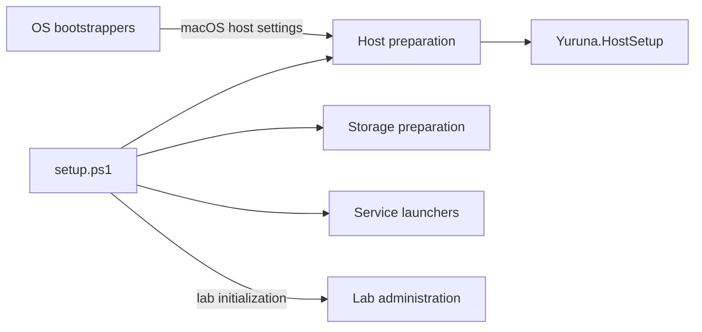
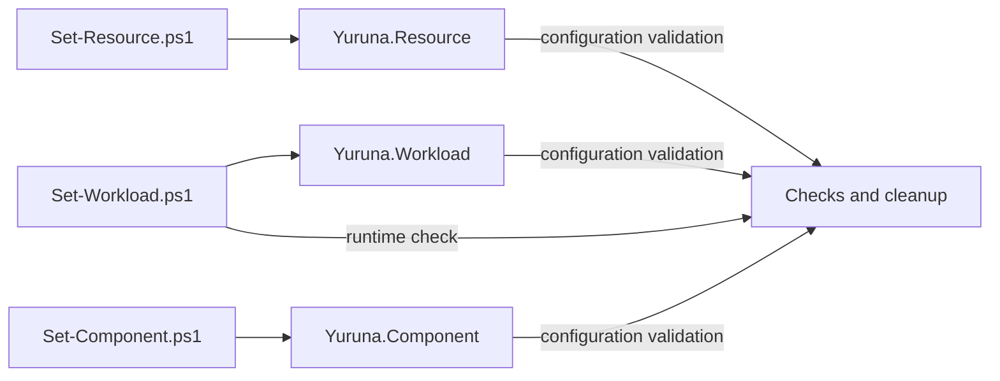
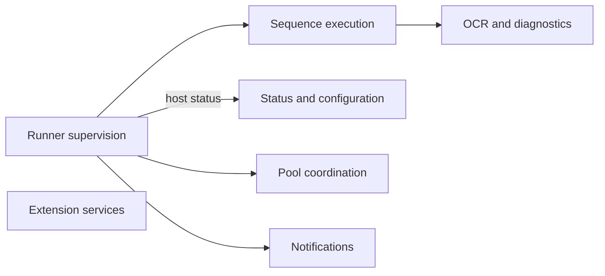
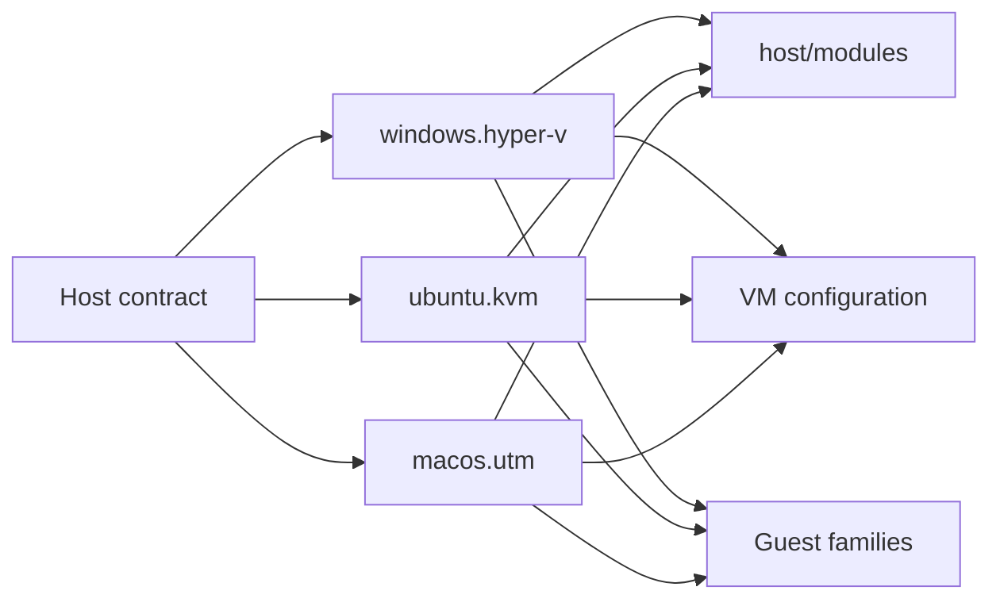
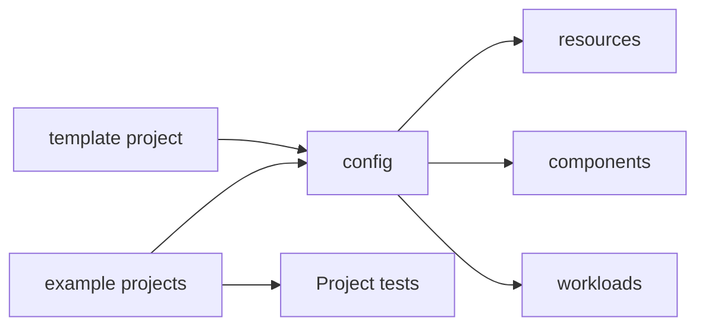
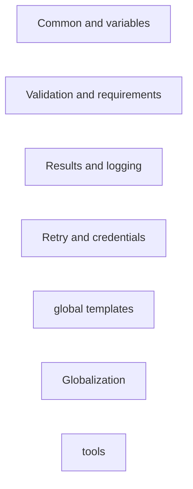
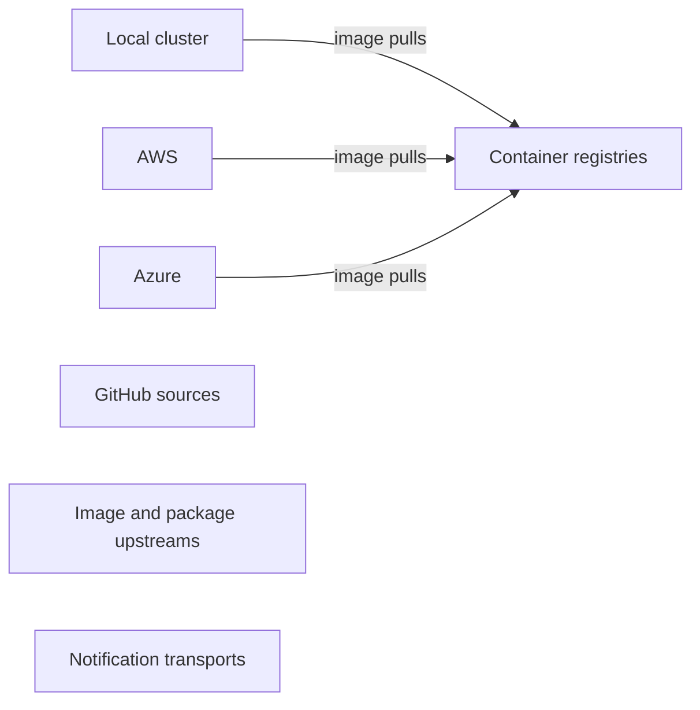

# Component breakdown

These flowcharts map each Level-1 boundary to its current public scripts, modules, and artifact families.

Section order and titles match [Context and components](01-context-and-components.md).
A family box groups the sources listed below it. Each view contains at most
seven boxes; arrows identify the stated calls or dependencies, and unconnected
boxes are inventory rather than additional execution steps.

## Provisioning

Sources: the [Windows](../../install/windows.hyper-v.ps1),
[Ubuntu](../../install/ubuntu.kvm.sh), and [macOS](../../install/macos.utm.sh)
bootstrappers install prerequisites and clone the repository. The operator runs
setup.ps1 separately: there is no bootstrap-to-setup invocation. Windows and
Ubuntu print an Enable-TestAutomation command; macOS applies its host settings
with -SkipPoolStorage and reports any remaining operator action.
[setup.ps1](../../install/setup.ps1) orchestrates
[Enable-TestAutomation](../../test/lab/Enable-TestAutomation.ps1), storage
preparation, and [service launchers](../../test/service/).
The host dispatcher uses [Yuruna.HostRedirect](../../automation/Yuruna.HostRedirect.psm1)
to select the platform script; those scripts import
[Yuruna.HostSetup](../../automation/Yuruna.HostSetup.psm1).

Storage preparation groups
[New-LocalLabStorage](../../test/lab/New-LocalLabStorage.ps1) with setup's configured
NAS path. Storage is prepared before the service guests. Lab administration
groups [test/lab/](../../test/lab/) and [test/pool/](../../test/pool/), including
token initialization, pool creation, enrollment, storage administration, and
[Invoke-HostRefresh](../../test/lab/Invoke-HostRefresh.ps1).
Setup brings up cache and stash for standalone mode. Download-agent is optional
there; lab mode enables it and adds pool-control and a default pool. A healthy
service VM can be adopted; rebuilding applies changed provisioning settings.

## Deploy engine

Sources: [Set-Resource](../../automation/Set-Resource.ps1),
[Set-Component](../../automation/Set-Component.ps1), and
[Set-Workload](../../automation/Set-Workload.ps1) import
[Yuruna.Resource](../../automation/Yuruna.Resource.psm1),
[Yuruna.Component](../../automation/Yuruna.Component.psm1), and
[Yuruna.Workload](../../automation/Yuruna.Workload.psm1), respectively.
The seventh box groups
[Test-Configuration](../../automation/Test-Configuration.ps1),
[Test-Requirement](../../automation/Test-Requirement.ps1),
[Test-Runtime](../../automation/Test-Runtime.ps1), and
[Invoke-Clear](../../automation/Invoke-Clear.ps1), together with their
[validation](../../automation/Yuruna.Validation.psm1),
[requirement](../../automation/Yuruna.Requirement.psm1), and
[cleanup](../../automation/Yuruna.Clear.psm1) modules. Cleanup is an explicit
entry point, not an automatic fourth deployment phase.

The phase entry points do not invoke one another. The companion
[website guest script](https://github.com/alissonsol/yuruna-project/blob/main/example/website/test/ubuntu.server.26/ubuntu.server.26.workload.k8s.website.sh)
calls them in this order. The phase modules read the selected config directory,
use resource outputs, and return
[result manifests](../../automation/Yuruna.Result.psm1).
Resource templates resolve from the project first, then global/resources.
The workload module and validator share
[Yuruna.DeploymentKind](../../automation/Yuruna.DeploymentKind.psm1), whose current
built-ins are chart, kubectl, helm, and shell. Registry publication uses
[Yuruna.Component.Registry](../../automation/Yuruna.Component.Registry.psm1).

## Test harness

Sources and aggregate membership:

| Box | Sources |
| --- | --- |
| Runner supervision | [Start-TestRunner](../../test/Start-TestRunner.ps1), [Test.RunnerOuterLoop](../../test/modules/Test.RunnerOuterLoop.psm1), [Invoke-TestCycleRunner](../../test/modules/Invoke-TestCycleRunner.ps1), [Invoke-TestRunnerInnerLoop](../../test/modules/Invoke-TestRunnerInnerLoop.ps1), [Test.RunnerInnerLoop](../../test/modules/Test.RunnerInnerLoop.psm1), [Test.RunnerWatchdog](../../test/modules/Test.RunnerWatchdog.psm1), and runner identity/recovery modules in [test/modules/](../../test/modules/). |
| Sequence execution | [Test.SequenceRunner](../../test/modules/Test.SequenceRunner.psm1), [Test.SequenceEngine](../../test/modules/Test.SequenceEngine.psm1), [Test.SequenceHandler](../../test/modules/Test.SequenceHandler.psm1), and [sequences/](../../test/sequences/). |
| OCR and diagnostics | [Test.OcrEngine](../../test/modules/Test.OcrEngine.psm1), [Test.OcrMatch](../../test/modules/Test.OcrMatch.psm1), [Test.Diagnostic](../../test/modules/Test.Diagnostic.psm1), and [Get-SystemDiagnostic](../../automation/Get-SystemDiagnostic.ps1). |
| Status and configuration | [Start-StatusService](../../test/service/Start-StatusService.ps1), [Start-ConfigService](../../test/service/Start-ConfigService.ps1), and [status/](../../test/status/). |
| Pool coordination | [pool/](../../test/pool/), [Test.PoolWorker](../../test/modules/Test.PoolWorker.psm1), [Test.PoolSync](../../test/modules/Test.PoolSync.psm1), [Test.PoolPush](../../test/modules/Test.PoolPush.psm1), and [Test.PoolStorage](../../test/modules/Test.PoolStorage.psm1). |
| Extension services | [extension/](../../test/extension/) holds authentication, digest, cache management/parser, download-agent, pool aggregator/control, stash, notification, and the shared SDK. |
| Notifications | [Test.Notify](../../test/modules/Test.Notify.psm1), [Test.PoolNotifier](../../test/modules/Test.PoolNotifier.psm1), and configured providers in [notification/](../../test/extension/notification/). |

The outer runner supervises a fresh cycle process, which launches an inner
sequence process. These are processes on the host, rather than additional
network services. The watchdog follows the cycle heartbeat; OCR and guest
diagnostics supply sequence evidence. The host status listener also runs when
testing is idle. The caching-proxy launcher starts the host status and
configuration services through
[Test.Prelude](../../test/modules/Test.Prelude.psm1).

The extension family contains more than seven implementations and remains one
aggregate here. Its daemons have separate launch paths rather than a shared
runner-to-extension call. Their runtime placement and exchanges are expanded in
[Deployment](06-deployment.md) and [Data flows](03-data-flows.md).
Host refresh groups
[Test.HostRefresh](../../test/modules/Test.HostRefresh.psm1),
[Test.HostRefreshIntent](../../test/modules/Test.HostRefreshIntent.psm1), and
[Test.HostRefreshTrigger](../../test/modules/Test.HostRefreshTrigger.psm1)
with runner supervision.

## Providers

Sources: [host contract](../../host/Yuruna.Host.Contract.psm1),
[Hyper-V driver](../../host/windows.hyper-v/modules/Yuruna.Host.psm1),
[KVM driver](../../host/ubuntu.kvm/modules/Yuruna.Host.psm1),
[UTM driver](../../host/macos.utm/modules/Yuruna.Host.psm1),
[host/modules/](../../host/modules/), [host/vmconfig/](../../host/vmconfig/), and
[guest/](../../guest/).
Each driver dispatches per-guest image and VM builders and implements lifecycle,
console input, screenshots, discovery, networking, and the host contract checks.
VM configuration groups shared cloud-init service seeds, per-OS unattended
installation files, and UTM bundle templates. Guest edges identify the scripts
selected for the guest, not a requirement that every driver execute every script.

The guest family groups amazon.linux.2023, ubuntu.server.24, ubuntu.server.26,
windows.11, macos.26, and [guest/shared](../../guest/shared/) helpers. Platform
support comes from the corresponding builder folders; the diagram does not imply
every provider supports every guest. macos.26 has a UTM builder only; Hyper-V,
libvirt, and UTM retain their own native console and networking implementations.
Caching-proxy, stash, download-agent, and pool-control builders live under each
provider and reuse the shared seeds and Ubuntu guest scripts. The network
differences are expanded in [Deployment](06-deployment.md).

## Project data

Sources in yuruna-project:
[example/README.md](https://github.com/alissonsol/yuruna-project/blob/main/example/README.md),
[template/README.md](https://github.com/alissonsol/yuruna-project/blob/main/template/README.md),
[website resources configuration](https://github.com/alissonsol/yuruna-project/blob/main/example/website/config/localhost/resources.yml),
[component configuration](https://github.com/alissonsol/yuruna-project/blob/main/example/website/config/localhost/components.yml),
[workload configuration](https://github.com/alissonsol/yuruna-project/blob/main/example/website/config/localhost/workloads.yml),
[Dockerfile](https://github.com/alissonsol/yuruna-project/blob/main/example/website/components/frontend/website/Dockerfile),
[Helm chart](https://github.com/alissonsol/yuruna-project/blob/main/example/website/workloads/frontend/website/Chart.yaml),
and [test/test.runner.yml](https://github.com/alissonsol/yuruna-project/blob/main/test/test.runner.yml).

The tests box groups the repository cycle plan with example and book sequence
definitions in [book/](https://github.com/alissonsol/yuruna-project/tree/main/book).
The current deployment examples select localhost, AWS, or Azure; no checked-in
GCP configuration is present. Examples contain projects below their name;
template itself contains
config, resources, components, and workloads without another project-name folder.
Some examples, including nested.host, supply tests without deployment directories.
The authentication vault belongs to the harness, as detailed in
[Data model](05-data-model.md).

## Shared modules

Sources:
[Yuruna.Common](../../automation/Yuruna.Common.psm1),
[Yuruna.VariableExpansion](../../automation/Yuruna.VariableExpansion.psm1),
[Import.Yaml](../../automation/Import.Yaml.psm1),
[Yuruna.Validation](../../automation/Yuruna.Validation.psm1),
[Yuruna.Requirement](../../automation/Yuruna.Requirement.psm1),
[Yuruna.DeploymentKind](../../automation/Yuruna.DeploymentKind.psm1),
[Yuruna.Result](../../automation/Yuruna.Result.psm1),
[Yuruna.Log](../../automation/Yuruna.Log.psm1),
[Yuruna.LogLevel](../../automation/Yuruna.LogLevel.psm1),
[Yuruna.Retry](../../automation/Yuruna.Retry.psm1),
[Yuruna.CredentialProvider](../../automation/Yuruna.CredentialProvider.psm1),
[global/](../../global/), [globalization/](../../globalization/), and
[tools/](../../tools/).

Seven boxes group related libraries and assets. Common and variables include
root/path resolution, YAML loading, and variable expansion. Validation and
requirements include the shared deployment-kind catalog; results and logging
include completion manifests and log levels. Retry and credentials group the
transient-operation helper and registry authentication provider catalog.
Global contains config, resource, component, and workload roots. The
globalization aggregate includes
[Yuruna.Globalization](../../automation/Yuruna.Globalization.psm1) and catalogs;
[Globalization](07-globalization.md) expands its language contract.
Tools include [Invoke-TestSuite](../../tools/Invoke-TestSuite.ps1) and its
[worker](../../tools/_InvokeOneSuite.ps1), which run isolated Pester suites and
retain validation evidence independently of the continuous VM runner.

## External services

Sources: [localhost resources](../../global/resources/localhost/),
[AWS resources](../../global/resources/aws/),
[Azure resources](../../global/resources/azure/),
[registry providers](../../automation/Yuruna.CredentialProvider.psm1),
[GitHub source resolution](../../automation/Yuruna.GitHubSource.psm1),
[host downloads](../../host/modules/Yuruna.HostDownload.psm1),
[guest setup](../../guest/), and
[notification providers](../../test/extension/notification/).

The cluster/cloud boxes group targets referenced by current resource templates:
localhost context/registry verification, AWS EKS/ECR, and Azure AKS/ACR plus the
checked-in resource-group, Linux VM, PostgreSQL, and storage-share templates.
Registry providers implement ACR, ECR, Google Artifact Registry, Docker Hub, and
generic Docker authentication. GAR support does not supply GCP provisioning.
The localhost registry template checks a registry already started by the caller,
and context-copy selects an existing local Kubernetes context.
The AWS template exposes the Kubernetes control-plane API separately from
application ingress, as shown in [Deployment](06-deployment.md#aws-application-ingress).

---

[Architecture](../architecture.md) | [Design overview](README.md)
