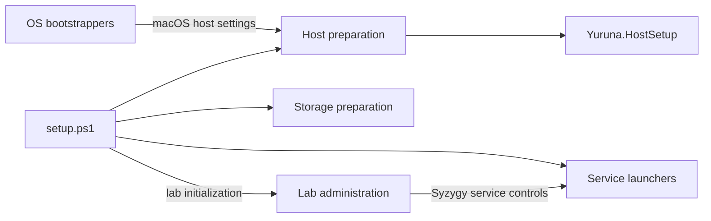
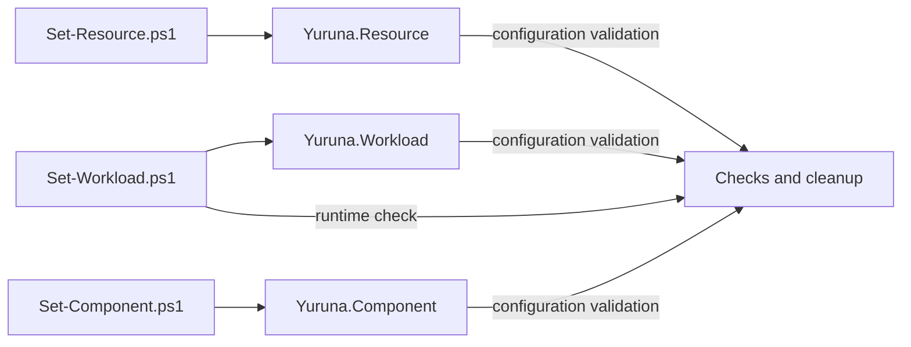
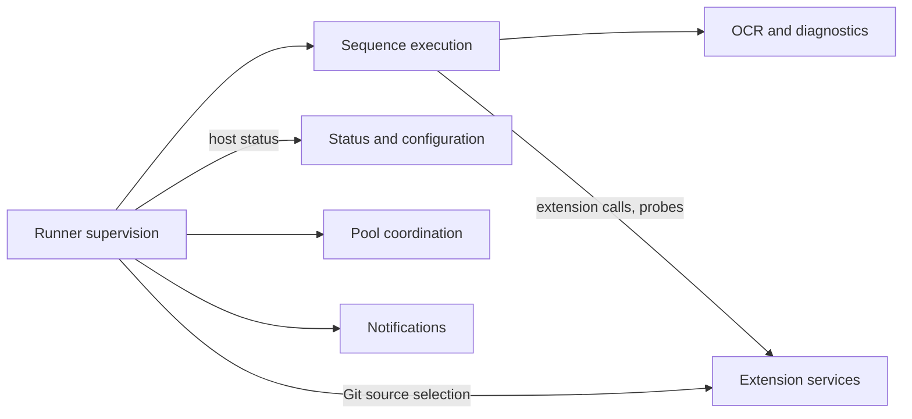
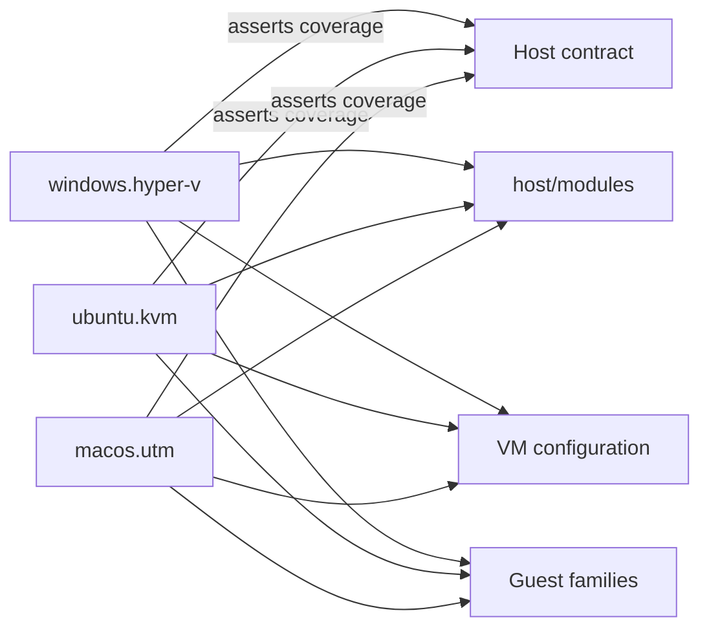
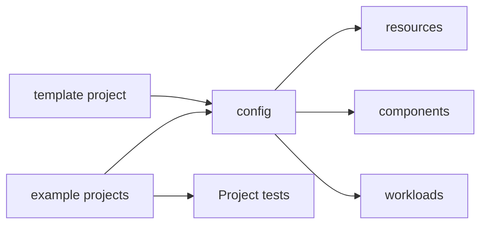
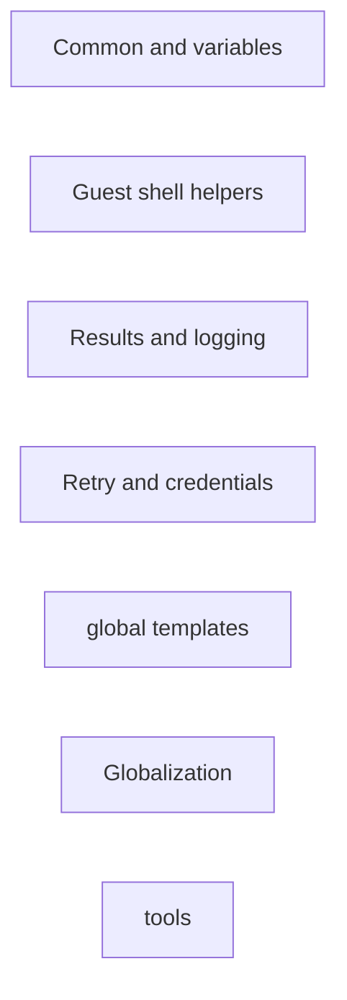
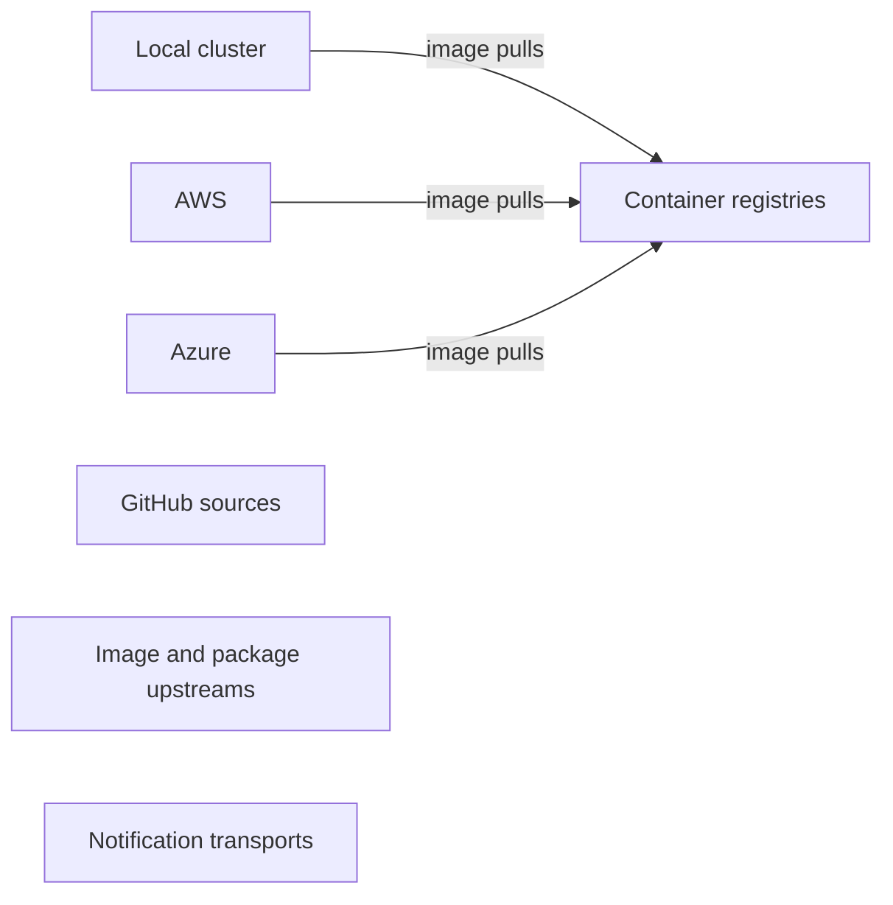

# Component breakdown

These flowcharts map each Level-1 boundary to its current public scripts, modules, and artifact families.

Section order and titles match [Context and components](01-context-and-components.md).
A family box groups the sources listed below it. Each view contains at most
seven boxes; arrows identify the stated calls or dependencies, and unconnected
boxes are inventory rather than additional execution steps.

## Provisioning

Sources: the [Windows](../../install/windows.hyper-v.ps1),
[Ubuntu](../../install/ubuntu.kvm.sh), and [macOS](../../install/macos.utm.sh)
bootstrappers install prerequisites, clone the repository, and end with a
[Test-Requirement](../../automation/Test-Requirement.ps1) version-floor check.
Before they update a checkout, they save a private recovery snapshot of a
running runner's options and stop the runner and status service; when a runner
was recorded, they print the
[Start-RecordedTestRunner](../../test/lab/Start-RecordedTestRunner.ps1) command
that restarts it explicitly after setup.
The operator runs setup.ps1 separately: there is no bootstrap-to-setup
invocation. Windows and Ubuntu print an Enable-TestAutomation command; macOS
applies its host settings with -SkipPoolStorage and reports any remaining
operator action. [setup.ps1](../../install/setup.ps1) creates or refreshes
`test.config.yml` from its template, then orchestrates
[Enable-TestAutomation](../../test/lab/Enable-TestAutomation.ps1), storage
preparation, [service VM launchers](../../test/service/), and the Test-Config
gate. After the caching proxy starts, setup points `vmStart.cachingProxyIp` at
it and enrolls the proxy's Git mirror verification key under
`repositories.mirror` through
[Test.CachingProxyService](../../test/modules/Test.CachingProxyService.psm1),
leaving a different proxy address that the operator set unchanged.
`-AnswerFile` runs it unattended;
[setup.answers.standalone.yml](../../install/setup.answers.standalone.yml) is
the checked-in example, and `setup.runTests: false` skips host settings for a
services-only machine. The host dispatcher uses
[Yuruna.HostRedirect](../../automation/Yuruna.HostRedirect.psm1) to select the
platform script; those scripts import
[Yuruna.HostSetup](../../automation/Yuruna.HostSetup.psm1).

Storage preparation groups
[New-LocalLabStorage](../../test/lab/New-LocalLabStorage.ps1) with setup's configured
NAS path. For a NAS, setup writes the pool and stash share coordinates after a
backup and a `previous -> new` report, stores an operator-supplied NAS password
in the authentication vault, then mounts and verifies both shares;
`storage.onFailure: local` falls back to local shares. Storage is prepared
before the service guests. Lab administration
groups [test/lab/](../../test/lab/) and the [test/pool/](../../test/pool/)
administration scripts, including token initialization, pool creation,
enrollment, storage administration,
[Invoke-HostRefresh](../../test/lab/Invoke-HostRefresh.ps1), and the
[Start-Syzygy](../../test/lab/Start-Syzygy.ps1) and
[Stop-Syzygy](../../test/lab/Stop-Syzygy.ps1) controls, which run the four
service VM scripts in order and in reverse. The pool-control
service invokes the same pool scripts.
Setup always brings up the cache, and the stash when storage is configured. The
download agent defaults off in standalone mode and on in lab mode unless
`downloadAgentService.enabled` says otherwise; lab mode also enrolls the lab
token and adds a default pool and pool-control. A healthy service VM can be
adopted; rebuilding applies changed provisioning settings. An interactive
[caching-proxy launcher](../../test/service/Start-CachingProxyServiceVM.ps1)
start also offers an optional GitHub token for the Git mirror; a supplied token
is stored in the host's authentication vault and forces a rebuild, so the new
seed carries it.

## Deploy engine

Sources: [Set-Resource](../../automation/Set-Resource.ps1),
[Set-Component](../../automation/Set-Component.ps1), and
[Set-Workload](../../automation/Set-Workload.ps1) import
[Yuruna.Resource](../../automation/Yuruna.Resource.psm1),
[Yuruna.Component](../../automation/Yuruna.Component.psm1), and
[Yuruna.Workload](../../automation/Yuruna.Workload.psm1), respectively.
The seventh box groups
[Test-Configuration](../../automation/Test-Configuration.ps1),
[Test-Requirement](../../automation/Test-Requirement.ps1),
[Test-Runtime](../../automation/Test-Runtime.ps1), and
[Invoke-Clear](../../automation/Invoke-Clear.ps1), together with their
[validation](../../automation/Yuruna.Validation.psm1),
[requirement](../../automation/Yuruna.Requirement.psm1), and
[cleanup](../../automation/Yuruna.Clear.psm1) modules. Cleanup is an explicit
entry point, not an automatic fourth deployment phase.

The phase entry points do not invoke one another. The companion
[website guest script](https://github.com/alissonsol/yuruna-project/blob/main/example/website/test/ubuntu.server.26/ubuntu.server.26.workload.k8s.website.sh)
calls them in this order. The phase modules read the selected config directory,
use resource outputs, and return
[result manifests](../../automation/Yuruna.Result.psm1).
Resource templates resolve from the project first, then global/resources.
The workload module and validator share
[Yuruna.DeploymentKind](../../automation/Yuruna.DeploymentKind.psm1), whose current
built-ins are chart, kubectl, helm, and shell. Registry publication uses
[Yuruna.Component.Registry](../../automation/Yuruna.Component.Registry.psm1).
[yuruna.ps1](../../automation/yuruna.ps1) dispatches the same modules as one CLI,
and [Start-McpServer.ps1](../../test/service/Start-McpServer.ps1) exposes the entry
points as stdio MCP tools; neither adds a phase.

## Test harness

Sources and aggregate membership:

| Box | Sources |
| --- | --- |
| Runner supervision | [Start-TestRunner](../../test/Start-TestRunner.ps1), [Test.RunnerOuterLoop](../../test/modules/Test.RunnerOuterLoop.psm1), [Invoke-TestCycleRunner](../../test/modules/Invoke-TestCycleRunner.ps1), [Invoke-TestRunnerInnerLoop](../../test/modules/Invoke-TestRunnerInnerLoop.ps1), [Test.RunnerInnerLoop](../../test/modules/Test.RunnerInnerLoop.psm1), [Test.RunnerWatchdog](../../test/modules/Test.RunnerWatchdog.psm1), [Test.ConfigPreflight](../../test/modules/Test.ConfigPreflight.psm1), [Test.RunnerAttemptHistory](../../test/modules/Test.RunnerAttemptHistory.psm1), [Test.SourceSelection](../../test/modules/Test.SourceSelection.psm1), [Test.HostGit](../../test/modules/Test.HostGit.psm1), [Test.PrivateStateRepair](../../test/modules/Test.PrivateStateRepair.psm1), the one-shot [Invoke-TestProject](../../test/Invoke-TestProject.ps1) and [Debug-TestSequence](../../test/Debug-TestSequence.ps1) entry points, and runner identity/recovery modules in [test/modules/](../../test/modules/). |
| Sequence execution | [Test.SequenceRunner](../../test/modules/Test.SequenceRunner.psm1), [Test.SequenceEngine](../../test/modules/Test.SequenceEngine.psm1), [Test.SequenceHandler](../../test/modules/Test.SequenceHandler.psm1), [Test.SequencePlanner](../../test/modules/Test.SequencePlanner.psm1), [Test.Orchestrator](../../test/modules/Test.Orchestrator.psm1), [Test.Start-GuestOS](../../test/modules/Test.Start-GuestOS.psm1), [Test.Start-GuestWorkload](../../test/modules/Test.Start-GuestWorkload.psm1), [sequences/](../../test/sequences/), and [schemas/](../../test/schemas/). |
| OCR and diagnostics | [Test.OcrEngine](../../test/modules/Test.OcrEngine.psm1), [Test.OcrMatch](../../test/modules/Test.OcrMatch.psm1), [Test.Tesseract](../../test/modules/Test.Tesseract.psm1), [Test.Diagnostic](../../test/modules/Test.Diagnostic.psm1), [Test.DiagnosticPreservation](../../test/modules/Test.DiagnosticPreservation.psm1), the [guest](../../test/Invoke-GuestDiagnosticWorker.ps1) and [host](../../test/modules/Invoke-HostDiagnosticWorker.ps1) diagnostic workers, [Get-SystemDiagnostic](../../automation/Get-SystemDiagnostic.ps1), and the [guest stall sampler](../../automation/guest-performance-snapshot.sh). |
| Status and configuration | [Start-StatusService](../../test/service/Start-StatusService.ps1), [Start-ConfigService](../../test/service/Start-ConfigService.ps1), [Repair-PrivateState.py](../../test/service/Repair-PrivateState.py), [Test.HostMemoryMetrics](../../test/modules/Test.HostMemoryMetrics.psm1), and [status/](../../test/status/). |
| Pool coordination | [Test.PoolWorker](../../test/modules/Test.PoolWorker.psm1), [Test.PoolSync](../../test/modules/Test.PoolSync.psm1), [Test.PoolPush](../../test/modules/Test.PoolPush.psm1), [Test.PoolStorage](../../test/modules/Test.PoolStorage.psm1), [Test.PoolPlanner](../../test/modules/Test.PoolPlanner.psm1), and [Test.PoolAdmin](../../test/modules/Test.PoolAdmin.psm1). |
| Extension services | [extension/](../../test/extension/) holds authentication, digest, cache management/parser, download-agent, pool aggregator/control, stash, notification, and the shared SDK. The [caching-proxy extension](../../test/extension/caching-proxy-service/) also holds the Git mirror. |
| Notifications | [Test.Notify](../../test/modules/Test.Notify.psm1), [Test.PoolNotifier](../../test/modules/Test.PoolNotifier.psm1), and configured providers in [notification/](../../test/extension/notification/). |

The outer runner supervises a fresh cycle process, which launches an inner
sequence process. Each cycle starts with the Test-Config gate; its verdict and
transcript are kept per attempt in a bounded attempt history, so the outer
runner separates gate refusals from watchdog kills and unexpected exits. The
gate resolves the framework and project revisions once through
Test.SourceSelection, and the inner process checks out the pinned project
commit from that handoff; while a network-only gate refusal holds the next
cycle, the outer runner polls source access the same way. Test.HostGit
accepts a caching-proxy Git mirror answer only with a receipt signed by an
enrolled `repositories.mirror` key, and otherwise uses GitHub according to the
configured mode. The runner and status service repair
private startup state before they start. These are processes on the host, rather
than additional network services. The watchdog follows the step heartbeat; OCR
and guest diagnostics supply sequence evidence. Sequence execution also includes
[Test.Transport](../../test/modules/Test.Transport.psm1) for console input and
[Test.SequenceFailureState](../../test/modules/Test.SequenceFailureState.psm1)
for shared failure evidence. `fetchAndExecute` records envelope transfer details;
it retypes a damaged compact envelope once only when the guest confirms that the
payload was not prepared. The guest-side verifier is
[yuruna-fetch-context.sh](../../automation/yuruna-fetch-context.sh), in the shared
helpers family. [Data flows](03-data-flows.md) follows this exchange.
`startVm` and `stopVm` observe
VM state through the host driver and save console evidence when a guest stops
answering. A `retry` step with `restartVmBeforeRetry: coldPowerCycle`
power-cycles a stalled startup guest on all three hosts before its next
attempt. Text waits ask a driver that exports a console second opinion
whether the guest stopped drawing; on UTM, a sustained inactive display with
static frames ends the wait as a livelock. The host status listener also runs
when testing is idle, and serves the native Linux and macOS memory gauges
from Test.HostMemoryMetrics on its metrics endpoint. The
caching-proxy launcher starts the host status and configuration services through
[Test.Prelude](../../test/modules/Test.Prelude.psm1).

The extension family contains more than seven implementations and remains one
aggregate here. Sequence steps call PowerShell extension methods through
[Test.Extension](../../test/modules/Test.Extension.psm1), and the
[lab-health gate](../../test/modules/Test.LabHealth.psm1) probes each area at
step boundaries; the Go daemons keep separate launch paths. The Git mirror
runs inside the caching-proxy extension:
[gitmirror.go](../../test/extension/caching-proxy-service/gitmirror.go) gives
the same daemon worker, reader, and CGI roles, so
[git-mirror-worker.service](../../test/extension/caching-proxy-service/git-mirror-worker.service)
refreshes and signs the GitHub repositories,
[git-mirror-reader.service](../../test/extension/caching-proxy-service/git-mirror-reader.service)
serves them read-only, and
[git-mirror-http-backend.sh](../../test/extension/caching-proxy-service/git-mirror-http-backend.sh)
answers Git HTTP clones. Their runtime
placement and exchanges are expanded in [Deployment](06-deployment.md) and
[Data flows](03-data-flows.md). Host refresh groups
[Test.HostRefresh](../../test/modules/Test.HostRefresh.psm1),
[Test.HostRefreshIntent](../../test/modules/Test.HostRefreshIntent.psm1),
[Test.HostRefreshTrigger](../../test/modules/Test.HostRefreshTrigger.psm1), and
[Test.HostRefreshAuth](../../test/modules/Test.HostRefreshAuth.psm1) with runner
supervision.

## Providers

Sources: [host contract](../../host/Yuruna.Host.Contract.psm1),
[Hyper-V driver](../../host/windows.hyper-v/modules/Yuruna.Host.psm1),
[KVM driver](../../host/ubuntu.kvm/modules/Yuruna.Host.psm1),
[UTM driver](../../host/macos.utm/modules/Yuruna.Host.psm1),
[host/modules/](../../host/modules/), [host/vmconfig/](../../host/vmconfig/), and
[guest/](../../guest/).
Each driver imports the contract and asserts at load time that it exports every
contract verb. It dispatches per-guest image and VM builders and implements
lifecycle, console input, screenshots, discovery, and networking. `Stop-VM` takes
`-ShutdownTimeoutSeconds` and `-NoForce` on all three drivers, so a sequence can
request a graceful shutdown and observe it through the host; Hyper-V also captures
the COM1 serial console during a cycle. The Hyper-V and UTM drivers also export
`Get-VMConsoleSecondOpinion`, outside the contract, which reads the framebuffer
independently of the screenshot path. Each provider folder also holds the
Enable/Disable-TestAutomation, Sync-HostConfiguration, and
Remove-OrphanedVMFiles scripts that the [test/lab/](../../test/lab/) dispatchers
select through [Yuruna.HostRedirect](../../automation/Yuruna.HostRedirect.psm1).

VM configuration groups the [host/vmconfig/](../../host/vmconfig/) cloud-init
seeds for guests and services (base user-data plus per-hypervisor overlays), the
Windows 11 `autounattend.xml` in each provider's builder, the UTM
`config.plist.template` files, and the seed renderers
[Yuruna.CloudInitTemplate](../../automation/Yuruna.CloudInitTemplate.psm1) and
[Yuruna.GuestSeed](../../automation/Yuruna.GuestSeed.psm1). The caching-proxy seed
carries a Zot sync self-test, and
[caching-proxy-service.zot-qualified.json](../../host/vmconfig/caching-proxy-service.zot-qualified.json)
records the release [Test-ZotRelease.py](../../tools/Test-ZotRelease.py) qualified.
The caching-proxy seed also installs the Git mirror worker and reader units and
their HTTP routes. The three caching-proxy builders stage its secret-bearing
seed media, including the mirror signing key and any GitHub token, through
[Yuruna.CachingProxySeed](../../host/modules/Yuruna.CachingProxySeed.psm1) in
the host/modules box.
Guest edges identify the scripts selected for the guest, not a requirement that
every driver execute every script.

The guest family groups amazon.linux.2023, ubuntu.server.24, ubuntu.server.26,
windows.11, macos.26, and [guest/shared](../../guest/shared/) helpers. Platform
support comes from the corresponding builder folders; the diagram does not imply
every provider supports every guest. macos.26 has a UTM builder only; Hyper-V,
libvirt, and UTM retain their own native console and networking implementations.
When a guest update script materializes a pinned framework revision, it tries
the caching-proxy Git mirror first if the guest has the proxy address, then
GitHub.
Caching-proxy, stash, download-agent, and pool-control builders live under each
provider and reuse the shared seeds; the stash, download-agent, and pool-control
seeds run their ubuntu.server.26 service scripts, while the caching-proxy seed is
self-contained. The network
differences are expanded in [Deployment](06-deployment.md).

## Project data

Sources in yuruna-project:
[example/README.md](https://github.com/alissonsol/yuruna-project/blob/main/example/README.md),
[template/README.md](https://github.com/alissonsol/yuruna-project/blob/main/template/README.md),
[website resources configuration](https://github.com/alissonsol/yuruna-project/blob/main/example/website/config/localhost/resources.yml),
[component configuration](https://github.com/alissonsol/yuruna-project/blob/main/example/website/config/localhost/components.yml),
[workload configuration](https://github.com/alissonsol/yuruna-project/blob/main/example/website/config/localhost/workloads.yml),
[Dockerfile](https://github.com/alissonsol/yuruna-project/blob/main/example/website/components/frontend/website/Dockerfile),
[Helm chart](https://github.com/alissonsol/yuruna-project/blob/main/example/website/workloads/frontend/website/Chart.yaml),
and [test/test.runner.yml](https://github.com/alissonsol/yuruna-project/blob/main/test/test.runner.yml).

The tests box groups the repository cycle plan with example and book sequence
definitions in [book/](https://github.com/alissonsol/yuruna-project/tree/main/book).
The current deployment examples select localhost, AWS, or Azure; no checked-in
GCP configuration is present. Examples contain projects below their name;
template itself contains
config, resources, components, and workloads without another project-name folder.
Some examples, including nested.host, supply tests without deployment directories.
The companion [tools/](https://github.com/alissonsol/yuruna-project/tree/main/tools)
folder holds the shared example workload helper and build module used by example
guest and component scripts.
The authentication vault belongs to the harness, as detailed in
[Data model](05-data-model.md).

## Shared modules

Sources:
[Yuruna.Common](../../automation/Yuruna.Common.psm1),
[Yuruna.VariableExpansion](../../automation/Yuruna.VariableExpansion.psm1),
[Import.Yaml](../../automation/Import.Yaml.psm1),
[fetch-and-execute.sh](../../automation/fetch-and-execute.sh),
[yuruna-retry.sh](../../automation/yuruna-retry.sh),
[yuruna-service-bringup.sh](../../automation/yuruna-service-bringup.sh),
[yuruna-host-locate.sh](../../automation/yuruna-host-locate.sh),
[Yuruna.Result](../../automation/Yuruna.Result.psm1),
[Yuruna.Log](../../automation/Yuruna.Log.psm1),
[Yuruna.LogLevel](../../automation/Yuruna.LogLevel.psm1),
[Yuruna.Retry](../../automation/Yuruna.Retry.psm1),
[Yuruna.CredentialProvider](../../automation/Yuruna.CredentialProvider.psm1),
[global/](../../global/), [globalization/](../../globalization/), and
[tools/](../../tools/).

Seven boxes group related libraries and assets. Common and variables include
host, network, bounded-process, process-identity, PID-file lock, and canonical-path
helpers, YAML loading, and variable expansion. The PID-file lock implementation
in Yuruna.Common is shared by the
[pool-storage drain](../../test/modules/Test.PoolStorage.psm1) and
[pool push forwarder](../../test/modules/Invoke-PoolPushForwarder.ps1).
Guest shell helpers group the scripts that guest seeds and
guest scripts install or source: fetch-and-execute.sh, yuruna-fetch-context.sh,
yuruna-retry.sh, yuruna-run.sh, yuruna-network.sh, yuruna-versions.sh,
yuruna-service-bringup.sh, the yuruna-host-locate pair, Test-YurunaHost.ps1, and
windows-guest-bootstrap.ps1. When the host status service is unreachable,
fetch-and-execute.sh reads a pinned commit's files from the caching-proxy Git
mirror before GitHub, and yuruna-retry.sh provides the pinned Git materializer
that the guest update scripts also embed. Results and logging include
completion manifests, log levels, and entry-point root and transcript resolution in Yuruna.LogLevel.
Validation, requirement, and deployment-kind modules are imported only by
deploy-engine code and appear in its checks family. Retry and credentials group the
transient-operation helper and registry authentication provider catalog.
Global contains config, component, and workload roots; global/resources appears
under External services. The globalization aggregate includes
[Yuruna.Globalization](../../automation/Yuruna.Globalization.psm1), the
[Test.Catalog](../../test/modules/Test.Catalog.psm1) and
[Test.Locale](../../test/modules/Test.Locale.psm1) runtime it loads, and catalogs;
[Globalization](07-globalization.md) expands its language contract.
Tools include [Invoke-TestSuite](../../tools/Invoke-TestSuite.ps1) and its
[worker](../../tools/_InvokeOneSuite.ps1), which run isolated Pester suites and
retain validation evidence independently of the continuous VM runner, and
[Gate.Scope](../../tools/Gate.Scope.psm1), the scope resolver shared by the lint
and shellcheck gates. The Git mirror release qualification tools also belong
to this box: [Invoke-GitMirrorQualification](../../tools/Invoke-GitMirrorQualification.ps1)
prepares candidate fixtures and merges native results,
[Invoke-GitMirrorNativeQualification](../../tools/Invoke-GitMirrorNativeQualification.ps1)
runs the checked-in [recipes](../../test/fixtures/git-mirror/) on a disposable
host, and [GitMirror.Qualification](../../tools/GitMirror.Qualification.psm1)
holds their shared checks. Runners, setup, and the proxy never load them.

## External services

Sources: [localhost resources](../../global/resources/localhost/),
[AWS resources](../../global/resources/aws/),
[Azure resources](../../global/resources/azure/),
[registry providers](../../automation/Yuruna.CredentialProvider.psm1),
[GitHub source resolution](../../automation/Yuruna.GitHubSource.psm1),
[host downloads](../../host/modules/Yuruna.HostDownload.psm1),
[guest setup](../../guest/), and
[notification providers](../../test/extension/notification/).

The cluster/cloud boxes group targets referenced by current resource templates:
localhost context/registry verification, AWS EKS/ECR, and Azure AKS/ACR plus the
checked-in resource-group, Linux VM, PostgreSQL, and storage-share templates.
Registry providers implement ACR, ECR, Google Artifact Registry, Docker Hub, and
generic Docker authentication. GAR support does not supply GCP provisioning.
GitHub sources also include the repositories that the caching-proxy Git mirror
worker refreshes, with the optional token described under Provisioning.
The localhost registry template checks a registry already started by the caller,
and context-copy copies an existing local Kubernetes context under the configured
destination name. Image and package upstreams include the container registries
the cache's Zot mirror syncs from, which the Zot sync self-test probes. The
registry providers authenticate the component phase's push; cluster pull access
comes from project workload configuration, such as the Azure website's
`docker-registry` secret.
The AWS template exposes the Kubernetes control-plane API separately from
application ingress, as shown in [Deployment](06-deployment.md#aws-application-ingress).

---

[Architecture](../architecture.md) | [Design overview](README.md)
