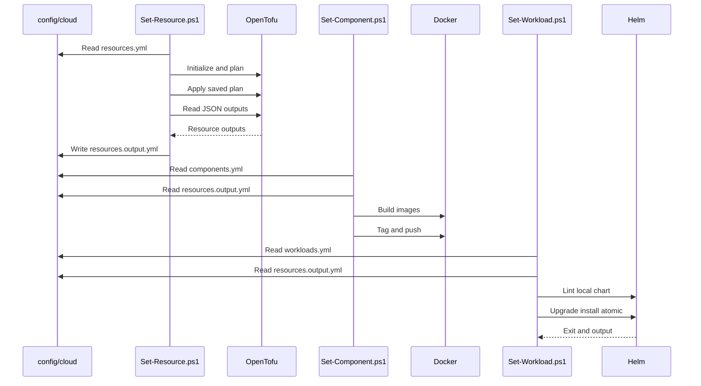
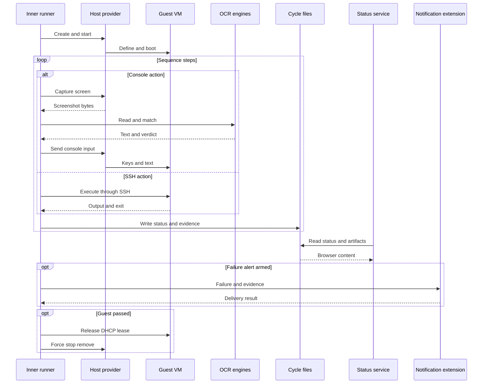
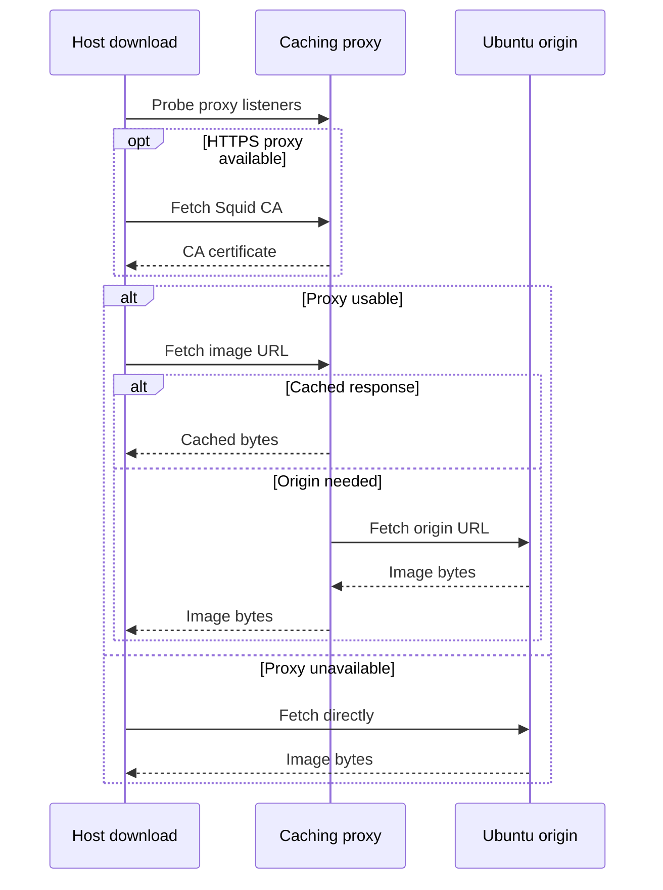
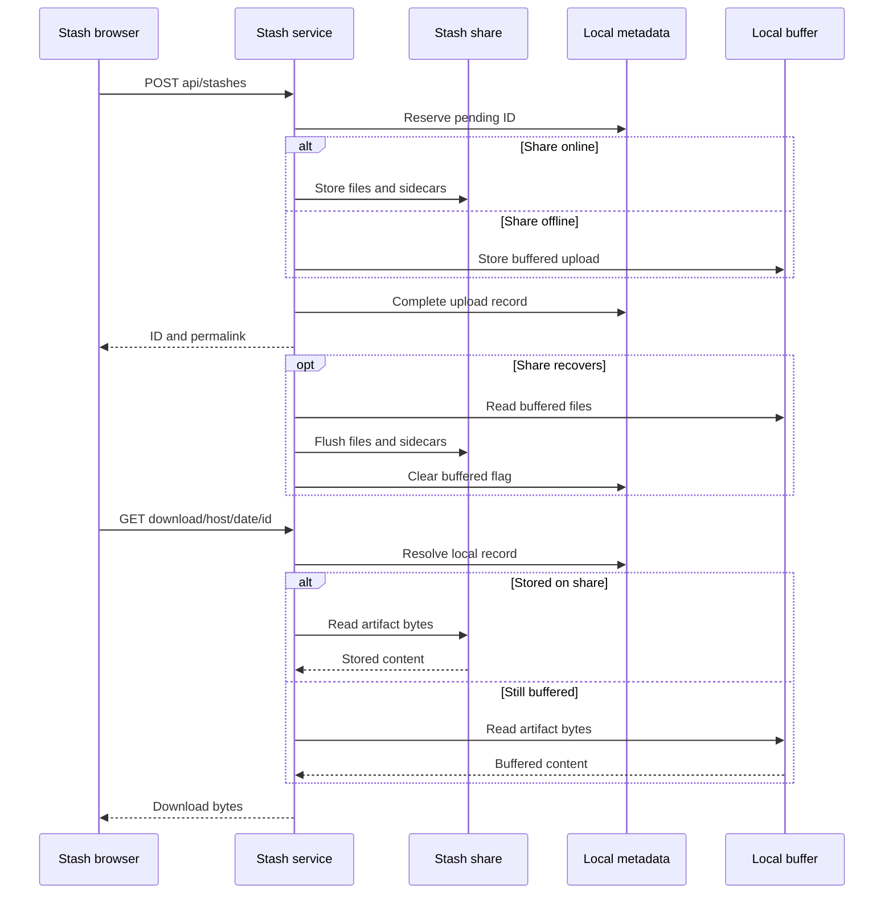
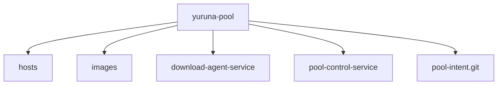
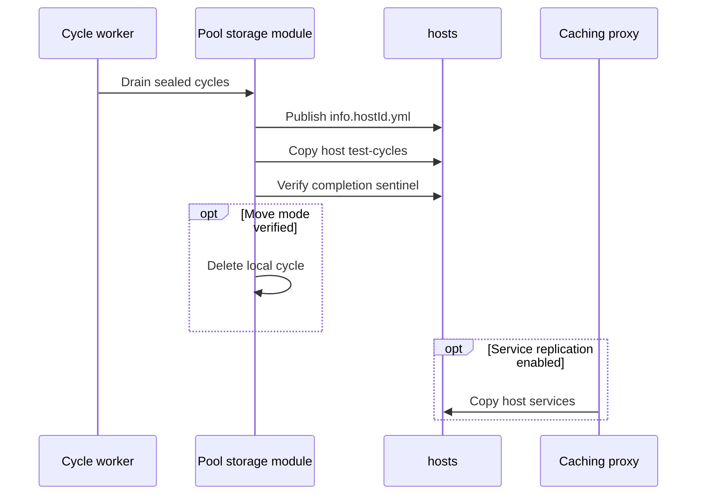
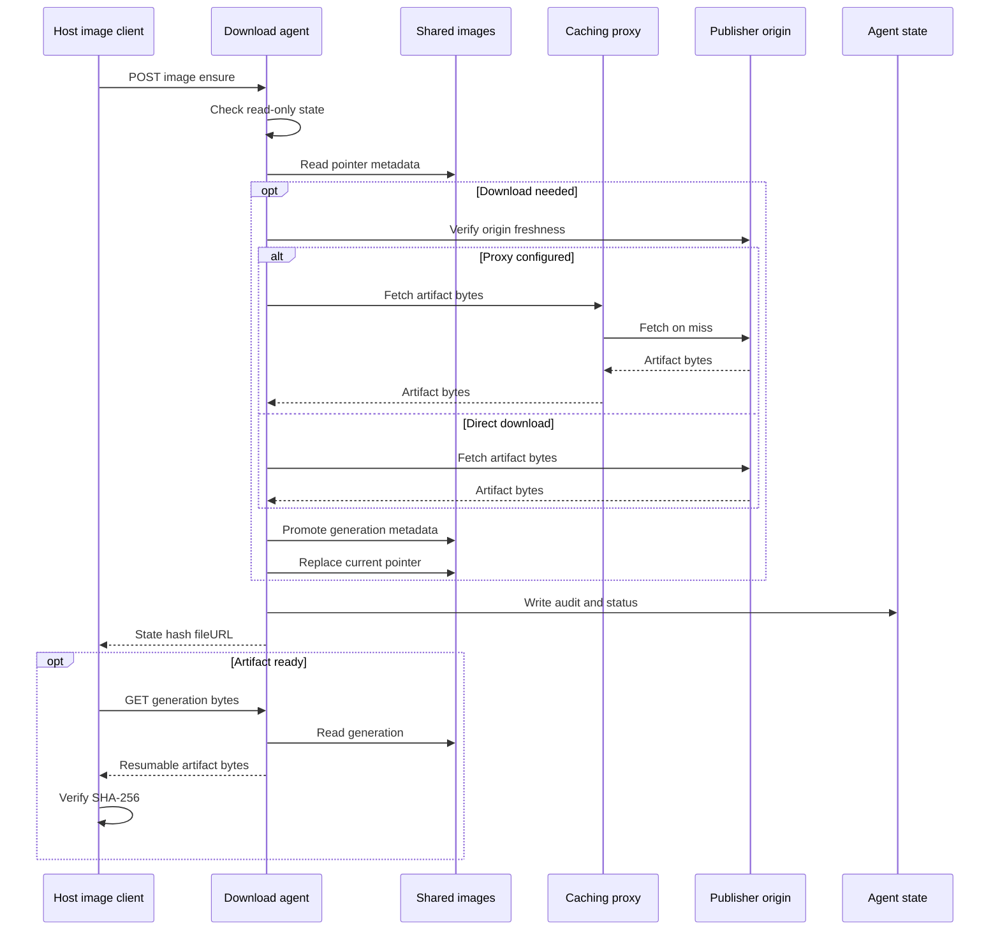
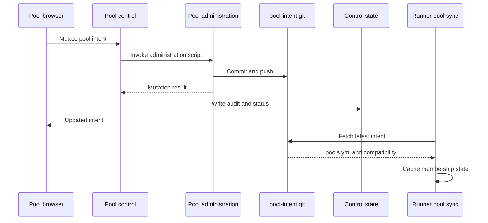

# Runtime data flows

This page traces deployment, test execution, downloads, and shared storage through the current runtime code.

The capability boundaries and phase definitions are in [Yuruna Architecture](../architecture.md). Each sequence below has at most seven participants; participants can be scripts, modules, services, or the storage they read and write.

## Three-phase deployment

The phases are separate invocations, ordered by the caller. The project's [website workload](https://github.com/alissonsol/yuruna-project/blob/main/example/website/test/ubuntu.server.26/ubuntu.server.26.workload.k8s.website.sh) invokes [Set-Resource.ps1](../../automation/Set-Resource.ps1), [Set-Component.ps1](../../automation/Set-Component.ps1), and [Set-Workload.ps1](../../automation/Set-Workload.ps1) in this order. The implementing modules are [Yuruna.Resource.psm1](../../automation/Yuruna.Resource.psm1), [Yuruna.Component.psm1](../../automation/Yuruna.Component.psm1), and [Yuruna.Workload.psm1](../../automation/Yuruna.Workload.psm1). Tools group their configured cloud, registry, and Kubernetes interactions to keep seven participants.

The resource module makes a planning pass and an application pass. Before each apply it records resource ownership in `resources.output.yml`, then replaces that entry with collected outputs; a failed deployment can leave a partial manifest. Both later phases expand resource outputs into their configured variables. The chart path shown uses `helm upgrade --install --atomic`; repository, manifest, and shell deployments are other workload kinds. Workloads can also read `config/resources.output.yml` when the cloud-specific file is absent. Components publish images to the configured registry; there is no component-output manifest passed to workloads.

## A test cycle

[Start-TestRunner.ps1](../../test/Start-TestRunner.ps1) owns the persistent outer loop. [Test.RunnerOuterLoop.psm1](../../test/modules/Test.RunnerOuterLoop.psm1) dispatches a fresh [Invoke-TestCycleRunner.ps1](../../test/modules/Invoke-TestCycleRunner.ps1), which starts a fresh inner process. [Test.RunnerInnerLoop.psm1](../../test/modules/Test.RunnerInnerLoop.psm1) serializes guests and calls the [host contract](../../host/Yuruna.Host.Contract.psm1). The runner participant groups its sequence modules, keeping seven participants while showing status publication as file access.

Console actions and matching are implemented by [Test.SequenceEngine.psm1](../../test/modules/Test.SequenceEngine.psm1) and [Test.OcrEngine.psm1](../../test/modules/Test.OcrEngine.psm1); SSH sequences use [Test.Ssh.psm1](../../test/modules/Test.Ssh.psm1). [Test.Status.psm1](../../test/modules/Test.Status.psm1) writes local status files, which the HTTP process launched by [Start-StatusService.ps1](../../test/service/Start-StatusService.ps1) serves. Failure artifacts include screenshots, OCR sidecars, and bounded diagnostics. [Test.Notify.psm1](../../test/modules/Test.Notify.psm1) dispatches configured extensions after failure thresholds arm an alert. [Lifecycle state](04-lifecycle-state.md) describes failure retention and boundary cleanup.

## Cached image download

[Yuruna.HostDownload.psm1](../../host/modules/Yuruna.HostDownload.psm1) discovers the proxy and implements `Save-CachedHttpUri`. HTTPS through Squid requires its bump listener and the CA served by Apache. Their configuration and disk cache are created by [caching-proxy-service.base.user-data](../../host/vmconfig/caching-proxy-service.base.user-data). [Yuruna.Image.psm1](../../host/modules/Yuruna.Image.psm1) owns the Ubuntu origin URL used here and the image-integrity checks.

The direct branch is the fallback when proxy discovery or CA prerequisites fail. The Squid response cache remains on its guest disk at `/var/spool/squid`. Guest script fetching is another common path: [fetch-and-execute.sh](../../automation/fetch-and-execute.sh) prefers a verified host source, bypasses proxying for that local source, falls back to a pinned GitHub source when available, and verifies trusted payload hashes before execution.

## Stash upload and retrieval

Browser code in [new.js](../../test/extension/stash-service/server/internal/httpsrv/web/assets/new.js) posts uploads to the routes in [handlers.go](../../test/extension/stash-service/server/internal/httpsrv/handlers.go). The same ingest implementation accepts SCP and SFTP through [sshsrv](../../test/extension/stash-service/server/internal/sshsrv/). [store.go](../../test/extension/stash-service/server/internal/store/store.go), [ingest.go](../../test/extension/stash-service/server/internal/sshsrv/ingest.go), and [flush.go](../../test/extension/stash-service/server/internal/sshsrv/flush.go) implement durable writes, the offline buffer, and later flushing.

[stash-service.base.user-data](../../host/vmconfig/stash-service.base.user-data) configures and mounts the dedicated stash share at `/mnt/ystash-nas`. [ubuntu.server.26.stash-service.sh](../../guest/ubuntu.server.26/ubuntu.server.26.stash-service.sh) selects that mounted storage and sets the service root to `stash/<hostId>/`. That root holds `hostkey/` and `files/yyyy/mm/dd/`, including `.yuruna.meta.json` sidecars. `stash.sqlite` is VM-local under `/var/lib/stash-service/metadata`; the offline upload buffer is VM-local under `/var/lib/stash-service/buffer`. [config.go](../../test/extension/stash-service/server/internal/config/config.go) defines these paths and the buffer ceiling. Retrieval can also resolve other hosts' share-side metadata through [resolve.go](../../test/extension/stash-service/server/internal/httpsrv/resolve.go). Without configured stash storage, the guest script uses a local share fallback.

## Pool storage and per-host evidence

`yuruna-pool` is the pool share as mounted by service guests; the host mount comes from `networkStorage.poolStorageLocalPath`, and the share name is configurable. [Test.PoolStorage.psm1](../../test/modules/Test.PoolStorage.psm1) derives host and archive paths and copies sealed cycle folders. [Test.HostIdentity.psm1](../../test/modules/Test.HostIdentity.psm1) writes the registry record. The pool's five named areas and root are six boxes; stash is on its own storage tier, illustrated above.

| Pool-relative path | Stored data | Producer |
|---|---|---|
| `hosts/info.<hostId>.yml` | Host identity and hardware fingerprint | [Test.HostIdentity.psm1](../../test/modules/Test.HostIdentity.psm1) |
| `hosts/<hostId>/test-cycles/<cycle>/` | Sealed cycle evidence and completion sentinel | [Test.PoolStorage.psm1](../../test/modules/Test.PoolStorage.psm1) |
| `hosts/<hostId>/services/caching-proxy-service/` | Replicated Loki, Prometheus, and Grafana data when enabled | [Proxy seed](../../host/vmconfig/caching-proxy-service.base.user-data) |
| `images/<hostType>/<imageKey>/` | Generations, `.meta.json` sidecars, current pointers, staging, manual imports | [Image store](../../test/extension/download-agent-service/server/internal/imagestore/store.go) |
| `download-agent-service/` | `audit.jsonl` and `status.json` | [Agent state](../../test/extension/download-agent-service/server/internal/state/state.go) |
| `pool-control-service/` | `audit.jsonl` and `status.json` | [Control state](../../test/extension/pool-control-service/server/internal/state/state.go) |
| `pool-intent.git/` | Bare Git repository holding pool intent | [Pool control setup](../../guest/ubuntu.server.26/ubuntu.server.26.pool-control-service.sh) |

The seven table rows describe paths inside the five areas, not additional boxes. [New-LocalLabStorage.ps1](../../test/lab/New-LocalLabStorage.ps1) can provide pool and stash shares from a lab host; the same runtime configuration supports a separate NAS. Pool and stash use separate shares, accounts, and configuration keys. Download-agent and pool-control guests mount `/mnt/yuruna-pool`; the cache guest mounts `/mnt/ypool-nas` for service replication.

The cycle worker's end-of-cycle hooks are in [Test.RunnerOuterLoop.psm1](../../test/modules/Test.RunnerOuterLoop.psm1). Copy mode launches a detached [Invoke-PoolStorageDrain.ps1](../../test/modules/Invoke-PoolStorageDrain.ps1); move mode runs a bounded drain synchronously after the push forwarder finishes reading. The drain verifies `.yuruna-complete` and copied artifacts before local deletion, excludes unsealed cycles, and keeps its ledger on the host in `poolstorage.state.json`. The cache guest's separate replication timer and host-specific service destination are defined in [caching-proxy-service.base.user-data](../../host/vmconfig/caching-proxy-service.base.user-data).

## Download agent and shared images

[Yuruna.DownloadAgent.psm1](../../host/modules/Yuruna.DownloadAgent.psm1) resolves the service, sends ensure requests, polls while downloading, streams the published artifact, and checks SHA-256. [imagestore](../../test/extension/download-agent-service/server/internal/imagestore/) implements single-flight downloads, a pool-wide writer lease, generation promotion, and pointer publication. The pool layout is defined in [config.go](../../test/extension/download-agent-service/server/internal/config/config.go) and wired by [ubuntu.server.26.download-agent-service.sh](../../guest/ubuntu.server.26/ubuntu.server.26.download-agent-service.sh).

Origin freshness checks bypass the cache-capable byte client, as implemented in [refresh.go](../../test/extension/download-agent-service/server/internal/imagestore/refresh.go). An ensure checks the agent's read-only state; lease acquisition and renewal happen separately in `Agent.Run` and `ScanOnce`, on the scan cadence, through [lease.go](../../test/extension/download-agent-service/server/internal/imagestore/lease.go). Publisher checksum verification is recorded in metadata and depends on the image family; it is distinct from the host checking the downloaded artifact against the agent's published hash. No current pointer is exposed before its generation and metadata exist. The daemon refuses ensures when the pool is unavailable. Host callers can fall back to their original publisher path through [Yuruna.Image.psm1](../../host/modules/Yuruna.Image.psm1). Operational audit and status live beside `images/`, through [state.go](../../test/extension/download-agent-service/server/internal/state/state.go).

## Pool control and intent synchronization

Pool control HTTP handlers in [handlers.go](../../test/extension/pool-control-service/server/internal/httpsrv/handlers.go) call PowerShell administration scripts through [intent.go](../../test/extension/pool-control-service/server/internal/intent/intent.go). [Test.PoolSync.psm1](../../test/modules/Test.PoolSync.psm1) fetches intent into a private runtime checkout, finds membership in `pools.yml`, and caches effective pool state. [ubuntu.server.26.pool-control-service.sh](../../guest/ubuntu.server.26/ubuntu.server.26.pool-control-service.sh) selects `pool-intent.git` and the state directory on the mounted share.

Pool control writes audit and health snapshots through [state.go](../../test/extension/pool-control-service/server/internal/state/state.go). Intent can be configured elsewhere; the sequence shows the seeded share deployment. Runner sync keeps the last good intent on transient fetch failure. Desired state `paused` holds dispatch, `drain` stops the runner at a dispatch boundary, and `run` admits ordinary work.

## The stderr.log / rc sidecar contract

Phase logs store captured tool stdout and stderr; the filename does not imply a stderr-only stream. Headers include the command or label and `exit=N`; retry headers include attempt information. A companion `.rc` records the latest completed logged operation's native exit code, rather than aggregate phase success. Producers are [Yuruna.Resource.psm1](../../automation/Yuruna.Resource.psm1), [Yuruna.Component.psm1](../../automation/Yuruna.Component.psm1), [Yuruna.Workload.psm1](../../automation/Yuruna.Workload.psm1), and [Yuruna.Retry.psm1](../../automation/Yuruna.Retry.psm1).

| Producer | Project-relative log | Companion |
|---|---|---|
| Resource helper | `.yuruna/<cloud>/resources/<resourceName>/tofu.stderr.log` | `tofu.rc` |
| Component helper | `.yuruna/<cloud>/components/docker.stderr.log` | `docker.rc` |
| Local chart helper | `.yuruna/<cloud>/workloads/<context>/<installName>/helm.stderr.log` | `helm.rc` |
| Other workload helper | `.yuruna/<cloud>/workloads/<context>/<tool>.stderr.log` | `<tool>.rc` |

Resources clear the pair on entry to each pass, then capture init, plan or apply, and output through the retry helper. Components clear the pair once per phase and append all components' Docker commands. Local charts clear the pair per chart and record lint and installation; pending-release recovery output is appended when needed, but status probes and recovery calls do not each rewrite `helm.rc`. Other workload kinds append by tool and rewrite `.rc` after the retry helper returns.

[Get-SystemDiagnostic.ps1](../../automation/Get-SystemDiagnostic.ps1) scans beneath its framework root recursively with `-Force` for `*.stderr.log`, associates each with its `.rc`, and prints the sidecar with captured output; large logs display their last 64 KiB. Separate gap heuristics compare resource state and declared workload configuration with actual cluster state. A zero native exit code alone is insufficient to prove deployment succeeded: local chart deployment also rejects Helm's terminal error output, and diagnostics can detect resources without Helm releases.

---

Back to [Yuruna Architecture](../architecture.md) | [Design overview](README.md)
