# Runtime data flows

This page traces deployment, guest tests, source routing, artifact downloads, and shared pool storage through the current public source.

[Yuruna Architecture](../architecture.md) defines the capabilities and phase model. Each view below shows at most seven participants or boxes; grouped tools and optional paths are identified in the surrounding prose.

## Three-phase deployment

The phases are separate commands whose caller supplies their order. The project's [website workload](https://github.com/alissonsol/yuruna-project/blob/main/example/website/test/ubuntu.server.26/ubuntu.server.26.workload.k8s.website.sh) invokes [Set-Resource.ps1](../../automation/Set-Resource.ps1), [Set-Component.ps1](../../automation/Set-Component.ps1), and [Set-Workload.ps1](../../automation/Set-Workload.ps1) in this order. Their implementing modules are [Yuruna.Resource.psm1](../../automation/Yuruna.Resource.psm1), [Yuruna.Component.psm1](../../automation/Yuruna.Component.psm1), and [Yuruna.Workload.psm1](../../automation/Yuruna.Workload.psm1). Each tool participant groups its remote cloud, registry, or cluster exchanges.

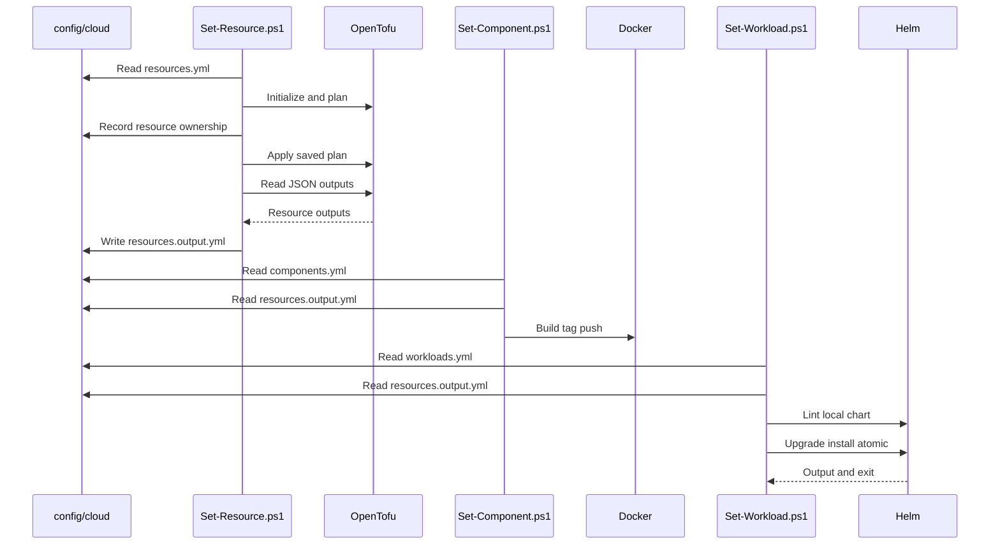

Resources run a planning pass followed by an application pass. Before applying each resource, the module atomically saves an ownership entry in `config/<cloud>/resources.output.yml`; successful output collection replaces that entry. A failed apply can therefore leave a partial manifest that still identifies owned resources. The normal apply uses the saved plan; a missing plan falls back to a refreshing apply, which is never retried because it is not idempotent after a partial apply.

Components and workloads each flatten resource outputs verbatim into their variable sets. Workloads can fall back to `config/resources.output.yml` when the cloud-specific file is absent. There is no component-output manifest. The diagram shows local chart deployment through `helm upgrade --install --atomic`; the workload module also handles configured `kubectl`, Helm-command, and shell deployments. Set-Workload checks and switches the kubectl context and restores the operator's context afterward. Before an upgrade, a release stuck in a `pending-*` state is rolled back, or uninstalled without hooks.

## Guest test cycle

[Start-TestRunner.ps1](../../test/Start-TestRunner.ps1) runs the persistent outer supervisor. [Test.RunnerOuterLoop.psm1](../../test/modules/Test.RunnerOuterLoop.psm1) starts a fresh [Invoke-TestCycleRunner.ps1](../../test/modules/Invoke-TestCycleRunner.ps1), which starts a fresh [Invoke-TestRunnerInnerLoop.ps1](../../test/modules/Invoke-TestRunnerInnerLoop.ps1). The inner participant groups [Test.RunnerInnerLoop.psm1](../../test/modules/Test.RunnerInnerLoop.psm1) and its sequence modules; provider calls follow [Yuruna.Host.Contract.psm1](../../host/Yuruna.Host.Contract.psm1).

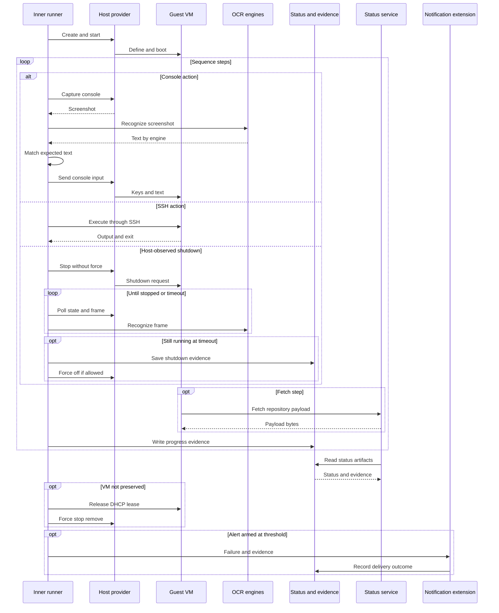

[Test.SequenceEngine.psm1](../../test/modules/Test.SequenceEngine.psm1) drives console actions and expected-text checks; [Test.OcrEngine.psm1](../../test/modules/Test.OcrEngine.psm1) supplies enabled, available OCR engines. [Test.Ssh.psm1](../../test/modules/Test.Ssh.psm1) executes SSH sequences. [Test.SequenceHandler.psm1](../../test/modules/Test.SequenceHandler.psm1) registers the step actions. `stopVm` requests shutdown through the driver's `Stop-VM -NoForce`, polls `Get-VMState`, and saves console frames with OCR sidecars while it waits; a guest that ignores the request fails as `wait_timeout` with that evidence unless `forceOnTimeout` forces it off and records a degradation. `startVm` waits for the same host-observed stopped state. `inputTextAndEnter` with `acknowledgeWithinSeconds` fails as `input_lost` when the console frame does not change. Each sequence records `firstGuestSilenceUtc` and `firstGuestSilenceSource` from the first silence it observes. On Hyper-V, COM1 output is captured during the cycle and saved as `serial-console.log` on failure. [Startup stall cold restart](#startup-stall-cold-restart) shows the bounded recovery inside a start sequence's login wait.

Fetch steps, typed at the console or run over SSH, execute fetch-and-execute.sh in the guest, which downloads repository payloads from the status service with a runner-supplied digest; [Guest fetch source routing](#guest-fetch-source-routing) shows its fallbacks. Failed guests keep screenshots, OCR sidecars, and bounded failure diagnostics in the cycle folder; a passed guest's screen ring buffer is discarded at teardown. Teardown applies to passed guests and to failed guests unless `stopOnFailure` preserves the VM for inspection. [Test.Status.psm1](../../test/modules/Test.Status.psm1) writes status documents; the separate HTTP process launched by [Start-StatusService.ps1](../../test/service/Start-StatusService.ps1) reads them and serves artifacts to browsers.

[Test.Notify.psm1](../../test/modules/Test.Notify.psm1) dispatches configured notification extensions at cycle end. The `failuresBeforeAlert` threshold, the armed latch, and the `successesBeforeRearm` streak gate delivery; the crash counter only drives backoff and the abort. Cycle-failure sends are synchronous, and each outcome is recorded in `notification.delivery.json`; notification failure does not replace the test verdict. [Lifecycle state](04-lifecycle-state.md) explains retries, cleanup, and durable diagnostic preservation.

## Startup stall cold restart

The Ubuntu [start sequence](../../test/sequences/start.guest.ubuntu.server.26.yml) wraps its login waits in `retry` steps with `restartVmBeforeRetry: coldPowerCycle`. The `retry` handler in [Test.SequenceHandler.psm1](../../test/modules/Test.SequenceHandler.psm1) runs the inner steps, and `Invoke-SequenceColdPowerCycle` restarts the guest through the provider contract. The login-wait participant groups `Wait-ForText` in [Test.SequenceEngine.psm1](../../test/modules/Test.SequenceEngine.psm1) and its OCR engines. The evidence participant groups `Save-StepFailureEvidence` in [Test.Log.psm1](../../test/modules/Test.Log.psm1) and the cycle event stream.

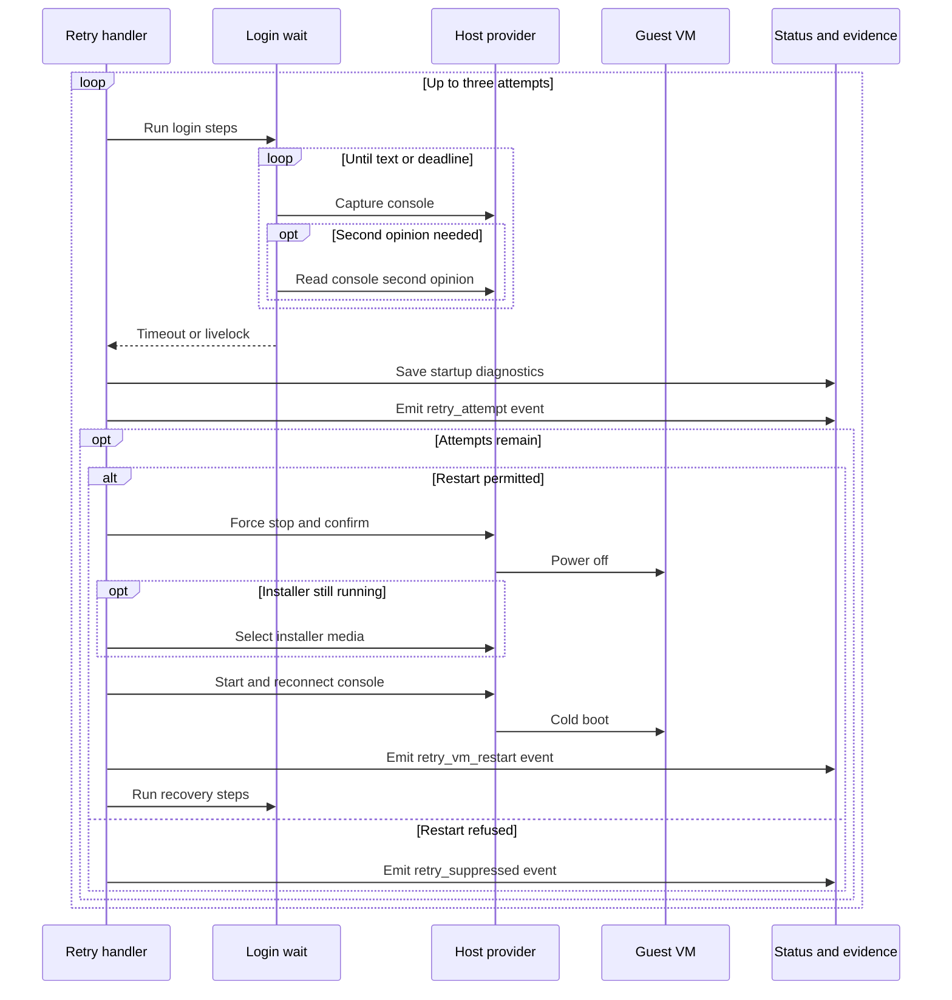

Cold restart is accepted only on the Hyper-V, KVM, and UTM providers and only for a non-sensitive step shape: Enter presses, waits of at most 60 seconds, and one final login `waitForTextWithNudge`, with recovery steps limited to short waits or the installer confirmation. Attempts are capped at three. Those login waits receive `endWaitOnGuestLivelock`. When every frame shows QEMU's `Display output is not active` for the livelock minimum, the wait asks the driver's `Get-VMConsoleSecondOpinion` and ends early on a `guest-wedged` verdict. An exhausted console-repair budget also requests that opinion. Only the Hyper-V and UTM drivers provide it.

A failed attempt saves frames with a diagnostic record holding the VM state and second opinion. A restart then requires that evidence, an OCR timeout rather than a matched failure pattern or console flood, and installer-media selection when Subiquity output shows an unfinished install. The restart stops the VM with `Stop-VMForce`, confirms `stopped`, optionally calls `Set-VMInstallerMediaFirstBoot`, starts it, confirms `running`, and calls `Restart-VMConsole`. Any unconfirmed phase fails the step with its `reasonCode`. Declared `stepsAfterVmRestart` run only after a confirmed restart, and an exhausted retry emits `retry_exhausted` with the deepest inner failure class.

## GUI fetch transport

The `fetchAndExecute` action in [Test.SequenceHandler.psm1](../../test/modules/Test.SequenceHandler.psm1) builds an integrity-bound command context and probes the guest's `/usr/local/bin/yfe` over [SSH](../../test/modules/Test.Ssh.psm1). When the launcher supports it and the result is smaller, the host types a compressed envelope through the provider. [yuruna-fetch-context.sh](../../automation/yuruna-fetch-context.sh) implements that launcher. The guest participant groups its shell, launcher, refusal record, and [fetch-and-execute.sh](../../automation/fetch-and-execute.sh); these execute inside one VM. Console recognition is the same [OCR path](../../test/modules/Test.SequenceEngine.psm1) used by the preceding cycle diagram.

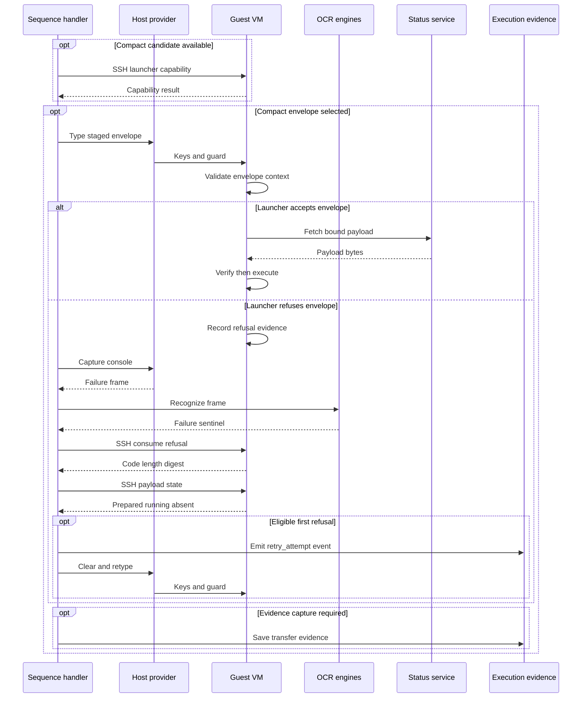

The accepted branch shows delivery from the status service. The source resolver
in [fetch-and-execute.sh](../../automation/fetch-and-execute.sh) also supports
`EXEC_BASE_URL`, the caching-proxy Git mirror, and a commit-pinned GitHub
fallback, as [Guest fetch source routing](#guest-fetch-source-routing) shows;
transport validation is the same whichever source supplies the payload.

The launcher verifies the compressed envelope's decoding and digest before preparing or consuming its command context. A refusal records its code, received character count, and received-text SHA-256 under `$HOME/.local/state/yuruna/gui-rejection/<envelopeDigest>`. After a console failure sentinel, the host reads and removes that record over SSH and independently checks for a prepared context or running fetch. Only `YFE_GUI_ENCODING` or `YFE_GUI_DIGEST` with confirmed `NOT_PREPARED` permits one clear-and-retype attempt. A missing record, unavailable SSH probe, other refusal, or payload failure does not permit this retry. A failure sentinel after a continuation prompt also establishes that staged input closed, even when OCR misreads the returning shell prompt.

The evidence participant groups the cycle event stream and `fetch-and-execute.<stepInvocationId>.evidence.json`. The event uses `retry_attempt` with `stack: gui-envelope`; the manifest records attempted line lengths, sent and received hashes, and launcher rejections. Capture runs for failed or at least 60-second fetches, skips sensitive steps, and needs a valid invocation and cycle folder. [Test.SequenceFailureState.psm1](../../test/modules/Test.SequenceFailureState.psm1) carries the refusal into `causeDetail.launcherRejection` and the `causeLauncherRejection` event field. [Test.Transport.psm1](../../test/modules/Test.Transport.psm1) sends each ordinary VNC key's press and release in one write with TCP `NoDelay`, preventing Nagle buffering from holding a release behind acknowledgment of its press.

## Cycle source selection

Each cycle selects its framework and project commits once and hands them forward. [Test.RunnerOuterLoop.psm1](../../test/modules/Test.RunnerOuterLoop.psm1) updates the framework through `Invoke-GitRepositoryUpdate` in [Test.HostGit.psm1](../../test/modules/Test.HostGit.psm1); the resolver participant groups that module's selection and checkout functions. [Test.SourceSelection.psm1](../../test/modules/Test.SourceSelection.psm1) reads mirror settings and owns the source records in private host state: `git-mirror/installed-sources.json` for installed provenance and `git-mirror/source-selection.json` for the handoff bound to the cycle generation. The gate participant is [Test-Config.ps1](../../test/Test-Config.ps1) through `Invoke-GitSourceGate`. The inner participant groups [Invoke-TestRunnerInnerLoop.ps1](../../test/modules/Invoke-TestRunnerInnerLoop.ps1), [Test.RunnerInnerLoop.psm1](../../test/modules/Test.RunnerInnerLoop.psm1), and the fetch context built by [Test.SequenceHandler.psm1](../../test/modules/Test.SequenceHandler.psm1).

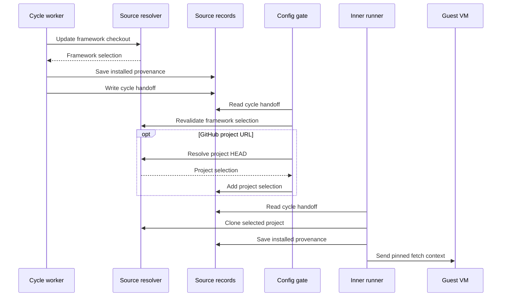

`Get-GitSourceConfiguration` reads `repositories.mirror`, where `mode` defaults to `prefer` and `mirrorOnlyMaxAgeSeconds` to 604800. Without a mirror URL it uses `vmStart.cachingProxyIp`, `YURUNA_CACHING_PROXY_SERVICE_IP`, or the recorded caching-proxy state. A pool manifest can reassign `frameworkUrl` and `projectUrl`, but mirror trust always comes from the host's own configuration. The handoff records the cycle generation, checkout and configuration paths, and the framework's selected commit; readers refuse a record whose identity or framework HEAD differs. A `-NoGitPull` cycle, a detached release, or an inner started without a handoff records the installed HEAD as `not-applicable` rather than claiming upstream confirmation, and the gate skips revalidation for it. [Invoke-TestProject.ps1](../../test/Invoke-TestProject.ps1) follows the same order for its single cycle. Only GitHub URLs take part; other project URLs keep their existing Git transport.

When every required GitHub selection succeeded, the gate skips its separate GitHub TCP probe, because the ref query already proved connectivity. The selection's `source`, `verification`, `fallbackReason`, and `keyId` fields are copied into the cycle's commit records for host status and the pool. Fetch steps take `E_FB_REPO` and `E_FB_REF` from the framework checkout's origin and HEAD through [Yuruna.GitHubSource.psm1](../../automation/Yuruna.GitHubSource.psm1), and `project/` payloads take `E_PROJECT_REPO` and `E_PROJECT_REF` from the project checkout, so guest fallbacks use the selected full commit.

## Git mirror resolution

`Resolve-GitSourceSelection` and `Invoke-GitSelectedFetch` in [Test.HostGit.psm1](../../test/modules/Test.HostGit.psm1) form the resolver. On the cache VM, Apache on port 80 forwards `/git-mirror/` to the [caching-proxy-service](../../test/extension/caching-proxy-service/main.go) daemon on port 9310, which relays it over a Unix socket to the [git-mirror-worker](../../test/extension/caching-proxy-service/git-mirror-worker.service). Apache serves read-only `/git/` smart HTTP through [git-mirror-http-backend.sh](../../test/extension/caching-proxy-service/git-mirror-http-backend.sh) and `/git-raw/` through the [git-mirror-reader](../../test/extension/caching-proxy-service/git-mirror-reader.service). The proxy participant groups Apache, the relay, and both read-only servers, as configured by [caching-proxy-service.base.user-data](../../host/vmconfig/caching-proxy-service.base.user-data). The worker's [coordinator](../../test/extension/caching-proxy-service/gitmirror_coordinator.go), [Git runner](../../test/extension/caching-proxy-service/gitmirror_git.go), and [receipt signer](../../test/extension/caching-proxy-service/gitmirror_receipt.go) implement refresh and signing.

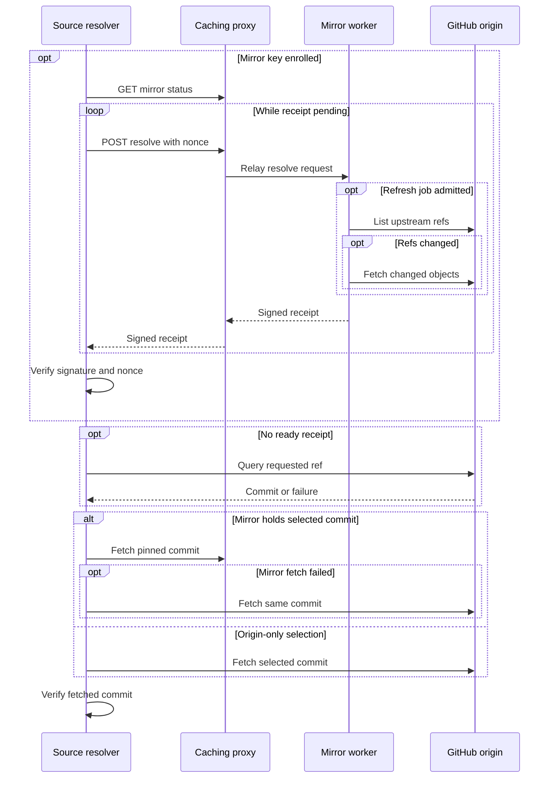

In mode `prefer` with at least one enrolled verification key, the resolver reads the capability document, cached for up to 30 seconds, and posts `repository`, `ref`, and a fresh nonce. The worker admits only registered repositories and coalesces requests into the active or next job. While a first population or refresh runs, it answers `pending` with an `operationId`, and the resolver re-posts within its budget: 45 seconds for a gate, 23 for a poll, and 43 otherwise, extended to 130 seconds for a populating framework update. The resolver verifies the RSA signature, nonce, repository, ref, and validity time. A `ready` receipt selects `mirror-confirmed` with the pin `refs/yuruna/pins/<sha>`. Mirror requests bypass proxies and carry no host Git credentials; GitHub requests use the host's normal credential attempts within the same deadline. Gate and poll selections stop before the fetch.

Without a ready receipt, the resolver queries the requested ref on GitHub. That covers a missing key, an older proxy, an unavailable or unregistered mirror, and a capacity refusal. A confirmed origin commit is `origin-direct`, and its objects still come from the mirror when the receipt already holds that commit. A `stale` receipt becomes `mirror-stale` only after a GitHub transport failure, within `mirrorOnlyMaxAgeSeconds`, and without replacing a newer installed selection. Authentication, missing refs, and receipt integrity failures never authorize stale content. Mode `fallback` asks GitHub first and the mirror only after a transport failure; mode `off` uses GitHub alone. The fetch writes a temporary candidate ref, retries GitHub transport for the same commit after a mirror fetch failure, and refuses content whose commit differs.

The worker's registry combines the seeded repository list with repositories named by `pools.yml` in the pool's `pool-configuration.git`. `Get-CachingProxyGitMirrorSeedSetting` in [Test.CachingProxyService.psm1](../../test/modules/Test.CachingProxyService.psm1) builds that list from the owning host's checkout and configuration. Every 60 seconds by default (`vmStart.cachingProxyGitMirrorRefreshSeconds`), the worker's timer reloads the registry and refreshes each idle repository. A refresh lists upstream refs and runs an atomic fetch only when a ref changed or a recorded commit is missing. The optional `github-mirror-token` reaches Git only through the worker's credential helper. [Yuruna.CachingProxySeed.psm1](../../host/modules/Yuruna.CachingProxySeed.psm1) keeps the seed media carrying the signing key and token private while the VM is built.

## Guest fetch source routing

[fetch-and-execute.sh](../../automation/fetch-and-execute.sh) selects one source before downloading. It sources [yuruna-host-locate.sh](../../automation/yuruna-host-locate.sh), which queries the pool directory route `/api/v1/host-address` that the [pool aggregator](../../test/extension/pool-aggregator-service/main.go) serves on the cache VM's port 9400. [Start-StatusService.ps1](../../test/service/Start-StatusService.ps1) serves `/yuruna-repo/`, and the caching proxy serves `/git-raw/<owner>/<repo>/<sha>/<path>` through [gitmirror_stream.go](../../test/extension/caching-proxy-service/gitmirror_stream.go).

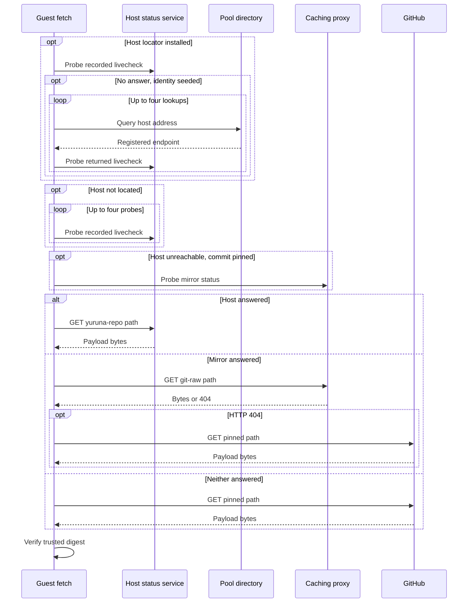

An explicit `EXEC_BASE_URL` skips this resolution; an `http://` value is fetched without a proxy as a host source, and any other scheme as an operator-supplied base. A guest without a global IPv4 address goes directly to GitHub. The locator probes the coordinates in `/etc/yuruna/host.env` first. With a seeded host ID and caching-proxy address, it then queries the directory up to four times, probing each returned endpoint before persisting it. The fallback probes are spaced three seconds apart. The mirror is probed only when the framework pin names a GitHub `owner/repo` and a 40-character commit.

Framework paths use `E_FB_REPO` and `E_FB_REF`, falling back to `EXEC_FALLBACK_*` and then `YURUNA_GITHUB_*` from `host.env`. `project/` payloads need their own `E_PROJECT_REPO` and `E_PROJECT_REF` pin or are refused, and a 64-character project ref cannot use the mirror. Mirror downloads ignore wgetrc and proxies, refuse redirects, and are bounded to 16 MiB and 120 seconds. Only an HTTP 404 from the mirror sends that file to GitHub; other mirror errors fail the fetch. GitHub reads use `raw.githubusercontent.com`, or the Contents API when `GH_TOKEN` is present. Payload verification requires the caller's trusted expected digest in `E_SHA` or `EXEC_SHA256`; runner-issued fetches supply `E_SHA` with `EXEC_REQUIRE_SHA256=1`. An explicit `EXEC_ALLOW_UNVERIFIED=1` permits missing-digest execution only when `EXEC_REQUIRE_SHA256=1` is not enforced, marks that provenance as unverified, and is unset before the payload runs. A supplied digest mismatch is re-fetched once, then refused.

Guest updaters such as [ubuntu.update.sh](../../guest/shared/ubuntu.update.sh) materialize checkouts through `yuruna_materialize_repositories` in [yuruna-retry.sh](../../automation/yuruna-retry.sh). The framework comes from the host's committed tarball, retried once after a directory relocation. Otherwise the pinned commit is fetched from the mirror's `/git/` path, then from GitHub, and HEAD must match before the checkout is renamed into place. Without a pin, the legacy unpinned clone remains. The project falls back from the host's project tarball to a clone of `projectUrl`.

## Pool telemetry

When installed, the aggregator in [main.go](../../test/extension/pool-aggregator-service/main.go) periodically discovers and polls host status services and reads new cycle events. [Invoke-PoolPushForwarder.ps1](../../test/modules/Invoke-PoolPushForwarder.ps1) and [Test.PoolPush.psm1](../../test/modules/Test.PoolPush.psm1) add an optional authenticated push after a cycle.

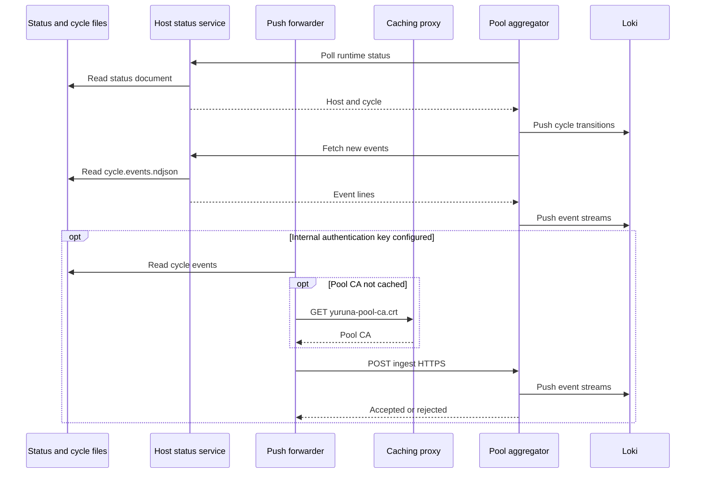

The default poll interval is 30 seconds. Discovery combines Squid access-log client addresses, hosts already known, and host self-announcements. Push uses the internal authentication key over HTTPS pinned to the pool CA, which the forwarder fetches over HTTP from Apache on the cache VM on first use, caches as `runtime/pool-ca.crt`, and refreshes once when a batch fails. The aggregator binds pushed lines to the host already discovered at the sender's address and returns 503 when no key is configured. Forwarding is detached, uses bounded HTTP calls, and stops at the first failed batch. Pull remains the discovery and backfill path when push is absent or fails. [Test.PoolNotifier.psm1](../../test/modules/Test.PoolNotifier.psm1) separately evaluates pool alert gauges and, when configured, maintains delivery state and sends through the notification extension.

## Cached image download

The host driver's `Resolve-CacheHostIp` finds the caching-proxy service and probes its HTTP listener; [Yuruna.HostDownload.psm1](../../host/modules/Yuruna.HostDownload.psm1) probes the bump listener and Apache, fetches the CA (trusted only by this process), and implements `Save-CachedHttpUri`. [caching-proxy-service.base.user-data](../../host/vmconfig/caching-proxy-service.base.user-data) configures Squid, its disk cache, and the Apache endpoint serving the bump CA. [Yuruna.Image.psm1](../../host/modules/Yuruna.Image.psm1) supplies the Ubuntu origin illustrated here.

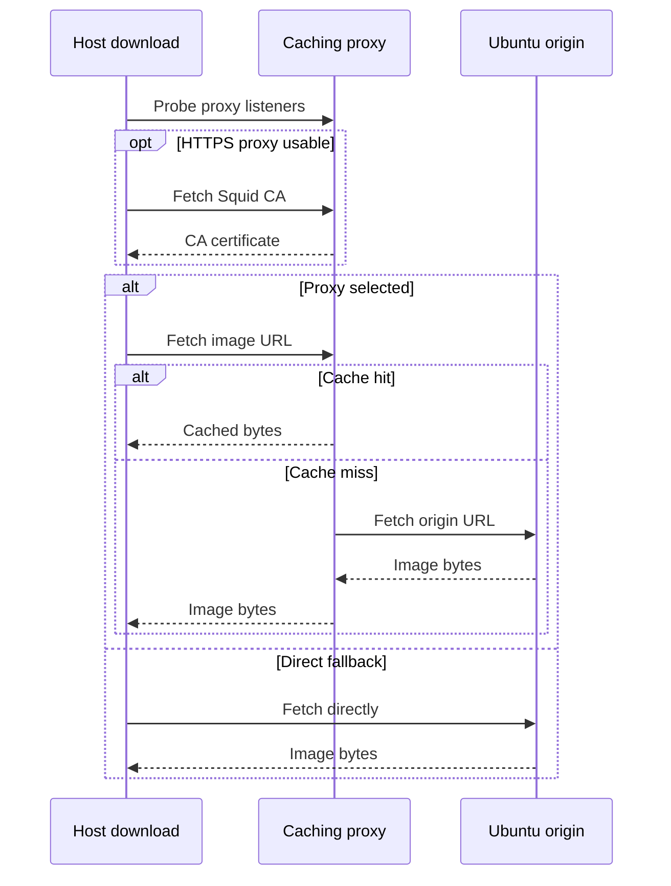

HTTPS proxying requires the bump listener and usable CA material. The helper goes direct when no proxy is usable; a proxied transfer that fails is not retried direct. Squid's response cache stays on the service VM at `/var/spool/squid`. Image integrity checks are independent of transport selection.

Guest scripts choose payload sources separately; [Guest fetch source routing](#guest-fetch-source-routing) traces that order.

## Pool storage layout

[Test.PoolStorage.psm1](../../test/modules/Test.PoolStorage.psm1) derives archive paths from `networkStorage.poolStorageLocalPath`. The seeded download-agent and pool-control guests mount the configurable pool share at `/mnt/yuruna-pool`; the conventional share is `yuruna.pool`, accessed by the `yuruna-pool` account. The root and its six areas fit in seven boxes; the dashed area exists only when a host subscribes to pool alerts.

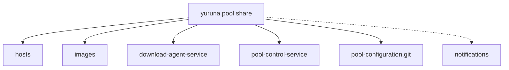

| Pool-relative path | Contents and source |
|---|---|
| `hosts/info.<hostId>.yml` | Identity and hardware fingerprint from [Test.HostIdentity.psm1](../../test/modules/Test.HostIdentity.psm1). |
| `hosts/<hostId>/test-cycles/<cycle>/` | Cycle evidence and `.yuruna-complete` from [Test.PoolStorage.psm1](../../test/modules/Test.PoolStorage.psm1). |
| `hosts/<hostId>/services/caching-proxy-service/` | Optional Loki, Prometheus, and Grafana replication from the [proxy seed](../../host/vmconfig/caching-proxy-service.base.user-data). |
| `images/<hostType>/<imageKey>/` | Generations, `.meta.json`, current pointers, `.staging/`, and `manual/` from the [image store](../../test/extension/download-agent-service/server/internal/imagestore/store.go). |
| `images/.agent-lease.json` | Single-writer lease from [lease.go](../../test/extension/download-agent-service/server/internal/imagestore/lease.go). |
| `download-agent-service/` | `audit.jsonl` and `status.json` from [agent state](../../test/extension/download-agent-service/server/internal/state/state.go). |
| `pool-control-service/` | `audit.jsonl` and `status.json` from [control state](../../test/extension/pool-control-service/server/internal/state/state.go), and `discovered-hosts.json` from the [host scan](../../test/extension/pool-control-service/server/internal/httpsrv/scan.go). |
| `pool-configuration.git/` | Bare configuration repository (`pools.yml`, optional `guests.compatibility.yml`) seeded when absent by [New-Lab.ps1](../../test/lab/New-Lab.ps1), the [pool administration scripts](../../test/modules/Test.PoolAdmin.psm1), the [pool-control installer](../../guest/ubuntu.server.26/ubuntu.server.26.pool-control-service.sh), or the [cache seed](../../host/vmconfig/caching-proxy-service.base.user-data). Installers and New-Lab rename a legacy `pool-intent.git` into place. |
| `notifications/{outgoing,sending,delivered,failed}/` | Pool-alert spool messages from [Test.PoolNotifier.psm1](../../test/modules/Test.PoolNotifier.psm1), written at cycle end by a host whose `transports.yml` subscribes to `pool.alert`. |

Shares from before the `hosts/` layout keep frozen `<hostId>/` roots that are never read or migrated; [Remove-PoolHost.ps1](../../test/pool/Remove-PoolHost.ps1) deletes them. Write probes and temp-then-rename files appear only briefly. The cache VM mounts pool storage read-write at `/mnt/ypool-nas` when pool storage is configured. It serves `pool-configuration.git` read-only over HTTP (`/pool-configuration.git`, legacy alias `/pool-intent.git`), reads `hosts/` archives through the aggregator, and replicates its services hourly. Its Git mirror worker reads `pools.yml` from that repository to register pool repositories and writes nothing to the share.

Stash uses a separate share and account through `stashStorageNetworkPath`, `stashStorageNetworkUser`, and `stashStorageLocalPath`; the conventional share is `yuruna.stash`, accessed by the `yuruna-stash` account. [New-LocalLabStorage.ps1](../../test/lab/New-LocalLabStorage.ps1) can provide both shares on a lab host, while runtime configuration also supports a NAS.

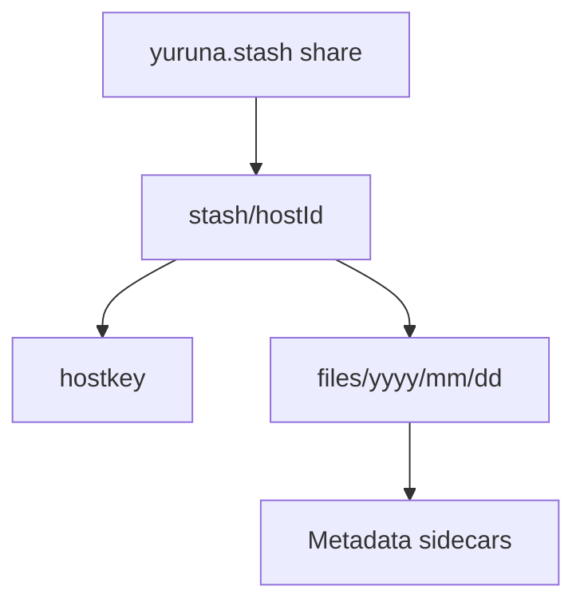

The stash VM mounts this share at `/mnt/ystash-nas` and selects its own `stash/<hostId>/` folder. `hostkey/` holds the stash daemon's SSH host key, and `files/yyyy/mm/dd/` holds each upload beside its `.yuruna.meta.json` sidecar. The SQLite index and the offline buffer stay on the stash VM; [Stash upload and retrieval](#stash-upload-and-retrieval) traces their use.

## Per-host cycle archive

Cycle-end hooks in [Test.RunnerOuterLoop.psm1](../../test/modules/Test.RunnerOuterLoop.psm1) launch [Invoke-PoolStorageDrain.ps1](../../test/modules/Invoke-PoolStorageDrain.ps1) for copy mode. Move mode runs the drain synchronously after a bounded wait for the push forwarder; each mount, copy, and delete is time-bounded, but the phase as a whole is not. The pool-storage participant groups the drain and [Test.PoolStorage.psm1](../../test/modules/Test.PoolStorage.psm1).

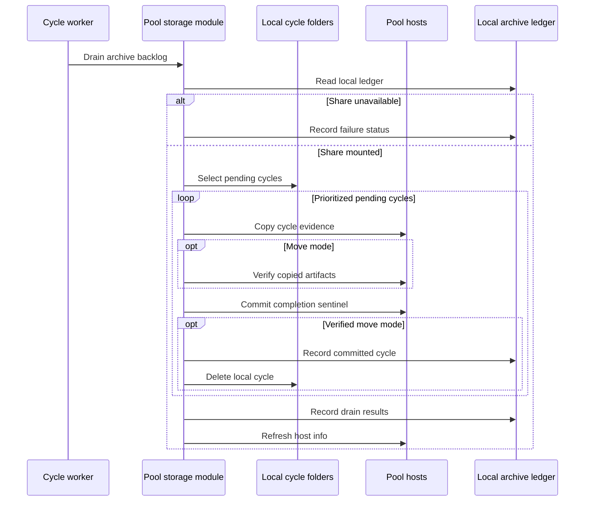

Move mode excludes `.incomplete` cycles; copy mode can include them. Archive names use stable cycle identities, flattening local history buckets and removing transient suffixes. When more than 100 cycles are pending, each drain takes the 20 newest and then the oldest. A busy drain lock skips the drain without touching the ledger. A missing vault credential, unreachable SMB port, or failed mount records failure status in the ledger and stops the drain. Move commits follow verification, completion sentinel, local ledger, then local deletion; copy mode retains its source and does not request the extra verification. In move mode, recovery can adopt an existing committed sentinel and finish interrupted deletion. `poolstorage.state.json` and the drain lock stay on the host, and host-info refresh is best-effort after any drain that mounted the share.

Move-mode admission checks projected free space before the next inner starts; a full share detected after a passing inner can change the cycle verdict to failure.

The cache VM's separate replication timer in [caching-proxy-service.base.user-data](../../host/vmconfig/caching-proxy-service.base.user-data) targets the host's `services/caching-proxy-service/` subtree.

## Download agent and shared images

[Yuruna.DownloadAgent.psm1](../../host/modules/Yuruna.DownloadAgent.psm1) sends ensures, polls first downloads, streams generations, and verifies SHA-256. The daemon's [refresh.go](../../test/extension/download-agent-service/server/internal/imagestore/refresh.go), [store.go](../../test/extension/download-agent-service/server/internal/imagestore/store.go), and [lease.go](../../test/extension/download-agent-service/server/internal/imagestore/lease.go) implement single-flight refreshes, writer leasing, promotion, and publication. [config.go](../../test/extension/download-agent-service/server/internal/config/config.go) and the [guest installer](../../guest/ubuntu.server.26/ubuntu.server.26.download-agent-service.sh) define storage paths.

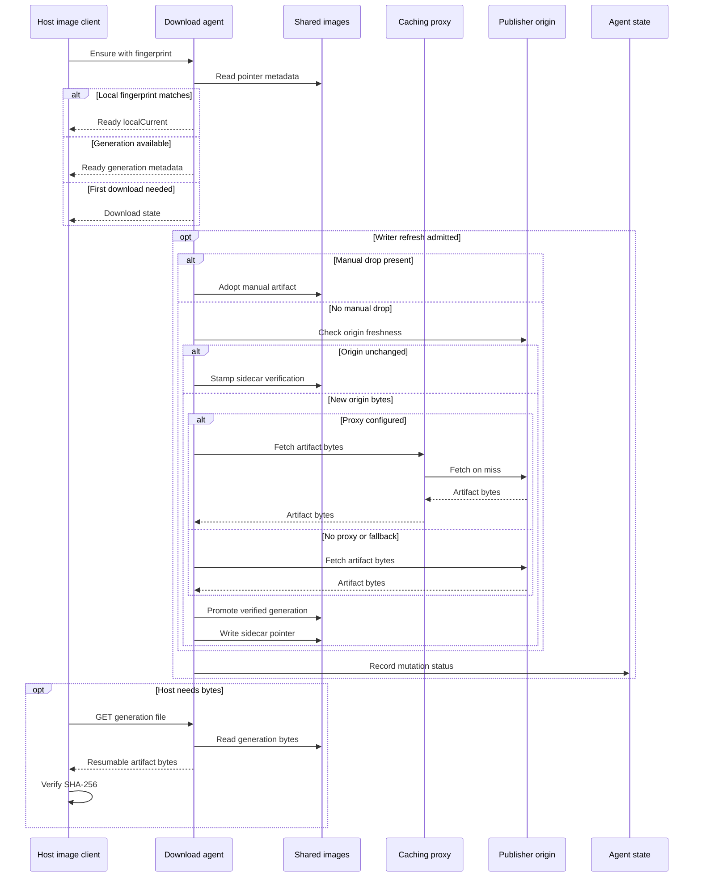

A matching local fingerprint returns immediately even when origin freshness has expired. A stale verified generation remains servable during refresh; a read-only lease follower can serve it without promising a refresh. With no generation, first downloads report progress or failure, and lease followers cannot start them. An unavailable pool refuses ensures. Host callers can fall back to their original publisher path through [Yuruna.Image.psm1](../../host/modules/Yuruna.Image.psm1).

For a best-effort image family, [manual.go](../../test/extension/download-agent-service/server/internal/imagestore/manual.go) adopts an operator's drop before any resolver or origin request and commits it as the new generation. `Agent.Run`/`ScanOnce` acquires or renews the lease on scan cadence, independently of ensures. Origin verification bypasses the cache-capable byte client. A broken proxy stream restarts the fetch direct, and proxied bytes that fail origin verification are fetched again direct. Publisher checksum verification depends on the image family; the host's agent-hash comparison is a separate transfer check. Generation bytes and metadata exist before the current pointer is replaced.

## Pool control and configuration synchronization

HTTP handlers in [handlers.go](../../test/extension/pool-control-service/server/internal/httpsrv/handlers.go) invoke public [pool administration scripts](../../test/pool/) through [configuration.go](../../test/extension/pool-control-service/server/internal/configuration/configuration.go). [Test.PoolSync.psm1](../../test/modules/Test.PoolSync.psm1) fetches `pool.configurationGitUrl` into a private runtime checkout and derives membership from `pools.yml`. [Set-LabToken.ps1](../../test/lab/Set-LabToken.ps1) seeds that URL as the cache VM's read-only `http://<proxy>/pool-configuration.git`; a runner never holds a writable remote. The seeded [guest installer](../../guest/ubuntu.server.26/ubuntu.server.26.pool-control-service.sh) uses the share's `pool-configuration.git` and `pool-control-service/`; another configuration URL can be configured.

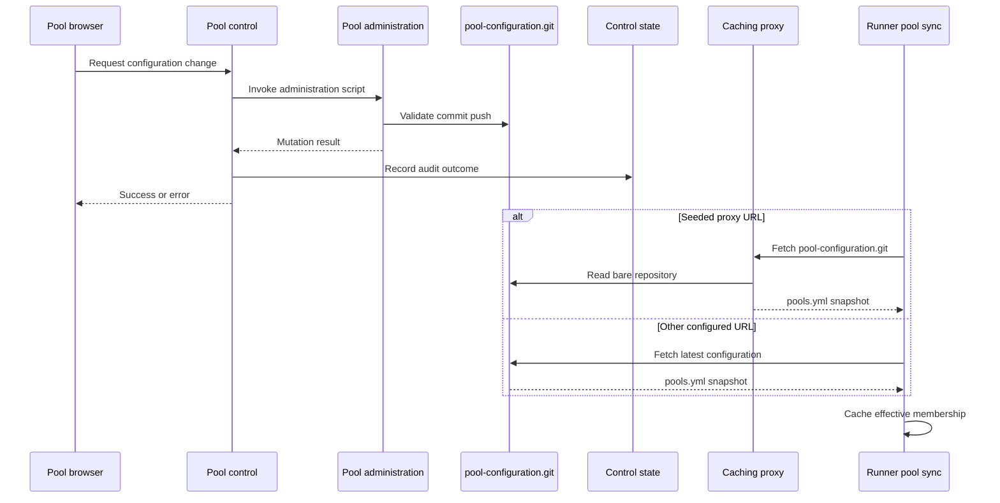

[Control state](../../test/extension/pool-control-service/server/internal/state/state.go) persists audit and health data. Runner sync retains the last good checkout during transient fetch failure and upgrades schema version 2 and 3 documents to version 4 in memory; [Update-PoolConfigurationSchema.ps1](../../test/pool/Update-PoolConfigurationSchema.ps1) persists that upgrade. When the current key is absent, the pool-control guest still reads the legacy `YURUNA_POOL_INTENT_GIT_URL` line in `/etc/yuruna/pool.env` and `POOL_CONTROL_INTENT_GIT_URL` in its service environment file. Guest compatibility is read by administration validation and by the runner's planner from the project checkout, not by the sync. Effective configured state `run` admits ordinary dispatch, `paused` causes periodic configuration rechecks, and `drain` ends the runner at a dispatch boundary. Pool control also exposes host-control and refresh routes; [Lifecycle state](04-lifecycle-state.md) describes the independent runner refresh gate.

## Stash upload and retrieval

Browser [new.js](../../test/extension/stash-service/server/internal/httpsrv/web/assets/new.js) creates stashes and [stash.js](../../test/extension/stash-service/server/internal/httpsrv/web/assets/stash.js) downloads them through routes in [handlers.go](../../test/extension/stash-service/server/internal/httpsrv/handlers.go). Browser uploads enter through [ingest.go](../../test/extension/stash-service/server/internal/sshsrv/ingest.go), SCP and SFTP uploads through [sshsrv.go](../../test/extension/stash-service/server/internal/sshsrv/sshsrv.go), and all three share its pending, target, and commit steps and [store.go](../../test/extension/stash-service/server/internal/store/store.go) finalization. [flush.go](../../test/extension/stash-service/server/internal/sshsrv/flush.go) moves buffered uploads when the share returns.

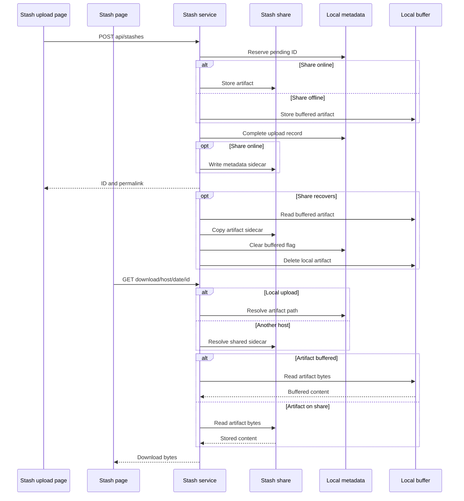

[stash-service.base.user-data](../../host/vmconfig/stash-service.base.user-data) mounts the dedicated share at `/mnt/ystash-nas`. [ubuntu.server.26.stash-service.sh](../../guest/ubuntu.server.26/ubuntu.server.26.stash-service.sh) selects `stash/<hostId>/`, containing `hostkey/` and `files/yyyy/mm/dd/`. Committed artifacts carry `.yuruna.meta.json` sidecars so metadata survives a service reimage. Other hosts' uploads resolve through those sidecars; their unflushed local buffers are unavailable through the share.

The SQLite index `stash.sqlite` stays in `/var/lib/stash-service/metadata`; the offline buffer stays in `/var/lib/stash-service/buffer`. [config.go](../../test/extension/stash-service/server/internal/config/config.go) defines these paths and the buffer ceiling. An unavailable share causes buffering; reaching the fixed 5 GB ceiling rejects new uploads. Without configured stash storage, the installer selects the local fallback `/var/lib/stash-service/share-local`.

## The stderr.log / rc sidecar contract

Deployment logs ending in `.stderr.log` contain captured stdout and stderr. Producers are [Yuruna.Resource.psm1](../../automation/Yuruna.Resource.psm1), [Yuruna.Component.psm1](../../automation/Yuruna.Component.psm1), [Yuruna.Workload.psm1](../../automation/Yuruna.Workload.psm1), and [Yuruna.Retry.psm1](../../automation/Yuruna.Retry.psm1). Sections identify their command or label and `exit=N`; retries include attempt information. The companion `.rc` contains the most recently completed logged operation's native exit code, which can differ from aggregate phase success.

| Producer | Project-relative log | Companion |
|---|---|---|
| Resource | `.yuruna/<cloud>/resources/<resourceName>/tofu.stderr.log` | `tofu.rc` |
| Component | `.yuruna/<cloud>/components/docker.stderr.log` | `docker.rc` |
| Local chart | `.yuruna/<cloud>/workloads/<context>/<installName>/helm.stderr.log` | `helm.rc` |
| Other workload | `.yuruna/<cloud>/workloads/<context>/<tool>.stderr.log` | `<tool>.rc` |

Resources reset the pair at each pass, then capture init, plan or apply, and output through the retry helper. Components reset once per phase and append every component's configured commands. Local charts reset per chart and log lint and installation; pending-release recovery output is appended when needed, but recovery/status probes do not each rewrite `helm.rc`. Other workload kinds append by tool and update sidecars after the retry helper returns.

[Get-SystemDiagnostic.ps1](../../automation/Get-SystemDiagnostic.ps1) recursively scans beneath its framework root with `-Force` for `*.stderr.log`, bounded to depth 12, the first 100 files, and a 10-second deadline. It reports the companion sidecar and displays the last 64 KiB of large logs. Separate gap heuristics compare OpenTofu state and the `globalVariables` namespaces in `resources.output.yml` with the cluster. A native zero exit is insufficient to establish overall success: chart deployment also rejects terminal Helm error output, and diagnostics can detect resources without releases.

---

[Architecture](../architecture.md) | [Design overview](README.md)
