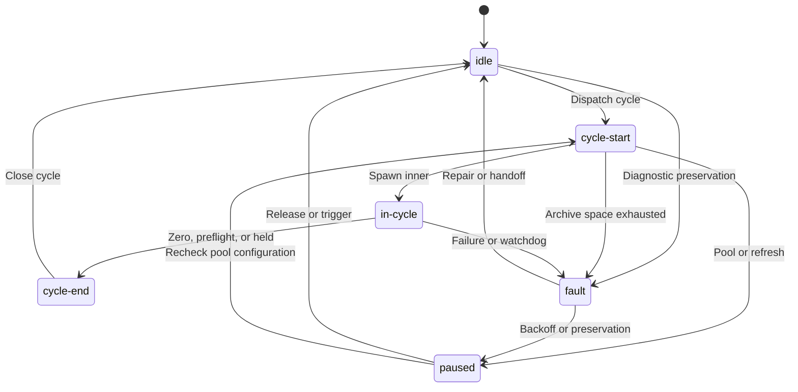
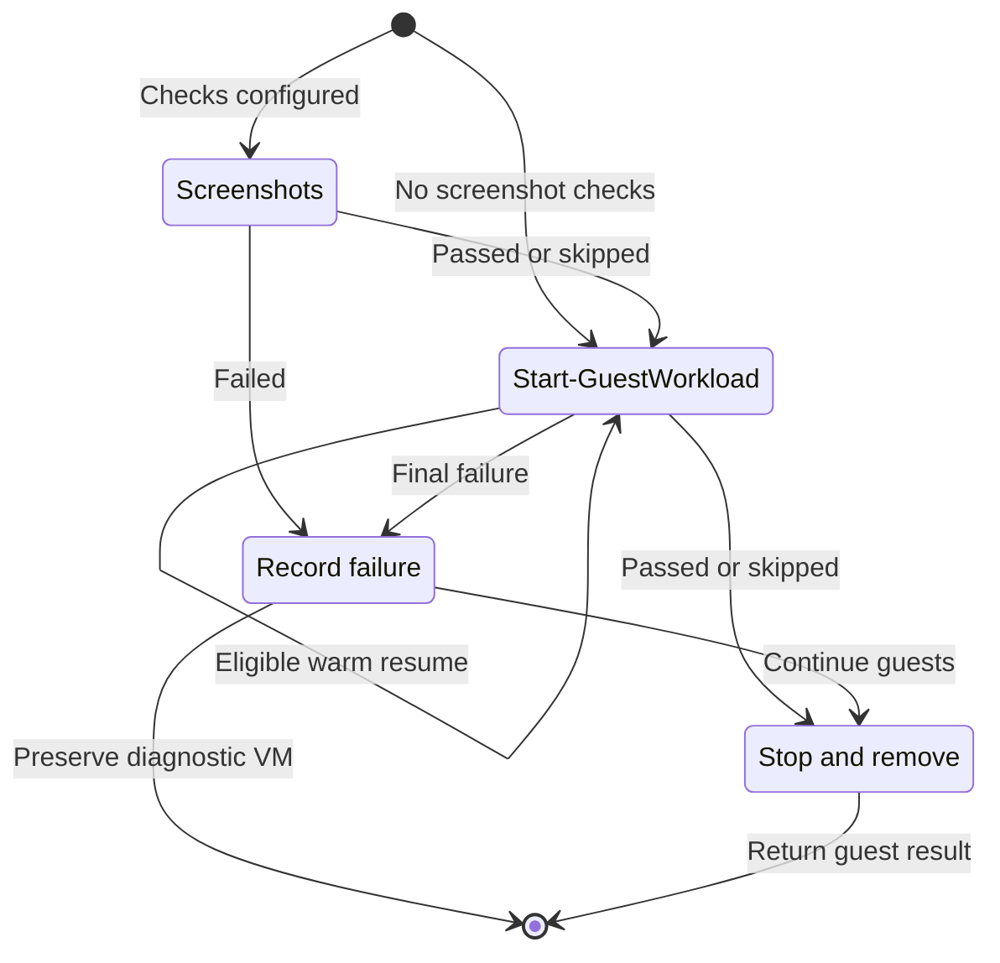
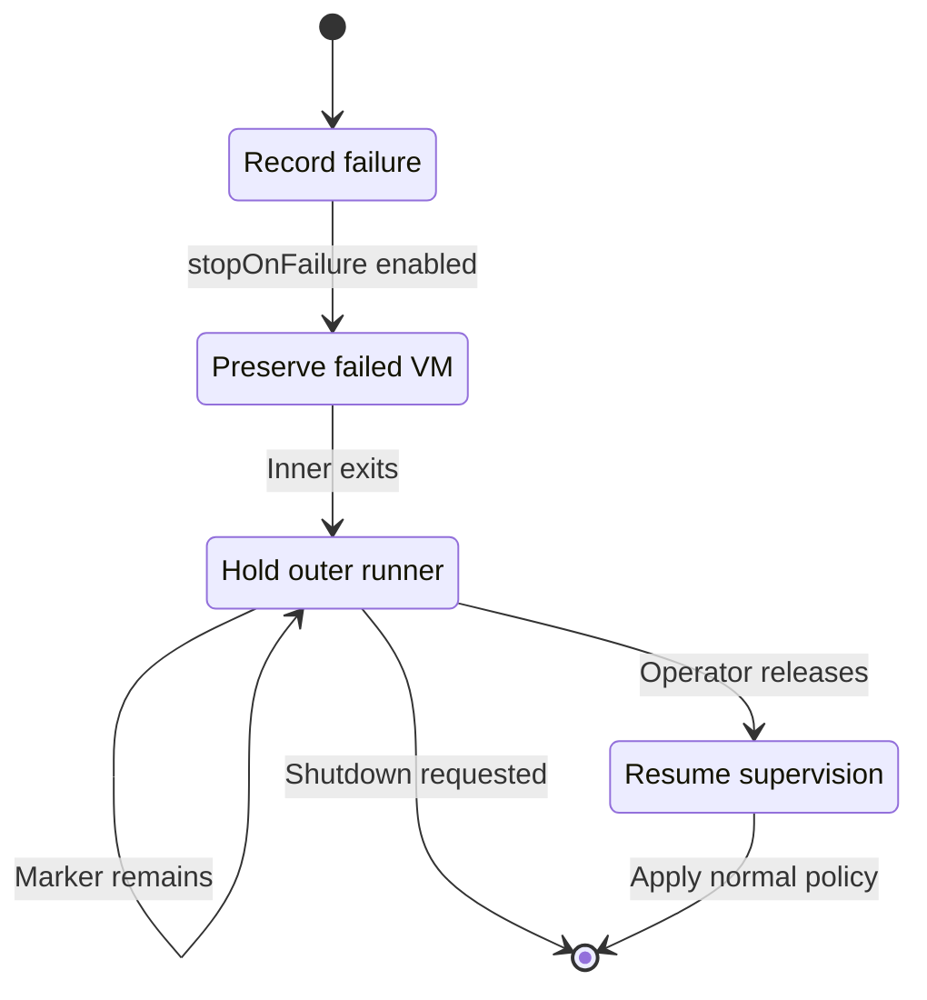
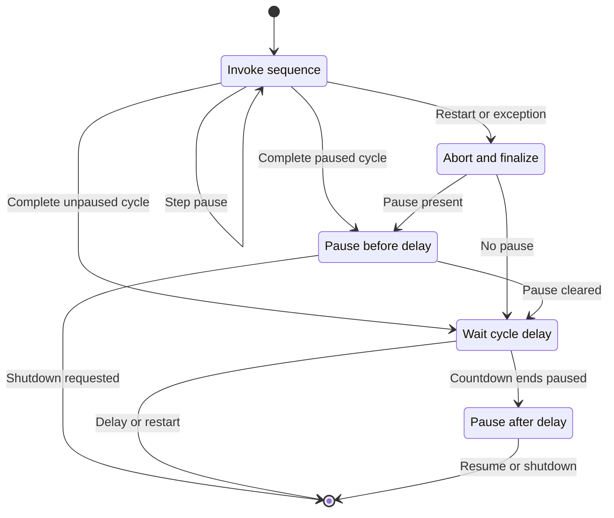
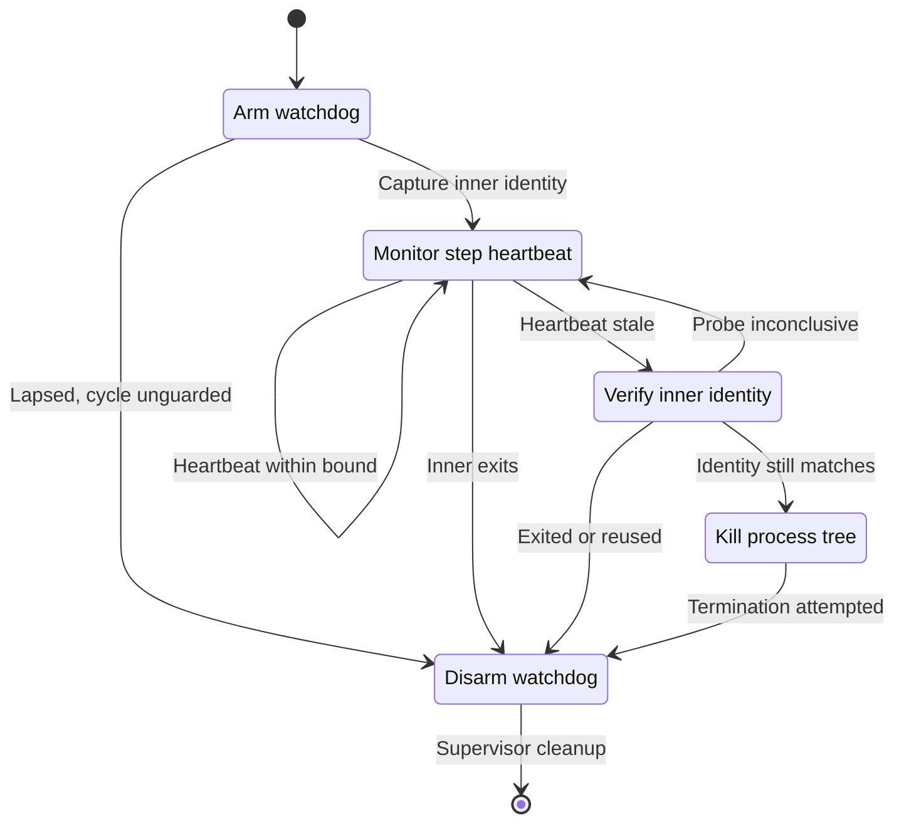
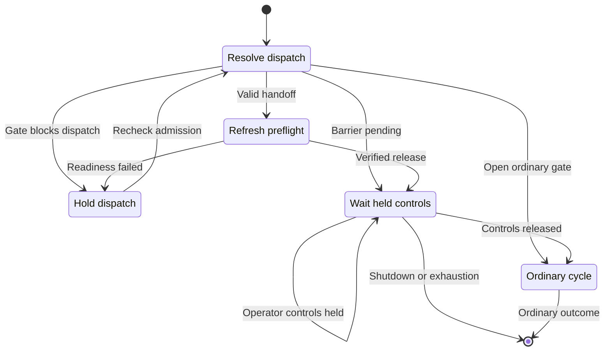

# Runner lifecycle state

This page maps runner telemetry, guest stages, diagnostic preservation, and recovery controls to the current public test harness.

[Yuruna Architecture](../architecture.md) defines the capability model; [Runtime data flows](03-data-flows.md) traces the exchanges. Each view contains at most seven elements, including start/end markers. State aliases use underscores where Mermaid's state grammar requires them; only the first view describes the persisted runner enum.

## Persistent outer lifecycle

[Test.RunnerState.psm1](../../test/modules/Test.RunnerState.psm1) declares six states, their transition matrix, `runner.state.json`, and `runner_state_transition` events. [Start-TestRunner.ps1](../../test/Start-TestRunner.ps1) initializes state and enters [Test.RunnerOuterLoop.psm1](../../test/modules/Test.RunnerOuterLoop.psm1). The diagram shows the declared transition pairs with their common runtime causes; holds and dispatch outcomes are not additional enum values.

The persistent outer starts a fresh [Invoke-TestCycleRunner.ps1](../../test/modules/Invoke-TestCycleRunner.ps1), which starts a fresh [Invoke-TestRunnerInnerLoop.ps1](../../test/modules/Invoke-TestRunnerInnerLoop.ps1). The cycle worker reloads cycle code and owns inner supervision and end hooks; the inner owns guest work, finalization, boundary cleanup, and configured cycle delay. `idle` means the supervisor is ready, rather than describing a VM.

Startup with a different prior run ID and unfinished state emits a synthetic transition from that prior state to `fault`, followed by `idle`. The validator warns about unexpected transition pairs but still persists telemetry. A missing, malformed, or mismatched cycle-outcome record is reported separately from a completed test verdict; a zero process exit without its expected record is insufficient to declare success.

Framework pull errors, process-creation failures, and very early unexplained cycle-worker aborts use short interruptible holds. These holds make no state transition, so the next dispatch records an undeclared `cycle-start` or `in-cycle` to `cycle-start` pair that the validator warns about. With automatic remediation enabled, a pull error from a stale Git lock is repaired and retried immediately. Pool `paused` rechecks configuration after a short hold; `drain` stops at dispatch. Move-mode archive-space exhaustion can fault before an inner starts or change a passing inner's cycle verdict afterward. `refresh-gated` short-holds without ordinary verdict accounting: a hold before the pull changes no state, a hold before the wipe moves `cycle-start` to `paused`, and a hold inside the inner closes through `cycle-end` to `idle` with a refresh reason.

## VM provisioning

`Invoke-GuestProvisionIteration` in [Test.RunnerInnerLoop.psm1](../../test/modules/Test.RunnerInnerLoop.psm1) performs the four named steps below. The [host contract](../../host/Yuruna.Host.Contract.psm1) is implemented by [windows.hyper-v](../../host/windows.hyper-v/), [ubuntu.kvm](../../host/ubuntu.kvm/), and [macos.utm](../../host/macos.utm/). `New-VM.Resource` polls VM running state; it is distinct from the deployment command `Set-Resource.ps1`.

The final marker leaves this view for validation or failure policy. Before guest iteration, the cycle resolves configuration and sequences, prepares images, and applies admission, bootstrap, and host-health gates. The iteration removes a same-name remnant and, on hosts with four or fewer logical processors, force-stops other running guests of this cycle; preamble admission has already refused competing VMs. Guests remain serialized.

Start sequences that power the guest off use the `stopVm` action in [Test.SequenceHandler.psm1](../../test/modules/Test.SequenceHandler.psm1): the driver's `Stop-VM -ShutdownTimeoutSeconds -NoForce` requests the shutdown, and the stopped state is observed through the host. A guest that ignores the request leaves console frames, OCR text, the observed state, the livelock verdict, and the first guest-silence marker, and `Start-GuestOS` fails as `wait_timeout`. With `forceOnTimeout`, the VM is turned off with a recorded `guest-shutdown` degradation and the sequence continues. `startVm` shares the same stopped-wait evidence.

[Test.GuestQuarantine.psm1](../../test/modules/Test.GuestQuarantine.psm1) can skip repeatedly failing guests until their configured skip budget or a framework/project revision change releases them. Preflight and image failures can skip a guest before VM creation. These decisions do not create extra persisted lifecycle states.

## Validation and cleanup

The inner runs configured screenshot checks and [Test.Start-GuestWorkload.psm1](../../test/modules/Test.Start-GuestWorkload.psm1) sequences. `Complete-GuestStepFailure` records the failed step and preserves evidence before applying `stopOnFailure`.

Workload sequences are skipped when none apply. Eligible transient workload failures can resume on the same live VM from a permitted checkpoint or restore point, bounded by `testCycle.warmResume.maxAttempts` (default 2). Unsafe replay or unsuccessful retries leave the failure to normal handling.

Passing guests release DHCP, force-stop, and remove the VM. Teardown forces deliberately because the disk is deleted next; the graceful `Stop-VM` path serves steps that keep the disk. If a VM still runs after retrying removal, cleanup fails and the runner refuses to start the next guest. Failed guests are removed when `stopOnFailure` is false. When true, the guest loop breaks, the cycle result is finalized, and the inner exits before its normal boundary sweep and delay.

`Complete-CycleRun` seals the transcript and overall result; when rebuilt guests received different addresses, it fails an otherwise passing cycle as `dhcp_identity_unbounded`. Failure evidence includes the Hyper-V `serial-console.log` captured from COM1 during the cycle. The `failuresBeforeAlert` threshold, the armed latch, and successful rearm streaks gate notifications; the crash streak drives only backoff and the abort. Bounded artifact capture can fail without replacing the original error. Authentication vault keys are reused across cycles and retained after passing and failing results, through `Initialize-CycleAuthVault`.

## Durable diagnostic preservation

[Test.DiagnosticPreservation.psm1](../../test/modules/Test.DiagnosticPreservation.psm1) implements `diagnostic-preserve.json`. The failure handler writes the hold before diagnostic capture can throw or hang. The outer checks it both before dispatch and before automatic refresh or recovery; the hold therefore survives repository updates and runner restarts.

The outer reports `fault` then `paused` while evidence is held. Removing the marker or explicitly setting the Boolean `testCycle.stopOnFailure` to false releases the hold. Missing/unreadable configuration and corrupt/nonregular preservation markers keep it held. A completed failed cycle lacking its expected marker can receive an unknown-VM fallback hold; if that hold cannot be persisted, the outer requests shutdown.

Release returns supervision to its normal outcome policy, which may still include failure backoff before another cycle. A revision change or restart marker alone does not release preservation. Subsequent ordinary cleanup can remove the failed VM after release; [Remove-TestVMFiles.ps1](../../test/Remove-TestVMFiles.ps1) also provides explicit operator cleanup.

## Pause, restart, and cancellation

The status listener in [Start-StatusService.ps1](../../test/service/Start-StatusService.ps1) serves dashboard controls as runtime flag files; [Test.StatusControlRoute.psm1](../../test/modules/Test.StatusControlRoute.psm1) supplies its bounded request, reply, and worker-launch helpers. [Test.SequenceEngine.psm1](../../test/modules/Test.SequenceEngine.psm1) handles step-boundary pause and restart markers. The inner handles finalization, boundary cleanup, pause, and delay in this separate control view.

The abort state groups best-effort active-VM removal and one-time finalization. Emergency removal and the normal boundary sweep respect diagnostic preservation. The ordinary path seals the run and attempts cleanup before boundary waits; `stopOnFailure` takes its earlier exit. An unhandled exception other than a restart increments the crash streak; at three consecutive crashes the inner exits, and otherwise it waits a jittered backoff (30 seconds doubling to a 300-second cap) that refreshes the step heartbeat before the boundary sweep.

Step pause refreshes the step heartbeat while waiting before another action. Cycle pause holds at a boundary. Clearing a pre-delay pause permits the configured countdown. A cycle pause armed during countdown is honored after the countdown ends; clearing it then returns without repeating the delay.

A sequence restart throws `YurunaCycleRestart`; the inner catches it, finalizes once, and follows its exit path. A restart marker during delay ends the wait; the inner verdict still controls subsequent outer failure handling. [Invoke-StartCycleWorker.ps1](../../test/modules/Invoke-StartCycleWorker.ps1) confirms the listener's start-cycle reservation under the lifetime repair lock, clears pause/lab controls, requests restart, and performs bounded VM cleanup. It then rechecks runner identity before waking the resident runner or starting an absent one. Ctrl+C sets shared shutdown state; the outer stops an active cycle child's process tree.

## Watchdog

[Test.RunnerWatchdog.psm1](../../test/modules/Test.RunnerWatchdog.psm1) monitors `runner.stepHeartbeat`, independently of the timer-driven `runner.heartbeat`. This view follows its handlers and files, rather than adding runner enum states.

Defaults in [Start-TestRunner.ps1](../../test/Start-TestRunner.ps1) are 2,700 seconds for steps, 600 seconds for preamble work, and 30-second polling. `runner.phase` selects the tighter preamble bound until the inner clears it on entering the cycle body; configuration can override or disable the tighter bound. Missing step heartbeats age from watchdog arming. Preamble phases include host registration, host driver, stash address, host conditions, and VM admission. Each phase write also appends an `[inner phase]` line with PID and generation to `outer.log`, so a kill stays attributable after `runner.phase` is overwritten. When no inner is found, the watchdog writes `runner.watchdog.lapsed` and the cycle worker reports the unguarded cycle.

Completed pause polls and lab-health probes refresh the runspace step heartbeat.
A deliberate hold can therefore outlast the step timeout, while a blocked probe
or abandoned hold still ages out. The timer heartbeat alone never excuses a
stalled runspace.

The watchdog captures PID plus process start identity and rechecks before termination. A confirmed exited/reused PID disarms it; an inconclusive probe retries without killing an uncertain target. Stale matching inners and descendants are terminated. Before termination it writes `runner.watchdog-kill.json`, bound to the attempt generation, with failure class `preamble_stall` when a phase is present and `wait_timeout` otherwise. The cycle worker always stops its watchdog in `finally`.

Configuration rejection is `config_gate_failed`, rather than a crash or watchdog
stall. The inner returns the dedicated `EX_CONFIG` exit code 78, so the refusal
stays classified even if evidence cannot be written. Each gate run retains its
verdict and transcript under `runtime/runner-attempts/`;
`runner.configGate.json` points to the latest result. The retained folders are
bounded to 20 attempts, and the outer deletes the previous
`runner.configGate.json` and `runner.watchdog-kill.json` before each spawn. The
outer publishes a separate `runnerFault` with attempt time, generation,
framework commit and evidence paths. The status page and pool view show the host
failure while preserving the previous completed cycle's verdict, provenance and
pass/fail accounting. A successful gate clears the prior attempt fault; a fault
during an unfinished cycle still finalizes that cycle as failed.

## Recovery and host refresh

[Test.RecoveryLedger.psm1](../../test/modules/Test.RecoveryLedger.psm1) registers bounded repairs and keeps their attempt ledger; the outer plans them per failure through `Invoke-OuterRecovery`, gated by `testCycle.autoRemediation.enabled` (default off). [Test.Recovery.psm1](../../test/modules/Test.Recovery.psm1) runs the startup stale-state sweep. An applied repair can bypass ordinary backoff and use the next cycle for verification. Otherwise outer failure pause defaults to one hour, polling framework/project revisions and local configuration changes every five minutes; restart requests, enabled bounded repair, or the deadline can release it. Repeated stalls in the same preamble phase widen that pause while retaining early-release triggers.

Host refresh uses [Test.HostRefresh.psm1](../../test/modules/Test.HostRefresh.psm1), [Test.HostRefreshTrigger.psm1](../../test/modules/Test.HostRefreshTrigger.psm1), and the refresh dispatch/preflight/barrier handlers in both runner loops. The view below shows the existing dispatch roles; preflight and the ordinary barrier run in separate fresh cycle chains.

Closed, recovery-pending, handoff, or unreadable gates prevent ordinary pulls, spawns, and sweeps. A valid handoff admits a preflight inner, which probes the host from its final process ancestry and writes a readiness acknowledgment without ordinary Git, VM, control-sweep, or status-document work. The refresh worker or resident outer validates that acknowledgment before release. Failed preflight holds again; it is not counted as an ordinary failed test.

The first ordinary chain after refresh adopts preserved pause and lab-hold controls before VM mutation. It refreshes the step heartbeat and waits for their normal consumers; it does not delete pause flags to force progress. The normal lab-health gate handles lab-hold release or exhaustion.

Manual repair rungs are provider-specific and further constrained by qualification, privilege, and session requirements. The current automatic-refresh qualification table disables unattended refresh for every provider, and `testCycle.autoRefreshAfterStalls` defaults to zero. Declared but unavailable repair rungs are not implied operational paths in this diagram.

---

[Architecture](../architecture.md) | [Design overview](README.md)
