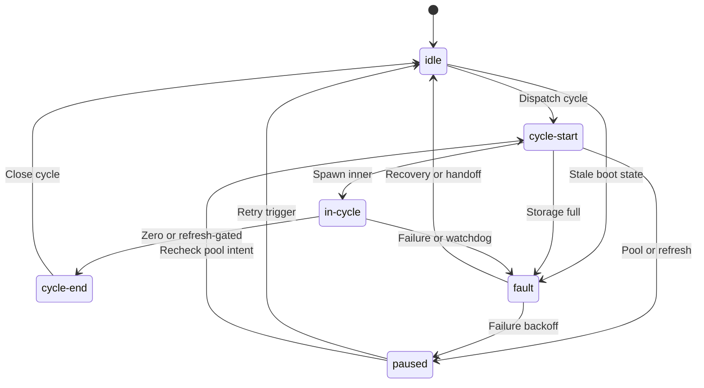
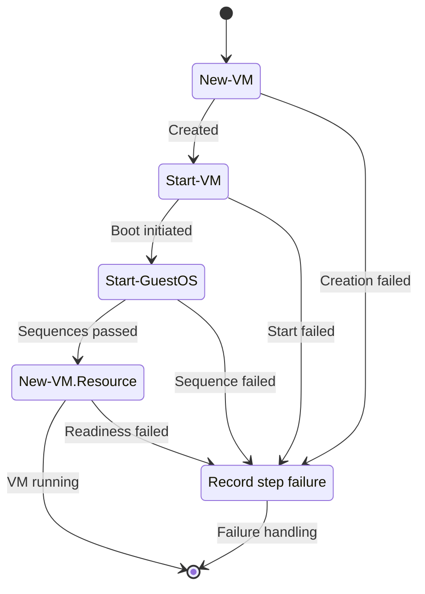
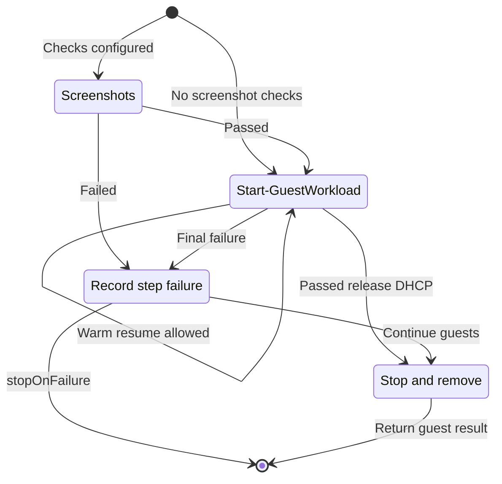
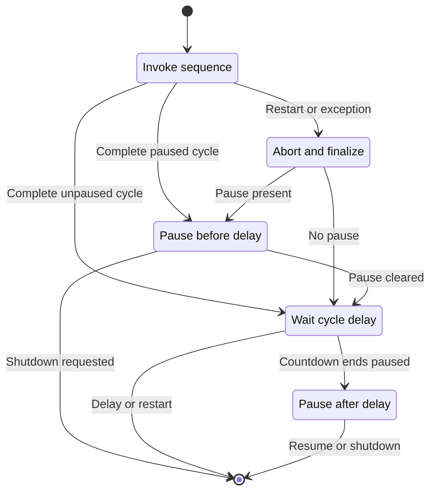

# Runner lifecycle state

This page maps persisted runner states, guest execution stages, and recovery boundaries to the current test harness.

The capability model is in [Yuruna Architecture](../architecture.md), and exchanges are shown in [Runtime data flows](03-data-flows.md). Each diagram has at most seven state boxes, counting its start and end markers; separate diagrams keep the outer lifecycle distinct from guest stages and controls. State aliases replace artifact hyphens with underscores because [Mermaid's state transition grammar](https://github.com/mermaid-js/mermaid/blob/develop/packages/mermaid/src/diagrams/state/parser/stateDiagram.jison) disallows hyphens in those IDs.

## Persistent outer lifecycle

[Test.RunnerState.psm1](../../test/modules/Test.RunnerState.psm1) defines six state names, their allowed transitions, `runner.state.json`, and `runner_state_transition` events. [Start-TestRunner.ps1](../../test/Start-TestRunner.ps1) initializes state and calls [Test.RunnerOuterLoop.psm1](../../test/modules/Test.RunnerOuterLoop.psm1). `idle` is the actual persisted ready state; it does not imply an idle guest VM.

The persistent outer dispatches a fresh [Invoke-TestCycleRunner.ps1](../../test/modules/Invoke-TestCycleRunner.ps1), which starts [Invoke-TestRunnerInnerLoop.ps1](../../test/modules/Invoke-TestRunnerInnerLoop.ps1). This three-process layout reloads cycle code and module caches every cycle. The inner owns guest work, completion, cleanup, and configured cycle delay; `cycle-end` is emitted after its successful exit. The state validator warns about an unexpected transition but still writes telemetry.

Startup recognizes a previous writer's unfinished state and synthesizes a transition from that stale state to `fault` before installing `idle`; the diagram's boot edge summarizes this recovery. Failed framework pulls, failed process creation, and very early unexplained cycle-process aborts take short interruptible holds rather than ordinary failure backoff. Move-mode pool-storage exhaustion produces a fault before spawning the inner. Pool `paused` is re-polled after a short hold; `drain` ends the outer at the dispatch boundary. An inner blocked by a refresh gate returns through `cycle-end` and `idle` without ordinary success/failure accounting.

## VM provisioning stages

`Invoke-GuestProvisionIteration` in [Test.RunnerInnerLoop.psm1](../../test/modules/Test.RunnerInnerLoop.psm1) performs these stages in order. The [host contract](../../host/Yuruna.Host.Contract.psm1) is implemented by [windows.hyper-v](../../host/windows.hyper-v/), [ubuntu.kvm](../../host/ubuntu.kvm/), and [macos.utm](../../host/macos.utm/). Labels below are actual runner step names; `New-VM.Resource` checks running VM state rather than invoking Kubernetes resource deployment.

The final marker leaves this provisioning view, continuing into validation on success or failure policy on failure. The cycle prepares images before guest iteration; admission and host-health gates also precede VM work. The iteration removes remnants for its guest and checks other running guests on constrained hosts before creating the VM. `Start-GuestOS` runs planned start sequences; `New-VM.Resource` waits for running state. Guests run one at a time. Optional quarantine skips repeatedly failing guests until its skip budget or a framework/project commit change releases them, through [Test.GuestQuarantine.psm1](../../test/modules/Test.GuestQuarantine.psm1).

## Validation and guest cleanup

[Test.RunnerInnerLoop.psm1](../../test/modules/Test.RunnerInnerLoop.psm1) invokes configured screenshot checks and [Test.Start-GuestWorkload.psm1](../../test/modules/Test.Start-GuestWorkload.psm1) workload sequences. `Complete-GuestStepFailure` records status and preserves screenshots, OCR sidecars, and diagnostic evidence before choosing whether the guest loop continues. Both the preceding and following diagrams use that same failure handler.

Workload execution is skipped when no workload sequences apply; the guest still follows success cleanup. Eligible transient workload failures can resume on the same live VM from a permitted checkpoint or restore point, bounded by `warmResumeMaxAttempts`; the original failure proceeds to failure handling when replay is unsafe or retries do not recover. Passing guests release DHCP, force-stop, and remove the VM before the next guest. Removal is checked again; a VM still running marks cleanup as failed and prevents starting another guest. Failed guests are removed when `stopOnFailure` is false; when true, the guest loop breaks, the result is finalized, and the inner exits before its normal boundary sweep and delay, retaining the failed VM. A later cycle-start sweep or operator start-cycle cleanup can remove it through [Remove-TestVMFiles.ps1](../../test/Remove-TestVMFiles.ps1).

`Complete-CycleRun` writes the overall result and seals the transcript. Failure notifications follow configured failure/crash thresholds and rearm after the configured successful streak. Bounded evidence capture can fail without replacing the original failure. Authentication vault data is reused across cycles and persists after both passing and failing results, as implemented by `Initialize-CycleAuthVault` and `Complete-CycleRun`.

## Pause, restart, and cancellation controls

[Test.StatusControlRoute.psm1](../../test/modules/Test.StatusControlRoute.psm1) implements dashboard controls. [Test.SequenceEngine.psm1](../../test/modules/Test.SequenceEngine.psm1) handles pause and restart markers at step boundaries; [Test.RunnerInnerLoop.psm1](../../test/modules/Test.RunnerInnerLoop.psm1) handles cycle-boundary pause, cleanup, and delay. The diagram states are concrete handlers, not extra persisted enum values. The final marker returns control to the supervising process.

Step pause holds the sequence before its next step and refreshes its heartbeat while waiting. Cycle pause holds after cleanup at a boundary. Clearing a pre-delay pause permits the configured countdown; a pause armed during countdown is honored only after countdown ends, and clearing that post-delay pause returns control without repeating the delay. The abort state groups active-VM removal and one-time log finalization to keep seven boxes including markers. Ordinary completion also seals the log and attempts its boundary sweep before either pause or delay; `stopOnFailure` bypasses those waits as described above.

A restart marker can interrupt a sequence via `YurunaCycleRestart`; its catch removes the active VM best-effort and closes the run once. During cycle delay the marker ends the wait; the inner's result still determines whether the outer enters failure backoff. The dashboard's [Invoke-StartCycleWorker.ps1](../../test/modules/Invoke-StartCycleWorker.ps1) clears pause and lab-hold controls, writes the restart marker, then performs bounded VM cleanup before deciding whether to signal the resident runner or spawn one. The outer can also consume the marker during failure backoff. Ctrl+C sets shared shutdown state; the outer stops a running cycle child's process tree and ends the loop.

## Watchdog and recovery

[Test.RunnerWatchdog.psm1](../../test/modules/Test.RunnerWatchdog.psm1) runs out of process against `runner.stepHeartbeat`, not timer-driven `runner.heartbeat`. Defaults in [Start-TestRunner.ps1](../../test/Start-TestRunner.ps1) are a 2,700-second step bound, a 600-second preamble bound, and 30-second polling; configuration can override the bounds. `runner.phase` selects the tighter preamble bound until the first sequence step clears it.

The watchdog captures inner PID and start identity, rechecks identity before termination, and kills the inner and descendants only when the identity still matches. An exited or recycled PID disarms it; an inconclusive process probe retries instead of terminating an uncertain target. Missing step heartbeats age from watchdog arming. The cycle worker cleans up the watchdog after the inner exits; the outer records a killed cycle as a fault even when inner finalization never ran.

[Test.RunnerOuterLoop.psm1](../../test/modules/Test.RunnerOuterLoop.psm1) updates crash counters, fault status, and failure evidence when a killed inner could not report a verdict. Ordinary failure pause defaults to one hour and polls framework commits, project commits, and local configuration changes every five minutes. A restart marker, enabled bounded repair, or deadline can also release it. Repeated stalls in the same preamble phase widen the pause while retaining early-release triggers. Cycle move-mode archive failure can turn an otherwise successful inner result into a failed cycle; archive-space checks can stop new VM work before spawning the inner.

Bounded automatic repairs are selected through [Test.Recovery.psm1](../../test/modules/Test.Recovery.psm1); an applied repair can return `fault` to `idle` and use the next cycle to verify recovery. Host refresh is separately gated through [Test.HostRefresh.psm1](../../test/modules/Test.HostRefresh.psm1) and [Test.HostRefreshTrigger.psm1](../../test/modules/Test.HostRefreshTrigger.psm1). A closed or unreadable refresh gate holds dispatch; an admitted handoff runs preflight before ordinary cycles resume. A held refresh is not a passing or failing cycle. Manual refresh availability is provider-specific; the automatic trigger qualification table currently disables unattended refresh for every provider, and `testCycle.autoRefreshAfterStalls` defaults to zero. These mechanisms do not add states to the six-state runner enum.

---

Back to [Yuruna Architecture](../architecture.md) | [Design overview](README.md)
