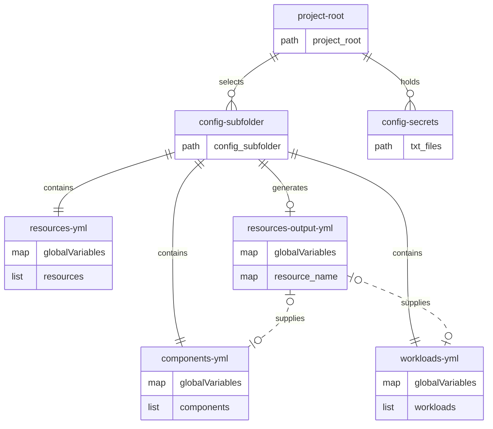
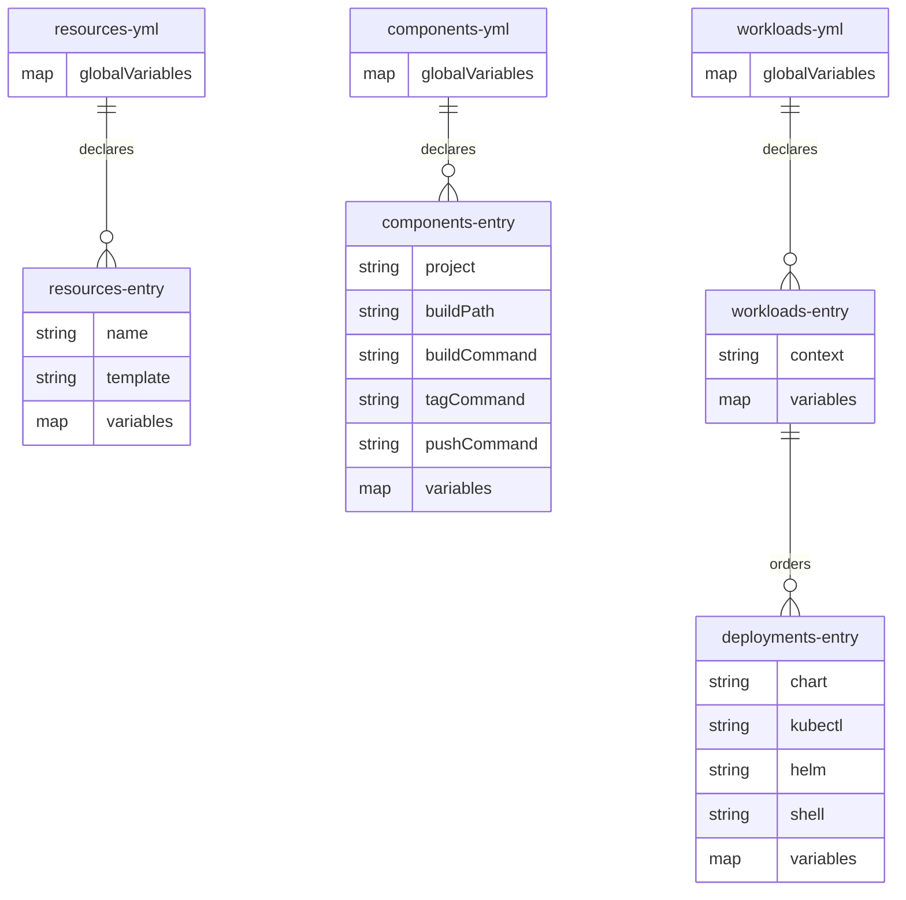
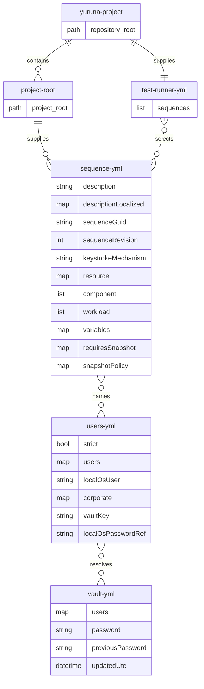

# Configuration data model

These views identify the project records, generated outputs, and credentials that the deployment engine and test harness actually read.

The entities describe filesystem scopes and YAML mappings, rather than database
tables. The [architecture](../architecture.md) supplies the phase model; these
diagrams document its data contracts.

## Project and configuration scopes

This seven-entity view groups both optional secret locations as `config-secrets`:
`config/<config_subfolder>/secrets/*.txt` and `config/secrets/*.txt`. The validator
checks their contents; it does not inject those files into the deployment
variable map. Workload validation rejects present files containing only
whitespace. The current companion examples and template do not contain these
secret folders.

`project_root` can be `example/website/`, `example/text-to-sql/`, or `template/`.
The template is itself a project root. Website configurations exist for
`localhost`, `aws`, and `azure`; the template and text-to-SQL example have
`localhost`. Neither repository has a GCP resource configuration or template.

`resources.output.yml` contains expanded globals and dynamically named resource
mappings. Each OpenTofu output normally retains its `value`, `type`, and
`sensitive` metadata. The reader exposes the value as
`<resource-name>.<output-name>` in the environment. The writer records ownership
before applying a resource, so an entry can exist before its outputs are ready.
The cleanup engine uses this manifest and the resource work folders.
Components read the selected configuration's output file when present.
Workloads also try its parent folder if the selected file is absent.

Sources: [root resolution](../../automation/Yuruna.LogLevel.psm1),
[validation](../../automation/Yuruna.Validation.psm1),
[resource writer](../../automation/Yuruna.Resource.psm1),
[component reader](../../automation/Yuruna.Component.psm1),
[workload reader](../../automation/Yuruna.Workload.psm1),
[output expansion](../../automation/Yuruna.VariableExpansion.psm1), and
[cleanup](../../automation/Yuruna.Clear.psm1). Concrete companion data:
[website configurations](https://github.com/alissonsol/yuruna-project/tree/main/example/website/config),
[text-to-SQL configuration](https://github.com/alissonsol/yuruna-project/tree/main/example/text-to-sql/config/localhost),
and [template configuration](https://github.com/alissonsol/yuruna-project/tree/main/template/config/localhost).

## Phase records

These seven entities separate document globals from list-item fields.
The `*-entry` IDs denote entries of the real `resources`, `components`,
`workloads`, and `deployments` keys. The four deployment-kind fields are
alternatives resolved by the deployment-kind catalog.

| Key | Contract used by the engine |
| --- | --- |
| `resources[].name` | Expanded name keys the output manifest and `.yuruna/<config>/resources/<name>/`. Validation rejects raw and expanded duplicate names. |
| `resources[].template` | Looks first under project `resources/<template>/`, then framework `global/resources/<template>/`. An empty template names an existing resource. |
| `resources[].variables` | Overrides resource-document globals when writing `terraform.tfvars.json`. |
| `components[].project` | Identifies the component; required and unique after expansion. |
| `components[].buildPath` | Selects `components/<buildPath>/`; defaults to the expanded `project` when omitted. |
| Component commands | `buildCommand`, `tagCommand`, and `pushCommand` use entry values with document-global fallbacks. `preProcessor` and `postProcessor` use merged variables. |
| `workloads[].context` | Selects a Kubernetes context. Validation rejects duplicate raw and expanded contexts; execution restores the original context afterward when it was read successfully. |
| `deployments[].chart` | Selects `workloads/<chart>/`; `variables.installName` is required and must be unique within the expanded context. |
| Other deployment kinds | `kubectl`, `helm`, and `shell` hold the configured command text. |

Component variables overlay resource-output globals and qualified outputs,
component-document globals, then component variables. Workload deployment
variables overlay resource outputs, workload-document globals, workload
variables, then deployment variables. Later layers replace matching keys.
Resource outputs enter these readers without expression expansion; configured
expressions expand at the phase-specific points in each reader.

Project directories provide OpenTofu templates in `resources/`, build inputs
and Dockerfiles in `components/`, and local charts or scripts in `workloads/`.
Framework [global resource templates](../../global/resources/) supply the
fallback implementations used by the examples.

Sources: [resource processing](../../automation/Yuruna.Resource.psm1),
[component processing](../../automation/Yuruna.Component.psm1),
[workload processing](../../automation/Yuruna.Workload.psm1),
[validation](../../automation/Yuruna.Validation.psm1),
[variable expansion](../../automation/Yuruna.VariableExpansion.psm1), and
[deployment kinds](../../automation/Yuruna.DeploymentKind.psm1). Example records:
[resources.yml](https://github.com/alissonsol/yuruna-project/blob/main/example/website/config/localhost/resources.yml),
[components.yml](https://github.com/alissonsol/yuruna-project/blob/main/example/website/config/localhost/components.yml),
and [workloads.yml](https://github.com/alissonsol/yuruna-project/blob/main/example/website/config/localhost/workloads.yml).

## Test identities and vault

This six-entity view separates the companion repository, individual projects,
and harness runtime credentials. Dotted relationships are name lookups.
The `users-yml` fields after `users` belong to each logical user's mapping;
the `vault-yml` fields after `users` belong to each secret-key entry.
`strict` belongs to the users document. Logical usernames and vault keys are
mapping keys.

The companion `test/test.runner.yml` selects top-level sequence names each cycle.
The sequence resolver checks project files before framework `test/sequences/`.
`sequenceGuid` persists across renames; `sequenceRevision` distinguishes sequence
shapes. The guest-sequence schema requires `description`, `keystrokeMechanism`,
and `resource`; the sequence normalizer defaults an omitted mechanism to `gui`.
Orchestration and host sequences have different shapes. The `resource` mapping
lists prerequisite sequences per guest;
`component` actions run before `workload` actions. These harness records are
distinct from the deployment YAML. `keystrokeMechanism` selects `gui` or `ssh`.
Optional `requiresSnapshot.id` identifies a reusable VM and snapshot;
`snapshotPolicy` adds provenance and age checks.

Runtime identity files live at
`test/status/extension/authentication/users.yml` and `vault.yml` in the framework
checkout. The committed `users.yml.template` bootstraps the identity mapping.
`vaultKey` selects the login secret; a configured, nonempty key must already
have a password. An empty key defaults to the logical username and permits
password generation. `localOsPasswordRef` selects the local guest-account
secret and permits generation when missing. The current pre-cycle checker
scans framework and project sequence YAML for usernames, rather than limiting
the check to selected top-level sequences. In strict mode it rejects undeclared
referenced identities and missing explicit `vaultKey` passwords.

The runtime initializes the vault only when it is absent and preserves it
across both successful and failed cycles. The older per-cycle cleanup wording
in the vault schema's description does not match this current implementation.

Sources: companion [runner selections](https://github.com/alissonsol/yuruna-project/blob/main/test/test.runner.yml)
and [website sequences](https://github.com/alissonsol/yuruna-project/tree/main/example/website/test);
framework [sequence resolver](../../test/modules/Test.SequenceResolve.psm1),
[sequence schema](../../test/schemas/sequence.schema.yml),
[users schema](../../test/schemas/users.schema.yml),
[vault schema](../../test/schemas/vault.schema.yml),
[identity template](../../test/extension/authentication/users.yml.template),
[authentication implementation](../../test/extension/authentication/default.psm1),
[pre-cycle checks](../../test/Test-Config.ps1), and
[cycle initialization and completion](../../test/modules/Test.RunnerInnerLoop.psm1).

Registry credentials follow a separate route:
[registry dispatch](../../automation/Yuruna.Component.Registry.psm1) and the
[credential providers](../../automation/Yuruna.CredentialProvider.psm1) support
Azure ACR, AWS ECR, Google Artifact Registry, Docker Hub, and generic registries
through CLI or environment credentials. They do not implicitly read the test
vault. Configured workload commands can create Kubernetes Secrets, as the
website workloads demonstrate.

The [config service](../../test/service/Start-ConfigService.ps1) uses the harness
vault for pool and stash storage credentials, combines them with
`test.config.yml` network-storage settings, and serves them over its authenticated
guest channel. See [data flows](03-data-flows.md) and
[deployment](06-deployment.md) for those consumers.

---

[Architecture](../architecture.md) | [Design overview](README.md)
