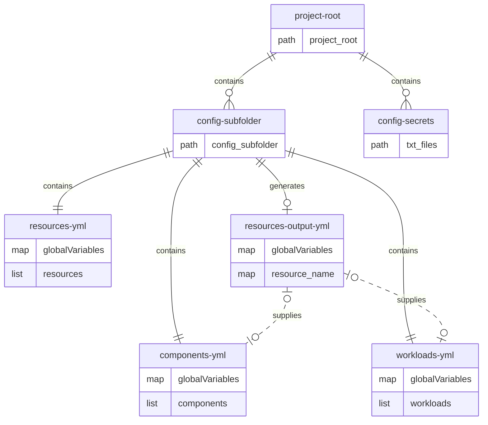
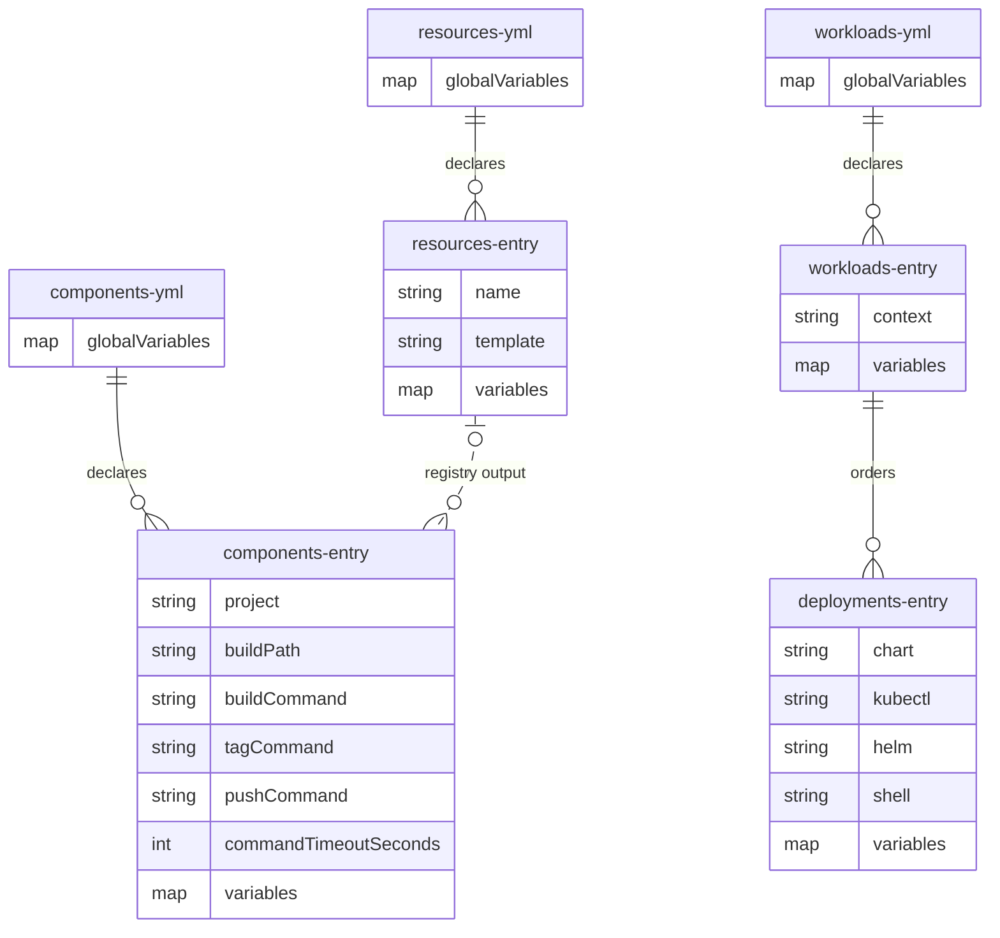
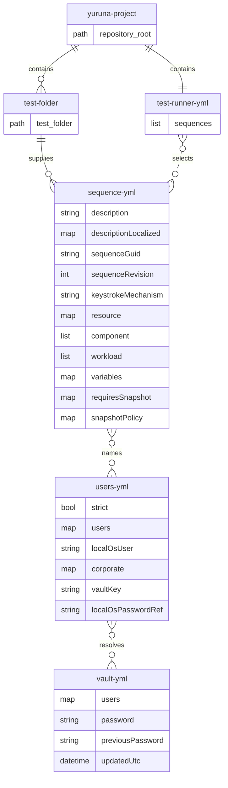

# Configuration data model

These views describe the project configuration, generated phase data, and identity mappings read by the current deployment engine and test harness.

The entities represent directories, YAML documents, and their records. They are
not database tables. [Architecture](../architecture.md) defines the deployment
phases; this page describes the data those phases exchange.

## Project configuration

The seven entities separate the selected configuration from its three input
documents and generated output. `config-secrets` groups the optional
`config/<config_subfolder>/secrets/*.txt` and `config/secrets/*.txt` locations.
Resource validation reports empty files in the configuration's own `secrets/`
without failing; workload validation checks both locations and rejects empty or
whitespace-only files. The publishers do not load these files into their
variable maps.

In the companion repository, `example/website/`, `example/text-to-sql/`, and
`template/` are project roots. The template has its configuration directly under
`template/config/`. Website supplies `localhost`, `aws`, and `azure`
configurations; text-to-SQL and the template supply `localhost`. The current
source has no GCP configuration or GCP resource-template directory.

Sources: [configuration validation](../../automation/Yuruna.Validation.psm1),
[resource publisher](../../automation/Yuruna.Resource.psm1),
[component publisher](../../automation/Yuruna.Component.psm1), and
[workload publisher](../../automation/Yuruna.Workload.psm1). Companion data:
[website configurations](https://github.com/alissonsol/yuruna-project/tree/main/example/website/config),
[text-to-SQL configuration](https://github.com/alissonsol/yuruna-project/tree/main/example/text-to-sql/config/localhost),
and [template configuration](https://github.com/alissonsol/yuruna-project/tree/main/template/config/localhost).

## Phase records and references

This seven-entity view expands the three list types and the ordered deployments
inside a workload. The `*-entry` IDs name records under the corresponding YAML
keys. Fields shown are the fields consumed by the publishers, rather than a
claim that every field is required on every record. The dotted relation is the
registry lookup described by `registryName` below.

| Record or field | Reference and constraint |
| --- | --- |
| `resources[].name` | Expanded name keys the resource output and `.yuruna/<config>/resources/<name>/`. Validation rejects duplicate raw names and expanded-name collisions. |
| `resources[].template` | Resolves project `resources/<template>/` before framework `global/resources/<template>/`. An empty template names an existing resource; the publisher skips it, so it gets no work folder, output mapping, or cleanup. |
| `globalVariables`, `resources[].variables`, chart `variables` | Validation rejects null or empty values. The `resources` list must be present; a missing `components` or `workloads` list skips that phase. |
| `registryName` | Names the registry resource. The component publisher reads `<registryName>.registryLocation` from resource outputs to choose a registry-login provider and skips login when none matches. |
| `components[].project` | Required component identity, unique after expansion. |
| `components[].buildPath` | Resolves under project `components/`; defaults to the expanded `project` value when omitted. The folder must contain `Dockerfile`, `dockerfile`, or `<project>-dockerfile`. |
| Component commands | `buildCommand`, `tagCommand`, and `pushCommand` prefer entry values and fall back to document globals. `preProcessor` and `postProcessor` come from the merged variables. |
| `components[].commandTimeoutSeconds` | Read from the entry, overriding `globalVariables.commandTimeoutSeconds`; the default is 600 seconds. The publisher requires integers from 1 through 3600. Each supervised command phase, including registry login, receives this bound. |
| `workloads[].context` | Selects an existing kubeconfig context; the operator's original context is restored afterward. Raw and expanded duplicate contexts are rejected. The publisher sets `contextName` and `workFolder` before expanding workload variables. |
| `deployments[].chart` | Resolves under project `workloads/`. `variables.installName` is required and must be unique within the expanded context. |
| `deployments[].kubectl`, `.helm`, `.shell` | `kubectl` and `helm` hold arguments that the kind catalog prefixes with the tool name; `shell` holds a PowerShell command. Each runs from `.yuruna/<config>/workloads/<context>/` with the merged variables in the environment. `chart` wins when several keys are present; otherwise the last of `kubectl`, `helm`, `shell` wins. |

Variable precedence follows the enclosing record scopes. Later layers replace
matching keys:

| Phase | Layers, lowest to highest |
| --- | --- |
| Resource inputs | Resource-document `globalVariables`, then resource `variables`. |
| Component inputs | Resource-output globals and qualified outputs, component-document `globalVariables`, component `variables`, then the publisher's `project`, `buildPath`, and `dockerfile` values. |
| Workload inputs | Resource-output globals and qualified outputs, workload-document `globalVariables`, workload `variables`, then deployment `variables`. |

Configured expressions expand at the publisher's phase-specific expansion
points. Resource outputs are already produced data and enter component and
workload readers without expression expansion. Component command phases pass
their environment changes to subsequent phases. The companion configurations
name the cluster resource after the workload `context`, so workload variables
can read that cluster's `<context>.hostname` and `<context>.frontendIp`
outputs; the engine does not enforce this convention.

Sources: [resource records](../../automation/Yuruna.Resource.psm1),
[component records](../../automation/Yuruna.Component.psm1),
[workload records](../../automation/Yuruna.Workload.psm1),
[validation](../../automation/Yuruna.Validation.psm1),
[variable layering](../../automation/Yuruna.VariableExpansion.psm1), and
[deployment kinds](../../automation/Yuruna.DeploymentKind.psm1). Concrete records:
[resources.yml](https://github.com/alissonsol/yuruna-project/blob/main/example/website/config/localhost/resources.yml),
[components.yml](https://github.com/alissonsol/yuruna-project/blob/main/example/website/config/localhost/components.yml),
and [workloads.yml](https://github.com/alissonsol/yuruna-project/blob/main/example/website/config/localhost/workloads.yml).

## Generated phase data

| Artifact | Stored data and consumer |
| --- | --- |
| `.yuruna/<config>/resources/<name>/terraform.tfvars.json` | Expanded resource inputs serialized as JSON strings for OpenTofu. Project templates take precedence over the [framework templates](../../global/resources/). |
| `.yuruna/<config>/resources/<name>/tofu.planfile` | The initialization pass's saved plan, consumed by the apply pass when present. Resource work folders also preserve Terraform state. |
| `config/<config>/resources.output.yml` | Expanded `globalVariables` plus mappings keyed by resource name. Normal OpenTofu leaves retain `value`, `type`, and `sensitive`. |
| `.yuruna/<config>/workloads/<context>/<installName>/values.yaml` | Merged deployment variables plus `contextName`, passed to Helm with the copied project chart. |
| `.yuruna/<config>/` phase folders | Timestamped input backups (newest 20 per phase), tool logs, and exit-code sidecars read by diagnostics. |

The resource writer preserves previous output mappings and records an empty
resource mapping before apply. That mapping records ownership even when apply
fails before outputs become available; it is not proof that the resource is
ready. Successful output retrieval replaces it with the OpenTofu output object.
The expansion helper exports each output value as
`<resource-name>.<output-name>`, and exports output globals without a prefix.

Components read `resources.output.yml` from the selected configuration when it
exists. Workloads first try the same location, then
`config/<config_subfolder>/../resources.output.yml` when the selected file is
absent. [Cleanup](../../automation/Yuruna.Clear.psm1) reads only the
`resources.output.yml` keys and the resource work folders; it does not infer
ownership from a successful component build. It destroys each listed resource
that still has a work folder, deletes the folder on success, and retains it with
its state on failure. Cleanup does not edit `resources.output.yml`, so the next
apply preserves its mappings. A template that produces no outputs fails the
apply, and the initialization pass refuses a work folder that already holds
`.terraform`.

Sources: [output serialization and planning](../../automation/Yuruna.Resource.psm1),
[output flattening](../../automation/Yuruna.VariableExpansion.psm1),
[component inputs](../../automation/Yuruna.Component.psm1), and
[chart values](../../automation/Yuruna.Workload.psm1).

## Test identities and vault

The six entities separate the companion repository's runner selection and
project sequences from the framework's runtime credentials. Dotted relations
are name lookups. The `users-yml` fields after `users` belong to a logical-user
entry; the `vault-yml` fields after `users` belong to a secret-key entry.

The companion [test/test.runner.yml](https://github.com/alissonsol/yuruna-project/blob/main/test/test.runner.yml)
lists top-level sequence names. The harness reads this file from its `project/`
checkout and resolves project sequences before framework `test/sequences/`.
Any directory named `test` under that checkout supplies sequences, including
`example/*/test/`, `book/test/`, and `example/nested.host/test/`; the latter two
are not project roots. A name found in two of them stops planning. Entries drop
`.yml`, `.yaml`, or `.json` suffixes, a host-specific `<name>.<host-short>.yml`
wins over `<name>.yml`, and an entry can also name a framework sequence.
Guest sequences require `description`, `keystrokeMechanism`, and `resource`
under the schema. The normalizer supplies `gui` for an omitted mechanism;
explicit mechanisms are `gui` or `ssh`. The `resource` mapping names ordered
prerequisites by guest, followed by `component` and then `workload` actions.
Orchestration and host sequences have separate shapes.

`sequenceGuid` supplies a persistent identity across renames;
`sequenceRevision` distinguishes changes to the action sequence.
`requiresSnapshot.id` identifies the reusable snapshot and VM, and an optional
`snapshotPolicy` adds source provenance and age constraints. These test records
are separate from the deployment YAML despite their shared phase names.

Identity mappings live at `test/status/extension/authentication/users.yml`,
bootstrapped from the committed `users.yml.template`. Secrets live beside them
in `vault.yml`. An existing `users.yml` later gains new credential-free template
entries. A sequence names its logical user in `variables.username`; along a
prerequisite chain the top-level value wins. That logical username can resolve
to `localOsUser` and to corporate `domain`/`sam` or `upn` login text.

| Mapping | Secret lookup |
| --- | --- |
| Empty `vaultKey` | Login uses the logical username as the vault key and can generate its password on first access. |
| Nonempty `vaultKey` | Login uses that explicit key. The authentication implementation requires an existing entry and does not generate a replacement. |
| `localOsPasswordRef` | Selects the guest's local account secret, defaulting to the logical username. This path permits generation even for an explicitly named key. |

An absent `strict` key means strict, although the committed template ships
`strict: false`. Strict pre-cycle checks reject undeclared sequence identities
and missing explicit login secrets; without strict, a missing `vaultKey` entry
only warns and usernames are not scanned. An existing entry with an empty
password fails in either mode. The strict checker scans usernames in framework
and project sequence YAML, not only the selected top-level sequences. Initialization creates a vault only if it is
absent. Credentials persist across successful and failed cycles until explicitly
changed or removed; password updates retain the previous password and update
`updatedUtc`.

Sources: [runner selection](../../test/modules/Test.SequencePlanner.psm1),
[sequence resolution](../../test/modules/Test.SequenceResolve.psm1),
[guest schema](../../test/schemas/sequence.schema.yml),
[users schema](../../test/schemas/users.schema.yml),
[vault schema](../../test/schemas/vault.schema.yml),
[identity template](../../test/extension/authentication/users.yml.template),
[authentication implementation](../../test/extension/authentication/default.psm1),
[pre-cycle validation](../../test/Test-Config.ps1), and
[cycle initialization](../../test/modules/Test.RunnerInnerLoop.psm1).

Registry login uses [credential-provider dispatch](../../automation/Yuruna.Component.Registry.psm1)
and [CLI or environment credentials](../../automation/Yuruna.CredentialProvider.psm1),
rather than implicitly reading the test vault. Kubernetes Secrets are created by
configured workload commands. The [config service](../../test/service/Start-ConfigService.ps1)
separately reads harness-vault credentials for pool and stash storage; their
runtime exchange is shown in [Data flows](03-data-flows.md).

---

[Architecture](../architecture.md) | [Design overview](README.md)
