# Deployment topology

These network views place the current runners, host providers, guest VMs, lab services, storage, and deployment targets.

Each subgraph identifies a machine or service endpoint; the explicitly named
cloud worker pools aggregate their configured VM instances. Repeated IDs across
views identify the same role. Each diagram contains at most seven boxes,
including subgraph frames. Ports are source defaults; bridge, NAT, and forwarding
settings determine which address reaches them. See [Architecture](../architecture.md)
for the system boundaries.

## Runner and guest endpoints

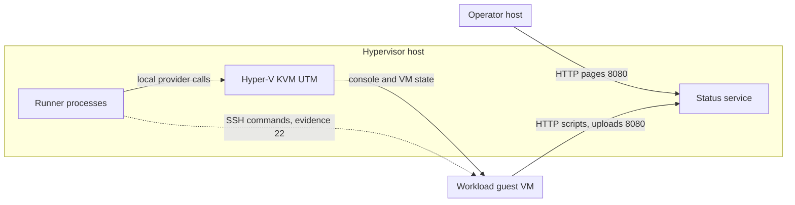

Sources: [Start-TestRunner](../../test/Start-TestRunner.ps1),
[outer runner](../../test/modules/Test.RunnerOuterLoop.psm1),
[cycle entry point](../../test/modules/Invoke-TestCycleRunner.ps1),
[inner entry point](../../test/modules/Invoke-TestRunnerInnerLoop.ps1),
[host contract](../../host/Yuruna.Host.Contract.psm1),
[SSH transport](../../test/modules/Test.Ssh.psm1),
[sequence handlers](../../test/modules/Test.SequenceHandler.psm1),
[Start-StatusService](../../test/service/Start-StatusService.ps1), and
[fetch-and-execute.sh](../../automation/fetch-and-execute.sh).

The outer, cycle, and inner runners are host processes. The selected driver
controls the guest through its native hypervisor interface, including console
input, screenshots, and the VM state used to observe shutdown; Hyper-V also
captures COM1 through a named pipe, and UTM the guest's UART through a loopback
TCP port. The status service is another host process,
serving operator pages, controls, runtime evidence, repository script fetches,
and bounded guest diagnostic and log uploads. A file under its runtime directory
is served only when it is one of the allow-listed status records, whichever path
names it, so credentials, keys, and other private state there answer 403;
harness state under `test/status/` is refused through the repository mount.
Sequences selecting SSH connect directly from the runner to the guest. Console
fetches also use SSH for launcher capability checks, refusal records, payload
state, and execution evidence when the guest is reachable; the payload itself
still starts through console input. See [GUI fetch transport](03-data-flows.md#gui-fetch-transport).
The status service can remain available while tests are idle. A browser can run on this same host;
the operator frame shows the separate-machine case. Six boxes include all three
host processes/families and the two other network nodes.
[Start-McpServer](../../test/service/Start-McpServer.ps1) serves the framework's
MCP tools over the standard input and output of a client-started process, so it
adds no network endpoint; the Go service daemons mount `POST /mcp` on their own
HTTP ports.

## Cache, image, and stash endpoints

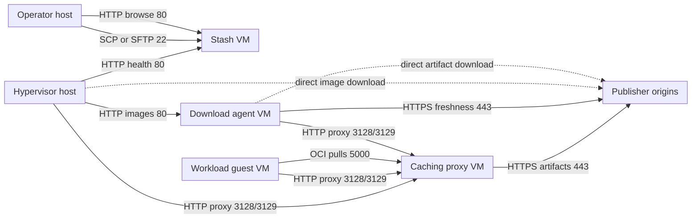

Sources: [host download client](../../host/modules/Yuruna.HostDownload.psm1),
[host image-agent client](../../host/modules/Yuruna.DownloadAgent.psm1),
[image publishers](../../host/modules/Yuruna.Image.psm1),
[agent refresh](../../test/extension/download-agent-service/server/internal/imagestore/refresh.go),
[cache seed](../../host/vmconfig/caching-proxy-service.base.user-data),
[CA trust](../../test/modules/Test.CachingProxyService.psm1),
[guest CA self-heal](../../automation/yuruna-retry.sh),
[stash client](../../test/extension/stash-service/default.psm1),
[stash server](../../test/extension/stash-service/server/main.go), and the companion
[example workload helper](https://github.com/alissonsol/yuruna-project/blob/main/tools/example-workload.sh).

Squid handles package/file requests, and Zot handles OCI pulls on the cache VM.
Hosts also fetch the cache CA from Apache on port 80. The copy a host seeds
into guests, serves at its status service's `/ca.crt`, pins for pool event
push and trusts for its own HTTPS downloads is accepted only when it is a root
the host trusts for that proxy: the CA it seeds into the proxies it builds, the
root pinned for that address, a matching legacy cached root, or a root named
by a builder-signed statement that verifies with an enrolled mirror public key
(`yuruna-squid-ca.sig.json` beside the CA). A host
that enrolls that key never trusts a CA on first use; one that enrolls none
pins the first root it sees. A builder that is handed an untrusted root stops
with the `source_integrity` class, and a host download sends HTTPS direct. The
download agent receives the CA in its seed instead. The cache builders seed an ssl-bump CA that
the building host keeps in its private state, so a rebuilt proxy keeps its root,
and the Linux guest and service seeds name that root's SHA-256 in `host.env`; a
guest's CA self-heal installs a CA from the host's `/ca.crt` only when it
matches. The download-agent serves shared OS images from its own VM and fetches
origin bytes through the cache. Its freshness and checksum requests bypass the
cache, and its byte downloads can fall back to direct origin access. Hosts can fall back
to their ordinary image download path when the agent cannot supply an image.
The seventh frame groups the configured image, package, and registry publishers;
each URL selects an independent external endpoint. Stash runs its SCP/SFTP listener on port
22 and its browse/download service on port 80. Uploads come from any `scp` or
`sftp` client; host code only probes `/healthz`. The
[stash guest installer](../../guest/ubuntu.server.26/ubuntu.server.26.stash-service.sh)
frees port 22 from the ordinary SSH daemon before starting the stash daemon.

[setup.ps1](../../install/setup.ps1) prepares storage before these guests. It
always brings up the cache, and the stash when storage is configured. The
download agent defaults off in standalone mode and on in lab mode, unless
`downloadAgentService.enabled` says otherwise; lab mode also adds pool-control
and a default pool. [Start-CachingProxyServiceVM.ps1](../../test/service/Start-CachingProxyServiceVM.ps1)
defaults to a full rebuild and authenticated enrollment of the builder's public
signing key on discovered pool hosts, preserving their CA pins. Pending host
enrollment warns after a ready rebuild; explicitly requesting
`-RepairPoolCaTrust` requires every discovered host to succeed. With
`-RepairPoolCaTrust:$false`, startup can instead adopt a healthy existing cache
and reassert its host services and forwarding. Ordinary runner hosts use the
configured cache address without launching this builder. They find the lab's
stash and download agent through the aggregator's extension-host discovery.
Each service seed fetches Yuruna source from its building host's
status service on port 8080; [Git mirror source endpoints](#git-mirror-source-endpoints)
shows the fallbacks.

The KVM and Hyper-V cache builders wait for the Zot sync self-test verdict on
`/cache-health` and exit 1 for an incompatible release; the UTM builder prints
that check as a manual step. The runner's cycle-start registry gate reads Zot
`/v2/` and `/zot-meta` and stops at once on an incompatible verdict.
`vmStart.cachingProxyZotVersion` and `vmStart.cachingProxyZotSha256` replace the
pinned release at build time.

### Provider networking

| Host provider | Source-backed reachability |
| --- | --- |
| [Hyper-V](../../host/windows.hyper-v/modules/Yuruna.Host.psm1) | Uses an External vSwitch on a wired PCI uplink. A Wi-Fi or USB-Ethernet uplink, or no External switch, builds on the Default Switch (NAT and DHCP); the cache launcher then installs `netsh portproxy` forwarders, and other service VMs get none. |
| [KVM](../../host/ubuntu.kvm/modules/Yuruna.Host.psm1) | Prefers the external bridge and can fall back to libvirt NAT. It checks the VM's actual interface and named network forwarding mode; a host-only fallback does not by itself expose the guest to the LAN. On the NAT fallback the cache launcher installs `systemd-socket-proxyd` forwarders, which re-originate connections, so the aggregator sees one client and the pool view needs a bridged cache. |
| [UTM](../../host/macos.utm/modules/Yuruna.Host.psm1) | Chooses Bridged networking on a bridgeable uplink, or Shared NAT on Wi-Fi. Shared NAT uses host TCP forwarders: the cache launcher maps 80, 3000, 9302, 9400, 3128, 3129, and 8022 to 22 without PROXY headers; the status service and runner then carry 3128 and 3129 to 3138 and 3139 with PROXY headers and leave the other forwarders running; stash maps 2222 to 22, download-agent 8082 to 80, and pool-control 8081 to 80. |

The [cache launcher](../../test/service/Start-CachingProxyServiceVM.ps1) checks
the built VM's attachment before deciding whether port maps are needed. Hyper-V
and KVM cache forwarders, and the UTM launcher's, carry 80, 3000, 9302, 9400, 3128,
3129, and 8022 to 22; Zot 5000 and management 9310 are not forwarded on any
provider, so peers on other machines cannot
reach a NAT-attached cache's Zot through the host address.
The [UTM forwarder](../../host/macos.utm/Start-CachingProxyServiceForwarder.ps1)
can preserve the original proxy client address using PROXY headers and the
seed's dedicated 3138/3139 listeners. A forwarded host address and its guest
destination are different endpoints; the provider's saved guest address targets
the forwarder without routing it back to the host listener.

## Git mirror source endpoints

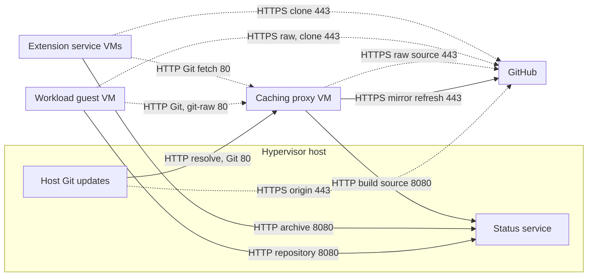

Sources: [source selection](../../test/modules/Test.SourceSelection.psm1),
[host Git updates](../../test/modules/Test.HostGit.psm1),
[mirror seed settings](../../test/modules/Test.CachingProxyService.psm1),
[fetch-and-execute.sh](../../automation/fetch-and-execute.sh),
[shared guest updater](../../guest/shared/ubuntu.update.sh),
[download-agent seed](../../host/vmconfig/download-agent-service.base.user-data),
[cache seed](../../host/vmconfig/caching-proxy-service.base.user-data),
[archive construction](../../test/modules/Test.HostGit.psm1),
[seed digests](../../automation/Yuruna.CloudInitTemplate.psm1),
[mirror roles](../../test/extension/caching-proxy-service/gitmirror.go), and
[mirror Git client](../../test/extension/caching-proxy-service/gitmirror_git.go).

The caching proxy's Git mirror keeps bare copies of the seeded GitHub
repositories and serves them through Apache on port 80. Its worker refreshes
them from `https://github.com` every `vmStart.cachingProxyGitMirrorRefreshSeconds`
(default 60) and signs resolve receipts with a key minted in the host's
authentication vault; an optional GitHub token from that vault authenticates the
refresh. Apache serves read-only smart HTTP at `/git/<owner>/<repo>.git`, pinned
files at `/git-raw/<owner>/<repo>/<commit>/<path>`, and status, metrics, and
signed resolution under `/git-mirror/`. It admits these paths only from loopback
and private IPv4 ranges and refuses `git-receive-pack`. The mirror relay answers
only in the management daemon's local mode. A NAT-attached cache's port 80
forwarder carries these paths as well.

Host updates read `repositories.mirror`, whose URL defaults to
`http://<caching proxy>`. The default `prefer` mode asks `/git-mirror/v1/resolve`
for a receipt, verifies it with an enrolled public key, and fetches the selected
commit from `/git/`. Without an enrolled key or an answering mirror, the host
fetches from GitHub. A verified stale receipt no older than
`repositories.mirror.mirrorOnlyMaxAgeSeconds` (default seven days) selects the
mirror's last confirmed pin with no GitHub call, unless that would roll back the
installed revision. Any other receipt that is not ready falls through to GitHub.
`fallback` mode asks GitHub first and uses
the mirror only after a network timeout; `off` uses the configured origin.
Setup enrolls the key of the host's own cache, and configuration sync asks the
operator before accepting a reference host's key.

Guests take source from the building host's status service first:
`fetch-and-execute.sh` reads files under `/yuruna-repo/` against a
runner-supplied digest. For guest updaters, the host's command context also
carries the framework and project archive commits and SHA-256 values when it
can compute them. The updater requests `/yuruna-archive.tar.gz?commit=<sha>`
and `/yuruna-project-archive.tar.gz?commit=<sha>` and extracts only bytes matching
the supplied digest. Without an archive identity pair, the legacy current
archive path still applies. See
[Guest checkout archives](03-data-flows.md#guest-checkout-archives). The
download-agent, pool-control, and stash seeds request
`/yuruna-archive.tar.gz?commit=<sha>` for the commit the seed names and extract
it only when its bytes match the SHA-256 seeded beside that commit; a seed
without the digest skips the host archive. When the host supplies no source,
guests read the pinned commit from the mirror and then from GitHub:
`fetch-and-execute.sh` from `/git-raw/`, and guest updaters through a shallow
`/git/` fetch. The service seeds make the same pinned `/git/` fetch, then clone
the public GitHub repository, whose code can be older than the host's. The cache
seed builds its own daemons from the status service and falls back to GitHub raw
content at the build commit, because its mirror is not yet running; every file
it fetches must match the seeded per-file SHA-256 manifest, and a missing or
different file skips that daemon's build. The service-VM frame aggregates those
three VMs, whose seeds share this order.

## Pool coordination endpoints

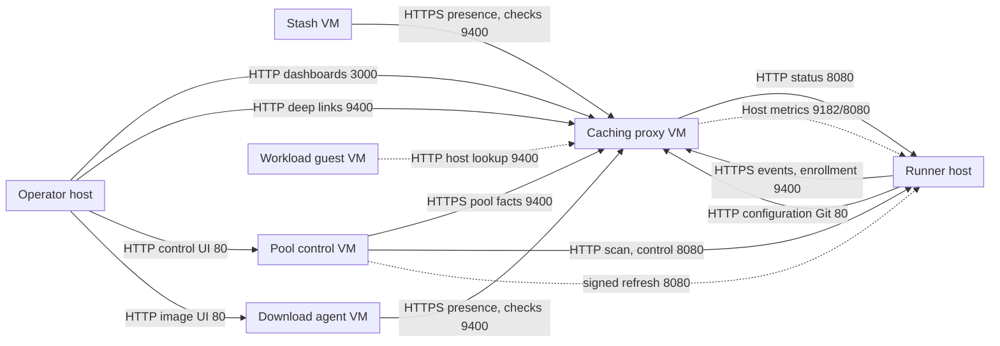

Sources: [pool event push](../../test/modules/Test.PoolPush.psm1),
[pool configuration sync](../../test/modules/Test.PoolSync.psm1),
[aggregator](../../test/extension/pool-aggregator-service/main.go),
[pool-control server](../../test/extension/pool-control-service/server/main.go),
[download-agent server](../../test/extension/download-agent-service/server/main.go),
[stash server](../../test/extension/stash-service/server/main.go), and the
[cache seed](../../host/vmconfig/caching-proxy-service.base.user-data).

The cache VM hosts the aggregator, Grafana, and Apache's HTTP endpoint for
pool-configuration.git. Runner event ingestion uses CA-pinned HTTPS. The aggregator
polls host status over HTTP and receives the configured service presence
announcements. It serves both HTTP and HTTPS on port 9400 when its readable TLS
certificate/key pair is present; without them it serves HTTP. The protocol choice
is specific to each client, rather than a separate aggregator process. Service
VMs bake `https://<cache>:9400` and try TLS without certificate verification
first, then plain HTTP. Hosts also announce themselves to the aggregator over
plain HTTP from the [host address beacon](../../test/modules/Invoke-HostAddressBeacon.ps1),
a detached sidecar the status service starts, which records each move of the
host's own address. Prometheus on the cache scrapes the reachable hosts that the
aggregator lists as scrape targets: `windows_exporter` on port 9182 for Windows
hosts, and memory gauges at `/metrics` on the status listener for Ubuntu and
macOS hosts; see [Test.HostMetricsExporter](../../test/modules/Test.HostMetricsExporter.psm1)
and [Test.HostMemoryMetrics](../../test/modules/Test.HostMemoryMetrics.psm1).

A guest or service VM whose saved host address stops answering asks the
aggregator's `/api/v1/host-address`, then `/api/v1/pool-status`, over plain HTTP
on port 9400; the workload guest box stands for both. These read-only routes carry
no proof. `Set-LabToken` exchanges the rotating dashboard code at
`/api/v1/lab-token`, trying HTTPS and then HTTP, and receives the internal
authentication key sealed under that code. Service write gates redeem submitted
codes at the same route. Browser links also use `/go/cycle`, `/go/host-event`, and
`/go/cycle-share`, and `/archive/` serves committed cycles from the pool share.
Pool-control's auto-enrollment sweep ships disabled and adds no network link.

Pool-control sweeps for hosts every 15 minutes by default, reads their status and
host facts, and sends pause and resume controls, each carrying a control proof
bound to the host it targets and scoped to its pause and resume routes:
pool-control mints it from the internal authentication key when it holds that
key, or asks the aggregator's `/go/host` for each member otherwise, and resends
a host that predates scoped proofs its full proof; see
[hostctl.go](../../test/extension/pool-control-service/server/internal/hostctl/hostctl.go)
and [hostcontrol.go](../../test/extension/pool-control-service/server/internal/httpsrv/hostcontrol.go).
Dashboard links reach a host or an extension service through the aggregator's
`/go/host` and `/go/stash` redirects, which mint a short-lived proof bound to
that host id or to `svc-<area>` for the service area they open, `stash-service`
by default; these redirects are unauthenticated because the LAN is the trust
boundary. Hosts verify the binding through
[Test.ConfigServiceSync](../../test/modules/Test.ConfigServiceSync.psm1) and
services through the SDK's
[controlproof](../../test/extension/extension-sdk/controlproof/controlproof.go)
package; both refuse an unbound proof, which names no target. A service that holds
no internal authentication key posts the proof to the aggregator's
`/api/v1/control-proof`, which verifies it and mints nothing.

Pool-control's remote refresh path is optional. Its separate authority and
operator credential checks are implemented in
[hostrefresh.go](../../test/extension/pool-control-service/server/internal/httpsrv/hostrefresh.go).
The diagram shows one runner host; other pool members repeat that node and its
links, independently of where the service fleet is hosted.

## Storage nodes

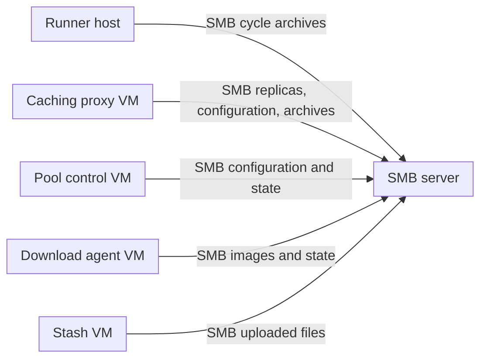

Sources: [pool storage](../../test/modules/Test.PoolStorage.psm1),
[local storage provisioning](../../test/lab/New-LocalLabStorage.ps1),
[cache seed](../../host/vmconfig/caching-proxy-service.base.user-data),
[control seed](../../host/vmconfig/pool-control-service.base.user-data),
[download-agent seed](../../host/vmconfig/download-agent-service.base.user-data), and
[stash seed](../../host/vmconfig/stash-service.base.user-data).

This six-node deployment uses one SMB server for the independently configured
pool and stash shares. If their network paths select different servers, each
server is its own node. With local storage, New-LocalLabStorage exports the
shares from the hypervisor host, so the SMB server and that host share one
machine. Pool paths hold host archives, monitoring replicas, images, control
state, the configuration repository, and the pool-alert spool; the stash path
holds uploaded files. The cache mounts the pool share whenever the host serves its
credential; replication is a separate option. Its aggregator and history backfill
also read host archives there. Exact
path ownership is expanded in [Data flows](03-data-flows.md).

Stash buffers uploads locally when its configured share is unavailable. A
service's local buffer or working state is distinct from the durable SMB data.
The cache's monitoring replication and host archive draining are configured
operations, rather than a claim that every byte is synchronously on the share.

## Caching-proxy VM processes

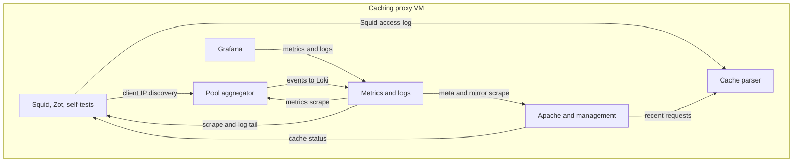

Sources: the [cache seed](../../host/vmconfig/caching-proxy-service.base.user-data),
[cache management daemon](../../test/extension/caching-proxy-service/main.go),
[parser unit](../../test/extension/caching-proxy-parser-service/caching-proxy-parser-service.service),
[aggregator unit](../../test/extension/pool-aggregator-service/pool-aggregator-service.service),
and the [qualified Zot release](../../host/vmconfig/caching-proxy-service.zot-qualified.json).

One VM frame and six child families total seven boxes. The aggregator family
includes `pool-history-backfill.service`, the same binary in backfill mode, which
reads host archives from the pool share and writes past samples and events to
Prometheus and Loki. The first family groups
Squid, Zot, the Zot prewarm, `zot-sync-selftest.py`, and
`yuruna-apt-index-selftest.py`, which every 30 minutes reads each probe
repository's apt metadata pair through the local Squid and reports any pair that
disagrees. Squid answers mutable apt metadata from the origin and still stores
it, so a stored `InRelease` cannot sit beside an index from a later publish.
Squid files a versioned PowerShell Gallery package request under the CDN object
the gallery redirects to, so a stored package is served without asking the
gallery. Zot is a pinned,
SHA-256-checked release with `http.compat` enabling Docker manifests, and its
upstream sync leaves through the local Squid 3129 listener. The self-test syncs
one probe image per upstream through Zot when Zot is installed and after each
warm run, blames Zot only when the upstream serves the image, and can add an
`http.compat` mode and restart Zot. Metrics and logs group Prometheus, Loki,
Alloy, and exporters; the Zot metadata exporter publishes the Zot self-test
verdict on Apache's `/zot-meta` and `/cache-health`, and the apt index verdict
appears on `/squid-meta` and `/cache-health`. Apache and management group the web
server with the Go caching-proxy-service daemon and that binary's Git mirror
roles: the [worker unit](../../test/extension/caching-proxy-service/git-mirror-worker.service)
refreshes and signs over a private Unix socket, the
[reader unit](../../test/extension/caching-proxy-service/git-mirror-reader.service)
serves pinned files, and the
[CGI wrapper](../../test/extension/caching-proxy-service/git-mirror-http-backend.sh)
runs read-only smart HTTP for Apache. Prometheus scrapes the mirror's metrics
from the management daemon, and Alloy tails the worker's journal. These
processes communicate locally inside this VM.

| Endpoint | Default role |
| --- | --- |
| Squid 3128/3129 | HTTP proxy/CONNECT and the TLS inspection path. The latter needs the cache CA trusted by the client. |
| Squid 3138/3139 | PROXY-header twins of 3128/3129; macOS Shared NAT forwarders target them to keep the client address. |
| Zot 5000 | OCI registry API and on-demand pull-through sync; upstream fetches go through Squid 3129. |
| Apache 80 | Landing page, CA certificates, `/squid-meta`, `/zot-meta`, `/cache-health` with the Zot and apt index self-test verdicts, pool configuration, and the Git mirror's `/git/`, `/git-raw/`, and `/git-mirror/` paths. |
| Management 9310 | Go management API and Git mirror relay; Apache proxies its landing page and mirror status and resolution. |
| Mirror reader 9311 | Loopback-only pinned file reads behind Apache's `/git-raw/`. |
| Parser 9302 | Recent Squid requests held in memory. |
| Aggregator 9400 | Pool facts, discovery, event ingestion, controls, dashboard redirects, the `/archive/` browser, host address lookup, lab-token exchange, control-proof verification, and MCP. |
| Grafana 3000 | Dashboards querying metrics and logs. |

A responding dashboard does not establish the health of an independent
collector, parser, or cache fetch.

## Service credential channel

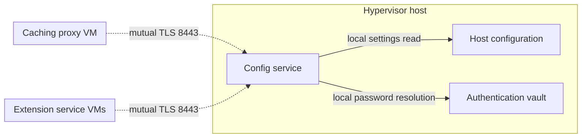

Sources: [Start-ConfigService](../../test/service/Start-ConfigService.ps1),
[ConfigServiceCA](../../test/modules/Test.ConfigServiceCA.psm1),
[authentication provider](../../test/extension/authentication/default.psm1),
[configuration template](../../test/test.config.yml.template),
[cache builder](../../host/ubuntu.kvm/guest.caching-proxy-service/New-VM.ps1),
[cache seed](../../host/vmconfig/caching-proxy-service.base.user-data),
[stash seed](../../host/vmconfig/stash-service.base.user-data),
[credential helper](../../automation/yuruna-nas-credential.sh), and the
[service-VM start pipeline](../../test/modules/Test.ServiceVm.psm1).

The configuration listener is a host process distinct from the HTTP status
service. ConfigService is enabled in the template, and each provider's service
builders bake the host CA and a client certificate for the VM they build. The
shared service-VM start pipeline ensures the listener before it builds a stash,
download-agent, or pool-control guest. When pool storage is configured, a cache
timer fetches /v1/nas/pool 30 seconds after boot and hourly, and enabled
replication fetches it again before each run. The fetch rewrites its root-only
CIFS credential and remounts on a credential version change. The service-VM frame
aggregates the stash, download-agent, and pool-control VMs: the stash fetches
/v1/nas/stash and the other two fetch /v1/nas/pool at first boot through
`yuruna-nas-credential.sh`, which writes the 0600 CIFS credentials file their share
mount reads. Their seeds carry no NAS password. A refresh timer reruns the helper
every 30 minutes and remounts a mounted share in place when the credential changed
or the share stopped answering; a share that is not mounted stays unmounted. The
listener rereads current host settings and resolves the current
vault password for each request. Its configuration and vault edges are local
reads.

On Linux the listener tries to allow its port through an active ufw without a
sudo prompt. Where that cannot act, an operator allows the port, or service
guests cannot reach the listener and their shares do not mount. The listener
implements /v1/nas/stash for the cache helper as well, but the current cache
seed does not activate a stash mount. The cache seed also bakes the internal
authentication key, an optional Docker Hub token for Zot sync, the Git mirror's
signing key and optional GitHub token from the host's vault, and the ssl-bump
CA from the host's private state. A host synchronizing configuration from a
reference pool host can fetch a missing storage credential from that host's
status service at `/control/vault-credential`; the route is gated by the
internal authentication key and returns the password encrypted with a key
derived from it. See
[Test.ConfigServiceSync](../../test/modules/Test.ConfigServiceSync.psm1).

## Deep diagnostics netconsole

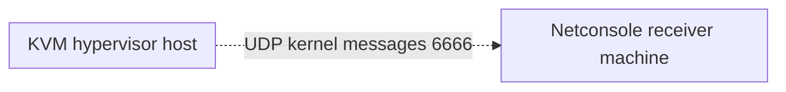

Sources: [Enable-DeepDiagnostics](../../host/ubuntu.kvm/Enable-DeepDiagnostics.ps1),
[Yuruna.Host.DeepDiagnostics](../../host/ubuntu.kvm/modules/Yuruna.Host.DeepDiagnostics.psm1),
and [Receive-Netconsole](../../test/lab/Receive-Netconsole.ps1).

With `-NetconsoleTarget <IPv4>[:port]`, a KVM host sends kernel messages over UDP,
port 6666 by default, to a receiver that should run on another always-on machine.
Lines sent before a freeze survive there. The receiver's firewall must allow the
port.

## Local deployment target

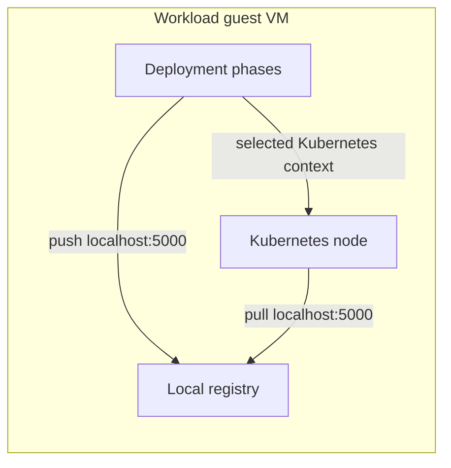

Sources: [Ubuntu Kubernetes setup](../../guest/ubuntu.server.26/ubuntu.server.26.k8s.sh),
[local context-copy](../../global/resources/localhost/context-copy/context-copy.tf),
[local registry check](../../global/resources/localhost/registry/localhost-registry.tf),
the companion [example helper](https://github.com/alissonsol/yuruna-project/blob/main/tools/example-workload.sh),
[website guest deployment](https://github.com/alissonsol/yuruna-project/blob/main/example/website/test/ubuntu.server.26/ubuntu.server.26.workload.k8s.website.sh),
and [localhost resources](https://github.com/alissonsol/yuruna-project/blob/main/example/website/config/localhost/resources.yml).

This four-box view is the Ubuntu website test's placement: its guest runs the
deployment client, a kubeadm Kubernetes node, and a registry:2.8.3 container on
port 5000. The Kubernetes installer removes the control-plane taint and renames
its context to docker-desktop; that context name does not imply another Docker
Desktop machine.
After Set-Resource, the website test renames that context to
`localhost-<clusterDnsPrefix>`. The project helper starts the registry before
Set-Resource and, when a cache is configured, pulls `registry:2.8.3` and base images
through the cache's Zot on port 5000. The localhost
resource templates verify this existing registry and copy the existing context;
they do not create another cluster or registry VM. Other callers can select an
existing local context from their own deployment host.

## AWS deployment target

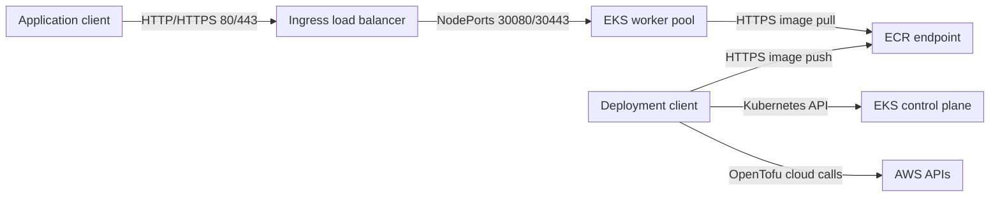

Sources: [EKS cluster](../../global/resources/aws/eks-cluster/cluster.tf),
[API outputs](../../global/resources/aws/eks-cluster/outputs.tf),
[ingress resources](../../global/resources/aws/eks-cluster/endpoints.tf),
[ECR repository](../../global/resources/aws/registry/registry.tf),
[component publisher](../../automation/Yuruna.Component.psm1), and the companion
[AWS resources](https://github.com/alissonsol/yuruna-project/blob/main/example/website/config/aws/resources.yml)
and [AWS workloads](https://github.com/alissonsol/yuruna-project/blob/main/example/website/config/aws/workloads.yml).

This view applies when AWS is selected. The deployment client can run on an
operator host or in a guest. The worker-pool frame aggregates the managed node
group's distinct EC2 nodes; nodeCount controls their number, and the checked-in
website configuration requests three. The managed control-plane API, worker
nodes, ECR endpoint, and ingress load balancer are separate network roles.

clusterEndpoint is the Kubernetes API address. Application hostname and
frontendIp come from the separately provisioned network load balancer. Its
80/443 listeners route to worker NodePorts 30080/30443, which the website's
ingress Helm release binds. The API's configured CIDR allow-list and the
application ingress address therefore serve different connections.

## Azure deployment target

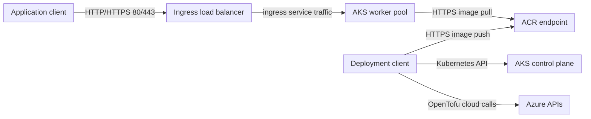

Sources: [AKS cluster](../../global/resources/azure/aks-cluster/cluster.tf),
[public IP outputs](../../global/resources/azure/aks-cluster/endpoints.tf),
[ACR registry](../../global/resources/azure/registry/registry.tf),
[component publisher](../../automation/Yuruna.Component.psm1),
[workload publisher](../../automation/Yuruna.Workload.psm1), and the companion
[Azure resources](https://github.com/alissonsol/yuruna-project/blob/main/example/website/config/azure/resources.yml)
and [Azure workloads](https://github.com/alissonsol/yuruna-project/blob/main/example/website/config/azure/workloads.yml).

This is the alternative Azure placement. Its worker-pool frame aggregates the
default node pool, whose size comes from nodeCount; the website configuration
requests three. Set-Resource provisions AKS, ACR, and the frontend public IP.
Set-Workload installs ingress-nginx with that IP as the Kubernetes LoadBalancer
service address, rather than using the AWS template's prebuilt NodePort/NLB
attachment. The workload also installs cert-manager for its configured public
certificate flow. API access is restricted by its own authorized CIDRs. The
registry template enables ACR admin credentials, and the website workloads
create a `docker-registry` pull secret from them; the AKS template grants no
registry role.

The current [global resources](../../global/resources/) and companion website
configurations supply localhost, AWS, and Azure deployment paths. There is no
active GCP deployment template or project configuration. Google Artifact
Registry authentication exists in
[Yuruna.CredentialProvider](../../automation/Yuruna.CredentialProvider.psm1);
that registry support does not create a GCP cluster or network topology.

---

LICENSEURI https://yuruna.link/license

Copyright (c) 2019-2026 by Alisson Sol et al.

Last review: 2026.11.05

[Architecture](../architecture.md) | [Design overview](README.md)
