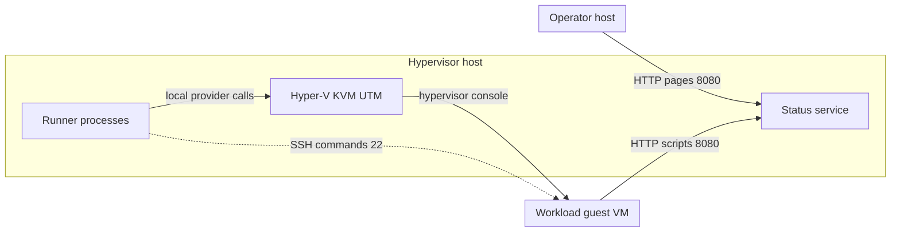
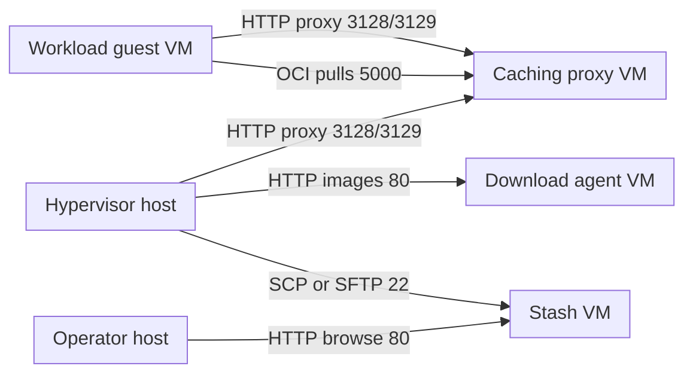
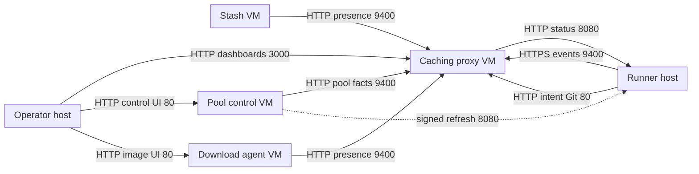
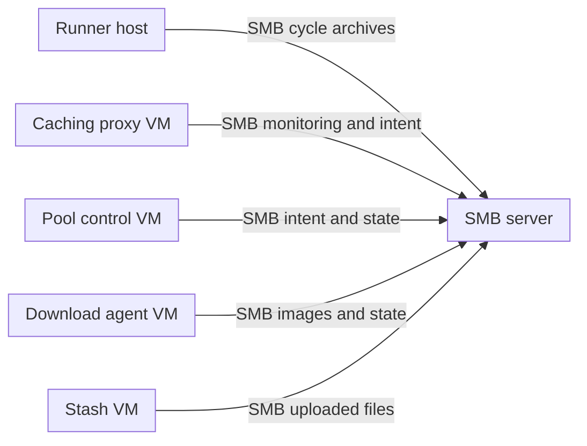
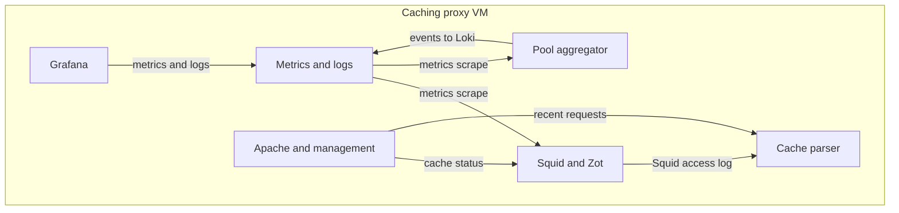
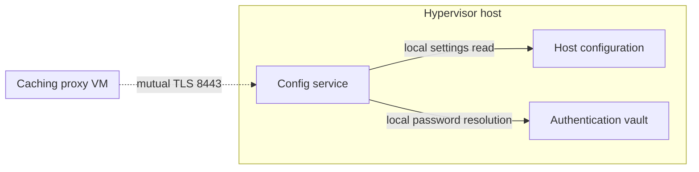
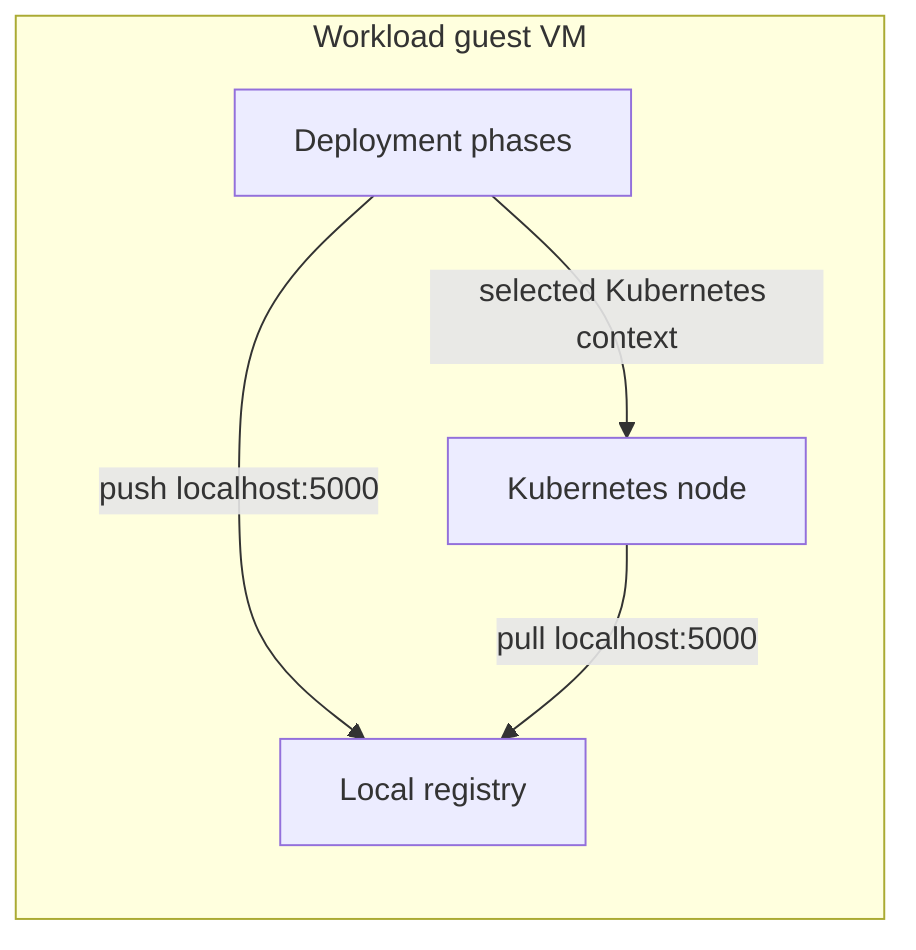
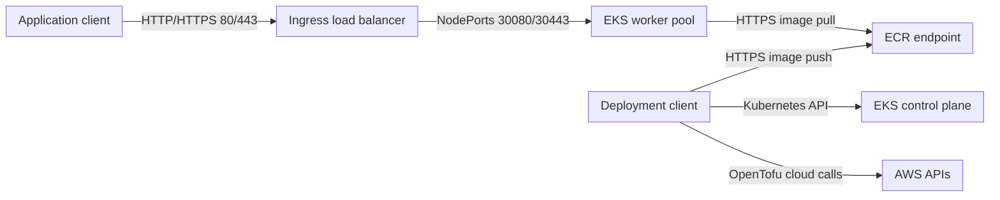
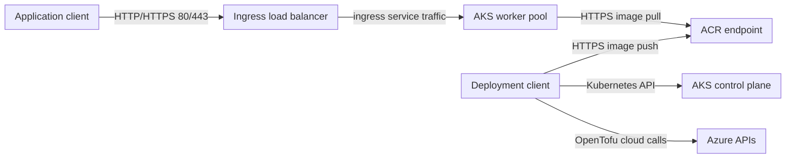

# Deployment topology

These network views place the current runners, host providers, guest VMs, lab services, storage, and deployment targets.

Each subgraph identifies a machine or service endpoint; the explicitly named
cloud worker pools aggregate their configured VM instances. Repeated IDs across
views identify the same role. Each diagram contains at most seven boxes,
including subgraph frames. Ports are source defaults; bridge, NAT, and forwarding
settings determine which address reaches them. See [Architecture](../architecture.md)
for the system boundaries.

## Runner and guest endpoints

Sources: [Start-TestRunner](../../test/Start-TestRunner.ps1),
[outer runner](../../test/modules/Test.RunnerOuterLoop.psm1),
[cycle entry point](../../test/modules/Invoke-TestCycleRunner.ps1),
[inner entry point](../../test/modules/Invoke-TestRunnerInnerLoop.ps1),
[host contract](../../host/Yuruna.Host.Contract.psm1),
[SSH transport](../../test/modules/Test.Ssh.psm1),
[Start-StatusService](../../test/service/Start-StatusService.ps1), and
[fetch-and-execute.sh](../../automation/fetch-and-execute.sh).

The outer, cycle, and inner runners are host processes. The selected driver
controls the guest through its native hypervisor interface, including console
input and screenshots. The status service is another host process, serving
operator pages, controls, runtime evidence, and repository script fetches.
Sequences selecting SSH also connect directly from the runner to the guest.
The status service can remain available while tests are idle. A browser can run on this same host;
the operator frame shows the separate-machine case. Six boxes include all three
host processes/families and the two other network nodes.

## Cache, image, and stash endpoints

Sources: [host download client](../../host/modules/Yuruna.HostDownload.psm1),
[host image-agent client](../../host/modules/Yuruna.DownloadAgent.psm1),
[cache seed](../../host/vmconfig/caching-proxy-service.base.user-data),
[stash client](../../test/extension/stash-service/default.psm1),
[stash server](../../test/extension/stash-service/server/main.go), and the companion
[example workload helper](https://github.com/alissonsol/yuruna-project/blob/main/tools/example-workload.sh).

Squid handles package/file requests, and Zot handles OCI pulls on the cache VM.
The download-agent serves shared OS images from its own VM. Hosts can fall back
to their ordinary image download path when the agent cannot supply an image.
Stash runs its SCP/SFTP listener on port 22 and its browse/download service on
port 80. The [stash guest installer](../../guest/ubuntu.server.26/ubuntu.server.26.stash-service.sh)
frees port 22 from the ordinary SSH daemon before starting the stash daemon.

[setup.ps1](../../install/setup.ps1) prepares storage before these guests. Its
standalone mode brings up cache and stash, with download-agent optional. Lab mode
enables download-agent and adds pool-control and a default pool. The launchers
under [test/service/](../../test/service/) also support using existing lab services.

### Provider networking

| Host provider | Source-backed reachability |
| --- | --- |
| [Hyper-V](../../host/windows.hyper-v/modules/Yuruna.Host.psm1) | Uses an External vSwitch when available; the cache launcher can map host ports when the built VM is not attached to an External switch. |
| [KVM](../../host/ubuntu.kvm/modules/Yuruna.Host.psm1) | Prefers the external bridge and can fall back to libvirt NAT. It checks the VM's actual interface and named network forwarding mode; a host-only fallback does not by itself expose the guest to the LAN. |
| [UTM](../../host/macos.utm/modules/Yuruna.Host.psm1) | Chooses Bridged networking on a bridgeable uplink, or Shared NAT on Wi-Fi. Shared NAT uses host TCP forwarders for service reachability. |

The [cache launcher](../../test/service/Start-CachingProxyServiceVM.ps1) checks
the built VM's attachment before deciding whether port maps are needed.
The [UTM forwarder](../../host/macos.utm/Start-CachingProxyServiceForwarder.ps1)
can preserve the original proxy client address using PROXY headers and the
seed's dedicated 3138/3139 listeners. A forwarded host address and its guest
destination are different endpoints; the provider's saved guest address targets
the forwarder without routing it back to the host listener.

## Pool coordination endpoints

Sources: [pool event push](../../test/modules/Test.PoolPush.psm1),
[pool intent sync](../../test/modules/Test.PoolSync.psm1),
[aggregator](../../test/extension/pool-aggregator-service/main.go),
[pool-control server](../../test/extension/pool-control-service/server/main.go),
[download-agent server](../../test/extension/download-agent-service/server/main.go),
[stash server](../../test/extension/stash-service/server/main.go), and the
[cache seed](../../host/vmconfig/caching-proxy-service.base.user-data).

The cache VM hosts the aggregator, Grafana, and Apache's HTTP endpoint for
pool-intent.git. Runner event ingestion uses CA-pinned HTTPS. The aggregator
polls host status over HTTP and receives the configured service presence
announcements. It serves both HTTP and HTTPS on port 9400 when its readable TLS
certificate/key pair is present; without them it serves HTTP. The protocol choice
is specific to each client, rather than a separate aggregator process.

Pool-control's remote refresh path is optional. Its separate authority and
operator credential checks are implemented in
[hostrefresh.go](../../test/extension/pool-control-service/server/internal/httpsrv/hostrefresh.go).
The diagram shows one runner host; other pool members repeat that node and its
links, independently of where the service fleet is hosted.

## Storage nodes

Sources: [pool storage](../../test/modules/Test.PoolStorage.psm1),
[local storage provisioning](../../test/lab/New-LocalLabStorage.ps1),
[cache seed](../../host/vmconfig/caching-proxy-service.base.user-data),
[control seed](../../host/vmconfig/pool-control-service.base.user-data),
[download-agent seed](../../host/vmconfig/download-agent-service.base.user-data), and
[stash seed](../../host/vmconfig/stash-service.base.user-data).

This six-node deployment uses one SMB server for the independently configured
pool and stash shares. If their network paths select different servers, each
server is its own node. With local storage, New-LocalLabStorage exports the
shares from the hypervisor host, so the SMB server and that host share one
machine. Pool paths hold host archives, monitoring replicas, images, control
state, and the intent repository; the stash path holds uploaded files. Exact
path ownership is expanded in [Data flows](03-data-flows.md).

Stash buffers uploads locally when its configured share is unavailable. A
service's local buffer or working state is distinct from the durable SMB data.
The cache's monitoring replication and host archive draining are configured
operations, rather than a claim that every byte is synchronously on the share.

## Caching-proxy VM processes

Sources: the [cache seed](../../host/vmconfig/caching-proxy-service.base.user-data),
[cache management daemon](../../test/extension/caching-proxy-service/main.go),
[parser unit](../../test/extension/caching-proxy-parser-service/caching-proxy-parser-service.service),
and [aggregator unit](../../test/extension/pool-aggregator-service/pool-aggregator-service.service).

One VM frame and six child families total seven boxes. Metrics and logs group
Prometheus, Loki, Alloy, and exporters; Apache and management group the web
server with the Go caching-proxy-service daemon. These processes communicate
locally inside this VM.

| Endpoint | Default role |
| --- | --- |
| Squid 3128/3129 | HTTP proxy/CONNECT and the TLS inspection path. The latter needs the cache CA trusted by the client. |
| Zot 5000 | OCI registry API and pull-through cache. |
| Apache 80 | Landing page, certificates, monitoring metadata, and pool intent. |
| Management 9310 | Go management API; Apache proxies its landing page. |
| Parser 9302 | Recent Squid requests held in memory. |
| Aggregator 9400 | Pool facts, discovery, event ingestion, and controls. |
| Grafana 3000 | Dashboards querying metrics and logs. |

A responding dashboard does not establish the health of an independent
collector, parser, or cache fetch.

## Cache credential channel

Sources: [Start-ConfigService](../../test/service/Start-ConfigService.ps1),
[ConfigServiceCA](../../test/modules/Test.ConfigServiceCA.psm1),
[authentication provider](../../test/extension/authentication/default.psm1),
[configuration template](../../test/test.config.yml.template),
[cache builder](../../host/ubuntu.kvm/guest.caching-proxy-service/New-VM.ps1), and
[cache seed](../../host/vmconfig/caching-proxy-service.base.user-data).

The configuration listener is a host process distinct from the HTTP status
service. ConfigService is enabled in the template, and each provider's cache
builder can bake the host CA and a cache client certificate. When pool replication
is configured, the cache seed fetches /v1/nas/pool at boot and before replication,
then rewrites its root-only CIFS credential and remounts on a credential version
change. The listener rereads current host settings and resolves the current vault
password for each request. Its configuration and vault edges are local reads.

The listener also implements /v1/nas/stash, and the cache helper can fetch that
name, but the current cache seed does not activate a stash mount. Stash,
download-agent, and pool-control instead have CIFS credentials baked into their
own seeds. Their current provisioning does not include this mTLS refresh client,
so the cache rotation path must not be assumed for those VMs.

## Local deployment target

Sources: [Ubuntu Kubernetes setup](../../guest/ubuntu.server.26/ubuntu.server.26.k8s.sh),
[local context-copy](../../global/resources/localhost/context-copy/context-copy.tf),
[local registry check](../../global/resources/localhost/registry/localhost-registry.tf),
the companion [example helper](https://github.com/alissonsol/yuruna-project/blob/main/tools/example-workload.sh),
[website guest deployment](https://github.com/alissonsol/yuruna-project/blob/main/example/website/test/ubuntu.server.26/ubuntu.server.26.workload.k8s.website.sh),
and [localhost resources](https://github.com/alissonsol/yuruna-project/blob/main/example/website/config/localhost/resources.yml).

This four-box view is the Ubuntu website test's placement: its guest runs the
deployment client, a kubeadm Kubernetes node, and registry:2 on port 5000. The
Kubernetes installer removes the control-plane taint and renames its context to
docker-desktop; that context name does not imply another Docker Desktop machine.
The project helper starts the registry before Set-Resource. The localhost
resource templates verify this existing registry and copy the existing context;
they do not create another cluster or registry VM. Other callers can select an
existing local context from their own deployment host.

## AWS deployment target

Sources: [EKS cluster](../../global/resources/aws/eks-cluster/cluster.tf),
[API outputs](../../global/resources/aws/eks-cluster/outputs.tf),
[ingress resources](../../global/resources/aws/eks-cluster/endpoints.tf),
[ECR repository](../../global/resources/aws/registry/registry.tf),
[component publisher](../../automation/Yuruna.Component.psm1), and the companion
[AWS resources](https://github.com/alissonsol/yuruna-project/blob/main/example/website/config/aws/resources.yml)
and [AWS workloads](https://github.com/alissonsol/yuruna-project/blob/main/example/website/config/aws/workloads.yml).

This view applies when AWS is selected. The deployment client can run on an
operator host or in a guest. The worker-pool frame aggregates the managed node
group's distinct EC2 nodes; nodeCount controls their number, and the checked-in
website configuration requests three. The managed control-plane API, worker
nodes, ECR endpoint, and ingress load balancer are separate network roles.

clusterEndpoint is the Kubernetes API address. Application hostname and
frontendIp come from the separately provisioned network load balancer. Its
80/443 listeners route to worker NodePorts 30080/30443, which the website's
ingress Helm release binds. The API's configured CIDR allow-list and the
application ingress address therefore serve different connections.

## Azure deployment target

Sources: [AKS cluster](../../global/resources/azure/aks-cluster/cluster.tf),
[public IP outputs](../../global/resources/azure/aks-cluster/endpoints.tf),
[ACR registry](../../global/resources/azure/registry/registry.tf),
[workload publisher](../../automation/Yuruna.Workload.psm1), and the companion
[Azure resources](https://github.com/alissonsol/yuruna-project/blob/main/example/website/config/azure/resources.yml)
and [Azure workloads](https://github.com/alissonsol/yuruna-project/blob/main/example/website/config/azure/workloads.yml).

This is the alternative Azure placement. Its worker-pool frame aggregates the
default node pool, whose size comes from nodeCount; the website configuration
requests three. Set-Resource provisions AKS, ACR, and the frontend public IP.
Set-Workload installs ingress-nginx with that IP as the Kubernetes LoadBalancer
service address, rather than using the AWS template's prebuilt NodePort/NLB
attachment. The workload also installs cert-manager for its configured public
certificate flow. API access is restricted by its own authorized CIDRs.

The current [global resources](../../global/resources/) and companion website
configurations supply localhost, AWS, and Azure deployment paths. There is no
active GCP deployment template or project configuration. Google Artifact
Registry authentication exists in
[Yuruna.CredentialProvider](../../automation/Yuruna.CredentialProvider.psm1);
that registry support does not create a GCP cluster or network topology.

---

[Architecture](../architecture.md) | [Design overview](README.md)
