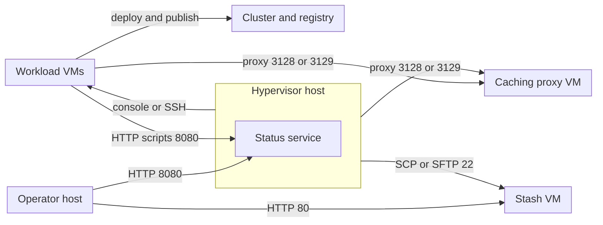
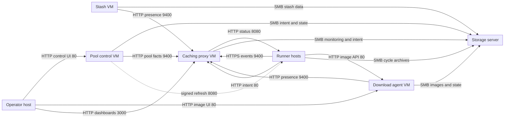
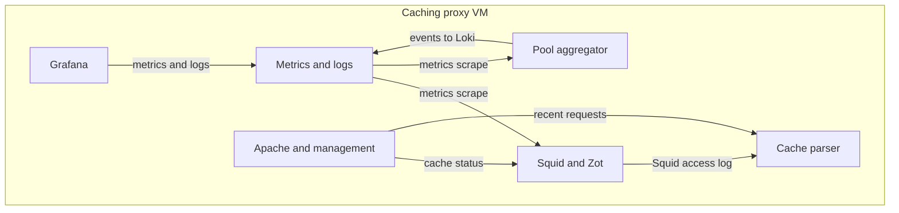
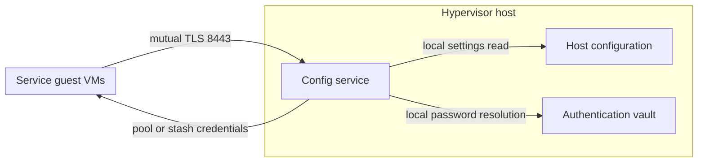
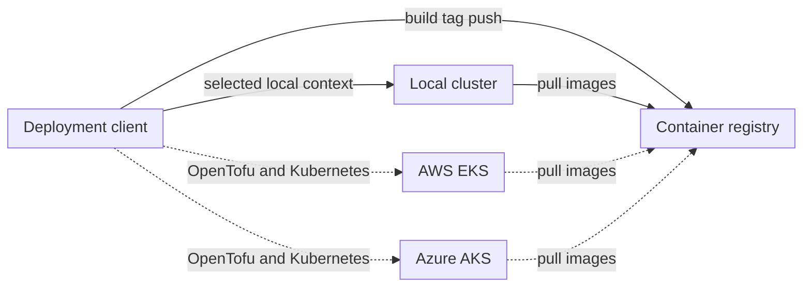

# Deployment topology

These network views place the current runners, providers, guests, services, storage, and deployment targets.

The views describe a lab with its service VMs enabled. Each diagram has at most
seven boxes, including subgraph frames; separate views expand aggregates without
adding boxes to their parent view. Ports are source defaults, and reachable
addresses depend on the selected bridge, NAT, and forwarding configuration.
See [Architecture](../architecture.md) for the system boundaries.

## Runner and guest endpoints

Sources: [Start-TestRunner](../../test/Start-TestRunner.ps1),
[host contract](../../host/Yuruna.Host.Contract.psm1),
[host providers](../../host/),
[Start-StatusService](../../test/service/Start-StatusService.ps1),
[fetch-and-execute.sh](../../automation/fetch-and-execute.sh),
[host cache client](../../host/modules/Yuruna.HostDownload.psm1),
[stash client](../../test/extension/stash-service/default.psm1),
[stash server](../../test/extension/stash-service/server/main.go), and the companion
[website guest deployment](https://github.com/alissonsol/yuruna-project/blob/main/example/website/test/ubuntu.server.26/ubuntu.server.26.workload.k8s.website.sh).

The hypervisor host runs the selected Hyper-V, KVM, or UTM driver with the outer,
cycle, and inner runner processes. Its status service is a host process and
provides operator pages, controls, runtime artifacts, and repository script
fetches. Six network frames plus its status child total seven boxes.
Console operations use the local hypervisor; SSH uses the guest network.
The operator and hypervisor roles can share one machine.

The target aggregate is expanded below. The website guest can also host its
local Kubernetes target and registry; a separate box expresses the target role
rather than requiring a separate physical machine. Stash accepts uploads through
its own SSH listener and serves the browse/download UI over HTTP.
The [stash guest installer](../../guest/ubuntu.server.26/ubuntu.server.26.stash-service.sh)
frees port 22 from the ordinary SSH daemon before starting the stash daemon.

## Pool services and storage

Sources: [setup](../../install/setup.ps1),
[pool event push](../../test/modules/Test.PoolPush.psm1),
[pool intent sync](../../test/modules/Test.PoolSync.psm1),
[pool storage](../../test/modules/Test.PoolStorage.psm1),
[aggregator](../../test/extension/pool-aggregator-service/main.go),
[pool-control service](../../test/extension/pool-control-service/server/main.go),
[download-agent service](../../test/extension/download-agent-service/server/main.go),
[host image client](../../host/modules/Yuruna.DownloadAgent.psm1),
[stash server](../../test/extension/stash-service/server/main.go), and the
[shared proxy seed](../../host/vmconfig/caching-proxy-service.base.user-data).

Caching-proxy, stash, download-agent, and pool-control each have service VM
builders under the three host providers. A beacon can host the service fleet,
while worker hosts use existing lab services. Setup prepares storage before
service guests; standalone mode starts cache and stash, and lab mode adds
download-agent and pool-control.

The caching-proxy VM also hosts the pool aggregator and Apache's HTTP Git
endpoint for pool-intent.git. The aggregator defaults to 9400 and serves HTTP
alongside HTTPS when a readable TLS certificate/key pair is configured.
Runner event ingestion requires pinned HTTPS; status polling reaches host HTTP
listeners. Remote host refresh is optional and requires the separate authority
and operator credential checked by
[hostrefresh.go](../../test/extension/pool-control-service/server/internal/httpsrv/hostrefresh.go).

The seven-box view groups pool and stash storage behind one server; their
independent settings can point to separate servers. A NAS or a runner host can
export the SMB shares. Pool storage carries host cycle archives, monitoring,
download images/state, control state, and intent; stash storage carries uploaded
files. Exact paths and ownership are expanded in [Data flows](03-data-flows.md).

Bridge and NAT selection alter reachability. The
[caching-proxy launcher](../../test/service/Start-CachingProxyServiceVM.ps1)
selects external networking or host port maps where supported. The
[UTM forwarder](../../host/macos.utm/Start-CachingProxyServiceForwarder.ps1)
exposes a Shared-NAT service through the host LAN address. A KVM host-only NAT
fallback requires an appropriate reachable path for remote clients; the arrows
describe service contracts rather than guaranteeing LAN exposure in every mode.

## Caching-proxy VM processes

Sources: the [shared seed](../../host/vmconfig/caching-proxy-service.base.user-data),
[cache management daemon](../../test/extension/caching-proxy-service/main.go),
[cache parser unit](../../test/extension/caching-proxy-parser-service/caching-proxy-parser-service.service),
and [pool aggregator](../../test/extension/pool-aggregator-service/main.go).

One VM frame and six children total seven boxes. Squid and Zot group the
HTTP/package and OCI-image caches. Metrics and logs group Prometheus, Loki,
Alloy, and service exporters. Apache and management group the web server with
the Go caching-proxy-service daemon.

| Endpoint | Default placement |
| --- | --- |
| Squid 3128/3129 | HTTP proxy and HTTPS bump path in the cache VM. |
| Zot 5000 | OCI registry API in the cache VM. |
| Apache 80 | Landing page, certificates, monitoring metadata, and pool intent. |
| Management 9310 | Go management API; Apache proxies its landing page. |
| Parser 9302 | Recent Squid requests held in memory. |
| Aggregator 9400 | Pool facts, host discovery, event ingestion, and controls. |
| Grafana 3000 | Dashboards querying the monitoring services. |

These are separate processes. A responding dashboard does not establish the
health of the collector or a cache fetch.

## Guest configuration channel

Sources: [Start-ConfigService](../../test/service/Start-ConfigService.ps1),
[ConfigServiceCA](../../test/modules/Test.ConfigServiceCA.psm1),
[authentication provider](../../test/extension/authentication/default.psm1),
[configuration template](../../test/test.config.yml.template), and the
[service guest seed](../../host/vmconfig/caching-proxy-service.base.user-data).

This five-box view makes host placement explicit. The configuration service is
a host listener distinct from the browser status service. Authenticated service
guests request /v1/nas/pool or /v1/nas/stash on default port 8443.
The listener reads current host configuration and resolves the current vault
password on each request, so rotated storage credentials can reach running VMs.
Its configuration and vault edges are local reads.

## Deployment targets

Sources: [localhost registry](../../global/resources/localhost/registry/localhost-registry.tf),
[local context-copy](../../global/resources/localhost/context-copy/context-copy.tf),
[AWS resources](../../global/resources/aws/),
[Azure resources](../../global/resources/azure/),
[component publisher](../../automation/Yuruna.Component.psm1),
[workload publisher](../../automation/Yuruna.Workload.psm1),
[credential providers](../../automation/Yuruna.CredentialProvider.psm1), and the
website configurations for
[localhost](https://github.com/alissonsol/yuruna-project/blob/main/example/website/config/localhost/resources.yml),
[AWS](https://github.com/alissonsol/yuruna-project/blob/main/example/website/config/aws/resources.yml),
and [Azure](https://github.com/alissonsol/yuruna-project/blob/main/example/website/config/azure/resources.yml).

The five frames expand the target aggregate. The client groups the three phase
scripts and can run on an operator host or in a workload guest. The registry box
groups the selected local registry, ECR, ACR, or another configured registry.
The localhost resource template verifies an existing registry; the companion
guest script prepares it before Set-Resource. Context-copy selects an existing
Kubernetes context.

AWS and Azure are configuration alternatives, so their edges are dashed and
marked optional. Their boxes represent checked-in provisioning paths.
GCP resource deployment has no current template or project configuration; GAR
authentication is implemented separately by the credential-provider module.

For AWS, [clusterEndpoint](../../global/resources/aws/eks-cluster/outputs.tf)
addresses the Kubernetes control-plane API. The
[ingress template](../../global/resources/aws/eks-cluster/endpoints.tf) separately
exports hostname and frontendIp and routes load-balancer ports 80/443 to ingress
NodePorts 30080/30443. The companion
[workload configuration](https://github.com/alissonsol/yuruna-project/blob/main/example/website/config/aws/workloads.yml)
uses the application outputs separately from the cluster context.

---

[Architecture](../architecture.md) | [Design overview](README.md)
