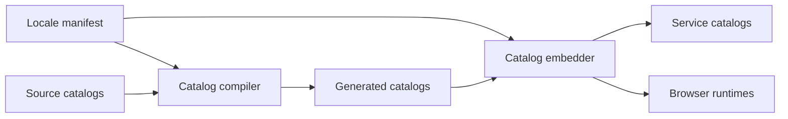
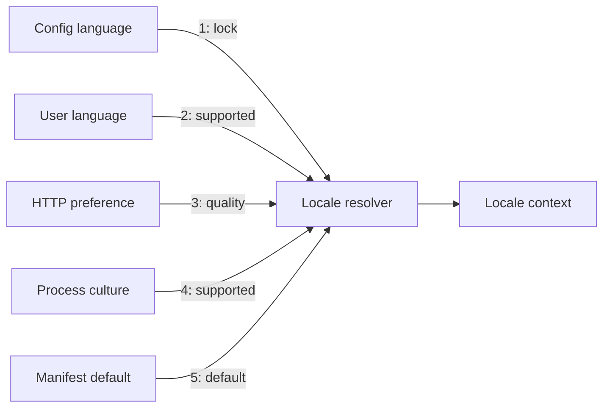
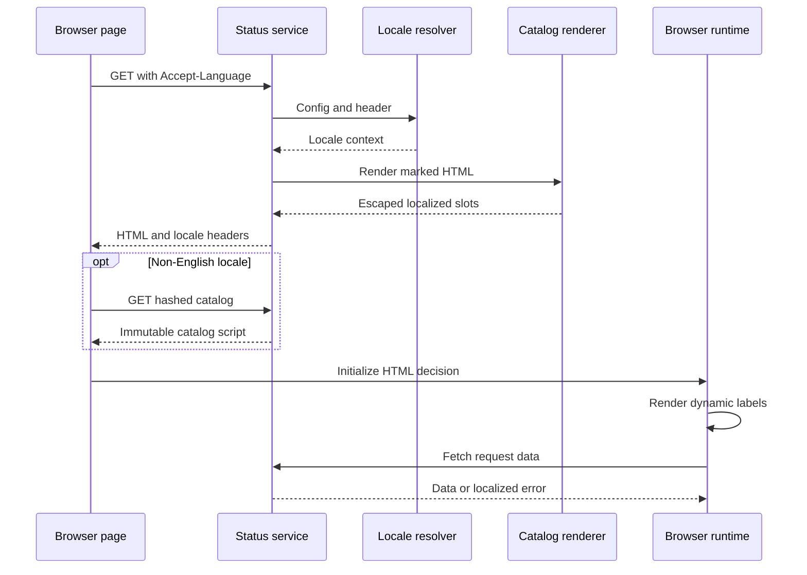
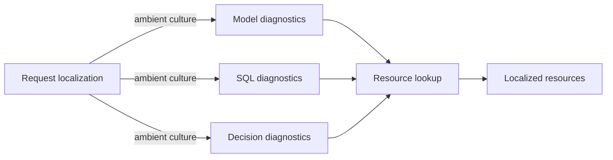

# Globalization

These diagrams explain the current catalog pipeline, locale decisions, and client/server exchange for localized Yuruna surfaces.

[Architecture](../architecture.md) defines the system boundaries; this page
explains language selection within them and the companion applications' separate
localization behavior.

## Catalog authority and delivery

The seven boxes group generated PowerShell, Go, and browser formats; service
catalog copies; and browser consumers. The embedder combines the shared browser
kernel with locale data and the domains each consumer needs. PowerShell reads
generated `.psd1` catalogs directly rather than receiving a service-local copy.

Sources: [locale manifest](../../globalization/locale-manifest.json),
[source catalogs](../../globalization/catalogs/),
[compiler](../../tools/Invoke-CatalogCompile.ps1),
[generated catalogs](../../globalization/generated/),
[embedder](../../tools/Invoke-CatalogEmbed.ps1),
[service catalog example](../../test/extension/extension-sdk/internal/catalog/),
[status browser runtime](../../test/status/yuruna.common.js),
[browser kernel](../../globalization/kernel/yuruna.i18n.js), and
[PowerShell catalog reader](../../test/modules/Test.Catalog.psm1).

The manifest's default is `en-US`. Supported locales are `en-US`, `pt-BR`,
`zh-CN`, and `he-IL`; diagnostic locales are `qps-Ploc` and `qps-Plocm`.
`he-IL` and `qps-Plocm` have right-to-left direction. Declared aliases, tag and
header bounds, number separators, and pinned plural rules are shared inputs to
the runtimes. Locale matching accepts exact supported tags and declared aliases;
it does not invent a match for an undeclared regional variant.

The compiler validates key coverage, placeholder contracts, plural forms, and
translation `sourceHash` values. Stale translations for supported locales fail
compilation. `origin: machine` records translation provenance, and removal of
that marker records acceptance; both use the same runtime compilation path.
The [catalog-set manifest](../../globalization/manifests/catalog-set.json)
records the compiled set and translation provenance under the
[catalog schema](../../globalization/schema/catalog.schema.json).

## Locale decisions at boundaries

These seven boxes show the common resolver's inputs and result. Each caller
supplies only the inputs available at its boundary. `UserLanguage` is a resolver
parameter; the current HTTP adapters do not supply a persisted user preference
or expose a language selector.

| Priority | Decision |
| --- | --- |
| Config language | A nonempty value other than `auto` locks the decision. An unsupported lock resolves to the manifest default and still reports `config` as its source. |
| User language | A supported explicit value wins when configuration is unlocked. An unsupported value falls through. |
| `Accept-Language` | Highest-quality supported candidate wins. Zero quality, malformed quality, and a bare wildcard supply no candidate. Ties use ordinal resolved-tag and requested-tag ordering. |
| Process culture | A supported process UI culture wins if earlier inputs supplied no decision. |
| Default | `en-US` is selected when nothing else wins. |

Sources: [PowerShell resolver](../../test/modules/Test.Locale.psm1),
[Go resolver](../../test/extension/extension-sdk/i18n/locale.go), and
[shared matching fixtures](../../globalization/fixtures/locale-matching.json).

| Boundary | Inputs and decision lifetime |
| --- | --- |
| PowerShell operator message | The adapter reads the lab configuration's language and process UI culture lazily, then caches the command's context at first emission. |
| PowerShell status request | Reads the configuration language at the request boundary, combines it with `Accept-Language`, and explicitly disables process-culture fallback. |
| Go service request | Uses its startup language option and `Accept-Language`, with no process-culture fallback. Negotiation is restricted to catalogs the binary carries. |
| Browser page | Initializes from the server's HTML `lang`, requested language, and decision source. The page context is then sealed. |

Sources: [operator adapter](../../automation/Yuruna.Globalization.psm1),
[status adapter](../../test/service/Start-StatusService.ps1),
[Go HTTP adapter](../../test/extension/extension-sdk/i18n/http.go),
[pool resolver wiring](../../test/extension/pool-control-service/server/internal/httpsrv/i18nwire.go), and
[browser initialization](../../globalization/kernel/yuruna.i18n.js).
Status opens diagnostic locales with `YURUNA_ALLOW_PSEUDO_LOCALE`; Go services
use `--allow-pseudo-locale`. Ordinary negotiation excludes them.

PowerShell contexts are read-only dictionaries, Go contexts are passed by
value, and browser contexts are frozen. They carry requested and resolved tags,
direction, decision source, timezone policy, and catalog version/hash.
PowerShell and Go catalog formatting use UTC; browser wall-clock formatting
explicitly uses the reader's local zone. Number formatting and plural selection
use the manifest's tables. Typed substitutions receive bidi isolation where
needed; see [PowerShell formatting](../../test/modules/Test.Catalog.psm1),
[Go formatting](../../test/extension/extension-sdk/i18n/format.go), and the browser
kernel.

## Status browser exchange

The five participants show the PowerShell status surface. The server fills
explicit text and presentation-attribute markers, writes `lang`, `dir`, and
decision metadata, and sends UTF-8 HTML with escaped catalog text. English
catalog data is already in the runtime; another selected locale requires its
generated catalog asset. Status refuses to send a selected non-English runtime
page when that asset is missing.

The browser reads the HTML decision and uses the selected catalog for dynamic
labels. It does not independently negotiate against browser preferences.
Subsequent API requests resolve their own locale at the server boundary. A
status configuration edit therefore affects the next request, while an already
loaded browser page retains its context until reload. Stable API fields and
message codes retain their machine meaning alongside localized error text.

Sources: [status HTML](../../test/status/index.html),
[status request handling](../../test/service/Start-StatusService.ps1),
[HTML catalog renderer](../../test/modules/Test.Catalog.psm1),
[browser runtime](../../test/status/yuruna.common.js), and
[browser kernel](../../globalization/kernel/yuruna.i18n.js).

## Go pages and response caching

Go page stores prepare a finite set of localized HTML representations and their
ETags during initialization. A request selects a prepared representation;
arbitrary request headers do not create an unbounded page cache or cause catalog
parsing. Pool-control also prepares its immutable pages and builds its supported
locale set at startup.

| Surface | Browser catalog delivery |
| --- | --- |
| Status, pool-control, stash, download-agent | Default catalog rides the existing runtime; another selected locale loads a hashed catalog script. |
| Caching-proxy, parser | The prepared HTML embeds the runtime and selected catalog, preserving their self-contained page behavior. |
| Pool aggregator | Uses the SDK catalog/negotiator for HTTP and JSON diagnostics; its operator messages also support configured language and process locale inputs. |

Sources: [SDK page store](../../test/extension/extension-sdk/i18n/page.go),
[pool page assets](../../test/extension/pool-control-service/server/internal/httpsrv/assets.go),
[stash pages](../../test/extension/stash-service/server/internal/httpsrv/localization.go),
[download pages](../../test/extension/download-agent-service/server/internal/httpsrv/localization.go),
[caching-proxy page](../../test/extension/caching-proxy-service/localization.go),
[parser page](../../test/extension/caching-proxy-parser-service/localization.go), and
[aggregator diagnostics](../../test/extension/pool-aggregator-service/localization.go).

Negotiated representations carry `Content-Language` and
`Vary: Accept-Language`. Their ETags identify the final localized bytes, and a
304 response repeats locale metadata. Hashed catalog scripts are immutable and
cacheable. Ordinary scripts and styles are not language-varying representations;
the HTTP middleware resolves context while the response handler decides whether
locale headers apply. See [HTTP headers](../../test/extension/extension-sdk/i18n/http.go),
[page serving](../../test/extension/extension-sdk/i18n/page.go), and the status
request handler.

## Companion project boundaries

Project labels use an additive contract: `descriptionLocalized` or
`displayNameLocalized` accompanies the English scalar. The
[project-label resolver](../../test/modules/Test.SequencePlanner.psm1) looks up
the already resolved canonical tag and falls back to the scalar.
The [operator adapter](../../automation/Yuruna.Globalization.psm1) applies this
contract to command output. The companion
[text-to-SQL sequence](https://github.com/alissonsol/yuruna-project/blob/main/example/text-to-sql/test/workload.guest.ubuntu.server.24.k8s.text-to-sql.test.yml)
demonstrates localized sequence and action descriptions. Names, command text,
and sequence references remain stable identifiers.

The text-to-SQL application uses its own ASP.NET Core request-localization
middleware and .NET resource lookup:

The six boxes group the default resource file and three translated `.resx`
files. `Program.cs` supports `en-US`, `pt-BR`, `zh-CN`, and `he-IL`, defaults to
`en-US`, and leaves the framework's request-culture provider collection in place.
`ServiceMessages` selects text with `CurrentUICulture` and formats arguments
with `CurrentCulture`. It does not use Yuruna's locale context or compiled
message catalogs.

Sources: companion text-to-SQL
[Program.cs](https://github.com/alissonsol/yuruna-project/blob/main/example/text-to-sql/components/frontend/text-to-sql-ui/Program.cs),
[LlmHttpRetry.cs](https://github.com/alissonsol/yuruna-project/blob/main/example/text-to-sql/components/frontend/text-to-sql-ui/Services/LlmHttpRetry.cs),
[SqlValidator.cs](https://github.com/alissonsol/yuruna-project/blob/main/example/text-to-sql/components/frontend/text-to-sql-ui/Services/SqlValidator.cs),
[ILlmClient.cs](https://github.com/alissonsol/yuruna-project/blob/main/example/text-to-sql/components/frontend/text-to-sql-ui/Services/ILlmClient.cs),
[ServiceMessages.cs](https://github.com/alissonsol/yuruna-project/blob/main/example/text-to-sql/components/frontend/text-to-sql-ui/Services/ServiceMessages.cs), and
[resource files](https://github.com/alissonsol/yuruna-project/tree/main/example/text-to-sql/components/frontend/text-to-sql-ui/Services).

This localizes service diagnostics, while the
[Razor page](https://github.com/alissonsol/yuruna-project/blob/main/example/text-to-sql/components/frontend/text-to-sql-ui/Pages/Index.cshtml)
and [generic orchestrator errors](https://github.com/alissonsol/yuruna-project/blob/main/example/text-to-sql/components/frontend/text-to-sql-ui/Services/AgentOrchestrator.cs)
still contain English literals. The
[resource checker](https://github.com/alissonsol/yuruna-project/blob/main/example/text-to-sql/tests/ServiceContracts.Tests/check_messages.py)
checks translated resource source hashes and provenance comments. The website
example's [Program.cs](https://github.com/alissonsol/yuruna-project/blob/main/example/website/components/frontend/website/Program.cs)
does not install request-localization middleware; its behavior should not be
inferred from text-to-SQL's configuration.

## Translation interchange

The public [exchange module](../../test/modules/Test.LocalizationExchange.psm1)
reads and writes JSON, CSV, and XLIFF 2.0 tables. Entries carry stable IDs,
English source, and translated text; an earlier translation is context rather
than a new answer. The XLIFF reader requires version `2.0` and prohibits DTD
processing and external XML resolution.

The [tooling decision](../../globalization/manifests/tooling-decision.json)
records a provisional requirement for translator interchange and names the
booked native translator's answer as its replacement. Its rationale mentions
XLIFF 2.1; the implemented public codec currently reads and writes 2.0. After
translated source is placed, [Publish-Localization.ps1](../../tools/Publish-Localization.ps1)
regenerates catalogs and embeddings, refreshes the inventory, and runs the
translation, project-label, reference-fixture, and cross-repository gates.

---

[Architecture](../architecture.md) | [Design overview](README.md)
