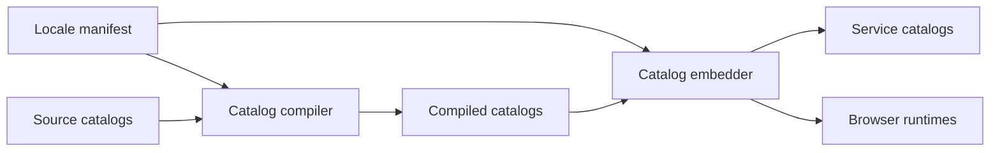
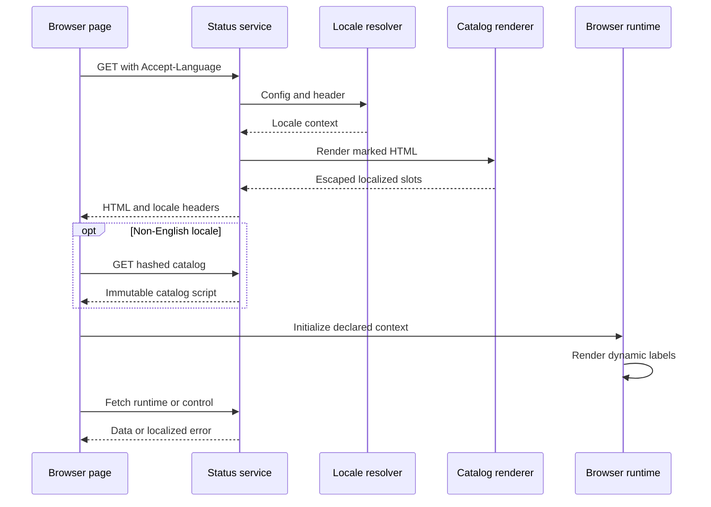
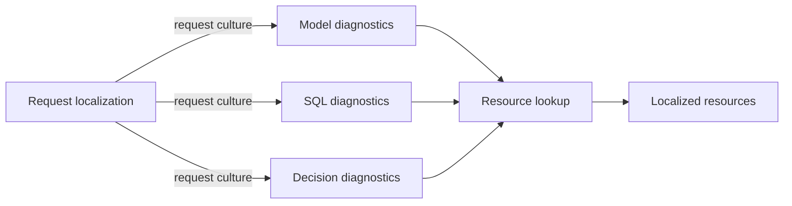

# Globalization

These diagrams explain how Yuruna selects a locale, ships catalogs, and renders localized client and server content.

The system boundaries are described in [Architecture](../architecture.md);
this page covers the locale decisions within those boundaries.

## Catalog authority and delivery

Sources: [locale manifest](../../globalization/locale-manifest.json),
[source catalogs](../../globalization/catalogs/),
[compiler](../../tools/Invoke-CatalogCompile.ps1),
[generated catalogs](../../globalization/generated/),
[embedder](../../tools/Invoke-CatalogEmbed.ps1),
[SDK service catalogs](../../test/extension/extension-sdk/internal/catalog/), and
[status browser runtime](../../test/status/yuruna.common.js).
The seven boxes group the three generated formats, the consumers' service
catalog directories, and the browser runtimes. PowerShell reads its generated
`.psd1` files directly through [Test.Catalog](../../test/modules/Test.Catalog.psm1).

The manifest declares `en-US` as the default and supports `en-US`, `pt-BR`,
`zh-CN`, and `he-IL`. It also declares the diagnostic locales `qps-Ploc` and
`qps-Plocm`; served surfaces require explicit pseudo-locale enablement.
`he-IL` and `qps-Plocm` read right to left. Aliases, plural categories, pinned
plural rules, and number separators come from this same manifest.

The compiler checks catalog coverage, placeholders, plural forms, and translation
`sourceHash` values before emitting PowerShell, Go, and JavaScript artifacts.
A supported locale's stale translation fails compilation. Translation acceptance
is separate from runtime availability: `origin: machine` records a draft;
an accepted entry has no `origin`. Both compile through the same rendering path,
with provenance recorded in the
[catalog-set manifest](../../globalization/manifests/catalog-set.json) under the
[catalog schema](../../globalization/schema/catalog.schema.json).

The embedder copies only each consumer's message domains. English tables and the
[browser kernel](../../globalization/kernel/yuruna.i18n.js) travel in the existing
runtime. Status, pool-control, stash, and download-agent pages load one additional
catalog asset for a selected non-English locale. Caching-proxy and parser pages
embed that selected catalog in their HTML; see
[page preparation](../../test/extension/extension-sdk/i18n/page.go),
[cache localization](../../test/extension/caching-proxy-service/localization.go),
and [parser localization](../../test/extension/caching-proxy-parser-service/localization.go).

## Boundary decisions

The common resolver uses this precedence:

| Input | Decision |
|---|---|
| Configured `language` | A nonempty value other than `auto` locks the locale. An unsupported lock selects `en-US` and retains `config` as its source. |
| Explicit user language | Used only without a config lock and only when supported. |
| `Accept-Language` | Selects the highest-quality supported candidate. |
| Process UI culture | Used when earlier inputs do not select a locale. |
| Default | Selects `en-US`. |

Sources: [PowerShell resolver](../../test/modules/Test.Locale.psm1),
[Go resolver](../../test/extension/extension-sdk/i18n/locale.go), and
[shared matching fixtures](../../globalization/fixtures/locale-matching.json).
Tags are bounded and canonicalized; only exact tags or declared aliases match.
Malformed qualities, zero-quality candidates, and a bare wildcard select no
candidate. Equal qualities use stable tag ordering. Undeclared regional variants
receive no prefix fallback.

The adapters supply different inputs to that common policy:

| Boundary | Inputs actually supplied |
|---|---|
| Operator command | Config language and process UI culture, resolved lazily at the first message. |
| PowerShell status request | Config language and request header; process culture is explicitly empty. The config is read at the request boundary. |
| Go service request | Startup language option and request header; process culture is explicitly empty. Candidates are restricted to embedded catalogs. |
| Browser page | The server's `lang`, `dir`, requested tag, and decision source in HTML. Initialization seals that page context. |

Sources: [operator adapter](../../automation/Yuruna.Globalization.psm1),
[status resolver](../../test/service/Start-StatusService.ps1),
[Go HTTP adapter](../../test/extension/extension-sdk/i18n/http.go),
[pool service resolver](../../test/extension/pool-control-service/server/internal/httpsrv/i18nwire.go),
and [browser kernel](../../globalization/kernel/yuruna.i18n.js).
The current HTTP adapters supply no persisted user preference; the resolver's
user-language input is an available API parameter, rather than a served language
selector. Status enables pseudo-locales through `YURUNA_ALLOW_PSEUDO_LOCALE`;
Go services expose `--allow-pseudo-locale`.

PowerShell returns a read-only locale context, Go passes its context by value,
and the browser freezes its initialized context. These carry the resolved tag,
requested tag, source, direction, and catalog provenance. PowerShell and Go use
UTC for catalog timestamps; the browser explicitly uses the reader's local zone
for wall-clock display. Number separators and plural selection remain shared
across the three runtimes. Typed arguments receive bidi isolation in right-to-left
text; see [PowerShell formatting](../../test/modules/Test.Catalog.psm1),
[Go formatting](../../test/extension/extension-sdk/i18n/format.go), and the browser
kernel.

## Status client and server exchange

Sources: [status HTML](../../test/status/index.html),
[status service](../../test/service/Start-StatusService.ps1),
[locale resolver](../../test/modules/Test.Locale.psm1),
[catalog renderer](../../test/modules/Test.Catalog.psm1), and
[browser runtime](../../test/status/yuruna.common.js).
The five participants show the status surface directly; Go services implement
the corresponding negotiation and HTML rendering through
[HTTP locale contexts](../../test/extension/extension-sdk/i18n/http.go) and
[localized pages](../../test/extension/extension-sdk/i18n/page.go).

The server translates explicit text and presentation-attribute markers and
writes `lang` and `dir` before sending UTF-8 HTML. Catalog text is escaped.
Dynamic browser labels use the same selected catalog; initialization reads the
HTML decision. API machine fields and identifiers retain their protocol meaning,
while catalog-backed error text is localized.

Localized representations carry `Content-Language` and
`Vary: Accept-Language`. Page ETags hash the final localized bytes, and a 304
retains locale metadata. Hashed catalog assets are immutable and cacheable;
ordinary scripts and styles do not acquire language-varying headers. Status
refuses a selected non-English page catalog when its asset is missing. Go page
stores precompute a finite set of localized representations during initialization.

## Project labels and example diagnostics

Project sequence files can supply `descriptionLocalized` beside the English
`description` scalar. [Resolve-ProjectLabel](../../test/modules/Test.SequencePlanner.psm1)
uses the already resolved canonical locale, with the scalar as fallback.
The [operator adapter](../../automation/Yuruna.Globalization.psm1) also applies
this additive contract to `displayName`. Real examples include the
[website warm sequence](https://github.com/alissonsol/yuruna-project/blob/main/example/website/test/website.ubuntu24.warm.yml)
and [text-to-sql test sequence](https://github.com/alissonsol/yuruna-project/blob/main/example/text-to-sql/test/workload.guest.ubuntu.server.24.k8s.text-to-sql.test.yml).
Names, commands, and sequence references remain stable machine identities.

The companion text-to-sql application has its own ASP.NET Core request-culture
policy and .NET resources:

Sources: text-to-sql
[Program.cs](https://github.com/alissonsol/yuruna-project/blob/main/example/text-to-sql/components/frontend/text-to-sql-ui/Program.cs),
[LlmHttpRetry.cs](https://github.com/alissonsol/yuruna-project/blob/main/example/text-to-sql/components/frontend/text-to-sql-ui/Services/LlmHttpRetry.cs),
[SqlValidator.cs](https://github.com/alissonsol/yuruna-project/blob/main/example/text-to-sql/components/frontend/text-to-sql-ui/Services/SqlValidator.cs),
[ILlmClient.cs](https://github.com/alissonsol/yuruna-project/blob/main/example/text-to-sql/components/frontend/text-to-sql-ui/Services/ILlmClient.cs),
[ServiceMessages.cs](https://github.com/alissonsol/yuruna-project/blob/main/example/text-to-sql/components/frontend/text-to-sql-ui/Services/ServiceMessages.cs), and
[resource files](https://github.com/alissonsol/yuruna-project/tree/main/example/text-to-sql/components/frontend/text-to-sql-ui/Services).
The six boxes group the default resource and its three translated `.resx` files.

`UseRequestLocalization` accepts `en-US`, `pt-BR`, `zh-CN`, and `he-IL`, with
`en-US` as the default. It keeps the normal ASP.NET Core culture providers,
including `Accept-Language`. `ServiceMessages` looks up text using
`CurrentUICulture` and formats arguments using `CurrentCulture`. Translation
comments record machine origin and source hashes, checked by the
[resource gate](https://github.com/alissonsol/yuruna-project/blob/main/example/text-to-sql/tests/ServiceContracts.Tests/check_messages.py).
This localizes service diagnostics; the
[Razor page](https://github.com/alissonsol/yuruna-project/blob/main/example/text-to-sql/components/frontend/text-to-sql-ui/Pages/Index.cshtml)
and [orchestrator's generic errors](https://github.com/alissonsol/yuruna-project/blob/main/example/text-to-sql/components/frontend/text-to-sql-ui/Services/AgentOrchestrator.cs)
still contain English literals.

---

Back to [Architecture](../architecture.md) | [Design overview](README.md)
