# Network information artifacts diagram

The `network:` namespace, `https://yuruna.com/ontology/2026/10/network#`, holds
the networking vocabulary: protocols, interfaces, links, addressing, name
resolution, routing, proxies and caches, and the network conditions, failures,
and checks. This page draws the information artifacts of the network namespace:
these classes, the object properties of the namespace drawn here, and the
existential restrictions on these classes, from version 2026/10 of the [Yuruna
ontology](../yuruna.owl).

The namespace's other pages: [Network system elements](network-elements.md),
[Network processes and situations](network-processes.md).

Circles are classes drawn on this page and boxes are classes drawn on another
page. A `subClassOf` arrow points from a class to its parent. An arrow labeled
with a property runs from its domain to its range. A frame titled Restriction is
an existential restriction on the class whose `subClassOf` arrow points at it:
each instance of that class has at least one value of the boxed property in the
circled class.

```mermaid
%%{init: {"flowchart": {"useMaxWidth": 0}}}%%
graph LR
classDef Datatype fill:#9c6,stroke:#9c6;
network:ARP((network:ARP)) -- subClassOf --> network:Protocol((network:Protocol))
network:AddressFootprint((network:AddressFootprint)) -- subClassOf --> y:Quantity[y:Quantity]
network:Bandwidth((network:Bandwidth)) -- subClassOf --> y:Quantity[y:Quantity]
network:BaseURL((network:BaseURL)) -- subClassOf --> network:URL((network:URL))
network:BridgedNetworking((network:BridgedNetworking)) -- subClassOf --> y:ConfigurationArtifact[y:ConfigurationArtifact]
network:CIFS((network:CIFS)) -- subClassOf --> network:Protocol((network:Protocol))
network:CacheHitRatio((network:CacheHitRatio)) -- subClassOf --> y:Quantity[y:Quantity]
network:CacheWarmSet((network:CacheWarmSet)) -- subClassOf --> y:InformationArtifact[y:InformationArtifact]
network:DHCP((network:DHCP)) -- subClassOf --> network:Protocol((network:Protocol))
network:DHCPClientIdentifier -- network:identifiesClient --> network:DHCPClient
network:DHCPClientIdentifier((network:DHCPClientIdentifier)) -- subClassOf --> r_DHCPClientIdentifier_identifiesClient_DHCPClient_((Anonymous class))
network:DHCPClientIdentifier((network:DHCPClientIdentifier)) -- subClassOf --> y:Identifier[y:Identifier]
network:DHCPLease -- network:leasesAddress --> network:IPAddress
network:DHCPLease((network:DHCPLease)) -- subClassOf --> r_DHCPLease_leasesAddress_IPAddress_((Anonymous class))
network:DHCPLease((network:DHCPLease)) -- subClassOf --> y:InformationArtifact[y:InformationArtifact]
network:DHCPReservation((network:DHCPReservation)) -- subClassOf --> y:ConfigurationArtifact[y:ConfigurationArtifact]
network:DNS((network:DNS)) -- subClassOf --> network:Protocol((network:Protocol))
network:DNSRecord((network:DNSRecord)) -- subClassOf --> y:InformationArtifact[y:InformationArtifact]
network:DUID((network:DUID)) -- subClassOf --> y:Identifier[y:Identifier]
network:DefaultRoute((network:DefaultRoute)) -- subClassOf --> network:Route((network:Route))
network:DeterministicMACAddress((network:DeterministicMACAddress)) -- subClassOf --> network:MACAddress((network:MACAddress))
network:Ethernet((network:Ethernet)) -- subClassOf --> network:Protocol((network:Protocol))
network:FQDN((network:FQDN)) -- subClassOf --> y:Identifier[y:Identifier]
network:FirewallRule((network:FirewallRule)) -- subClassOf --> y:ConfigurationArtifact[y:ConfigurationArtifact]
network:GuestHostBinding((network:GuestHostBinding)) -- subClassOf --> y:InformationArtifact[y:InformationArtifact]
network:GuestReachableHostAddress((network:GuestReachableHostAddress)) -- subClassOf --> network:IPAddress((network:IPAddress))
network:HTTP((network:HTTP)) -- subClassOf --> network:Protocol((network:Protocol))
network:HTTPRangeRequest((network:HTTPRangeRequest)) -- subClassOf --> y:InformationArtifact[y:InformationArtifact]
network:HTTPS((network:HTTPS)) -- subClassOf --> network:Protocol((network:Protocol))
network:Hostname((network:Hostname)) -- subClassOf --> y:Identifier[y:Identifier]
network:ICMP((network:ICMP)) -- subClassOf --> network:Protocol((network:Protocol))
network:IPAddress((network:IPAddress)) -- subClassOf --> y:Identifier[y:Identifier]
network:IPv4Address((network:IPv4Address)) -- subClassOf --> network:IPAddress((network:IPAddress))
network:IPv4LinkLocalAddress((network:IPv4LinkLocalAddress)) -- subClassOf --> network:IPv4Address((network:IPv4Address))
network:IPv4LinkLocalAddress((network:IPv4LinkLocalAddress)) -- subClassOf --> network:LinkLocalAddress((network:LinkLocalAddress))
network:IPv6Address((network:IPv6Address)) -- subClassOf --> network:IPAddress((network:IPAddress))
network:InterfaceAlias((network:InterfaceAlias)) -- subClassOf --> y:Identifier[y:Identifier]
network:InterfaceMetric((network:InterfaceMetric)) -- subClassOf --> y:Quantity[y:Quantity]
network:Latency((network:Latency)) -- subClassOf --> y:Quantity[y:Quantity]
network:LatencyPercentile((network:LatencyPercentile)) -- subClassOf --> y:Quantity[y:Quantity]
network:LinkLocalAddress((network:LinkLocalAddress)) -- subClassOf --> network:IPAddress((network:IPAddress))
network:MACAddress((network:MACAddress)) -- subClassOf --> y:Identifier[y:Identifier]
network:NeighborTable((network:NeighborTable)) -- subClassOf --> y:InformationArtifact[y:InformationArtifact]
network:NoUpstreamMode((network:NoUpstreamMode)) -- subClassOf --> y:Policy[y:Policy]
network:OAuth2((network:OAuth2)) -- subClassOf --> network:Protocol((network:Protocol))
network:ObservedAddressCount((network:ObservedAddressCount)) -- subClassOf --> y:Quantity[y:Quantity]
network:OfflineMode((network:OfflineMode)) -- subClassOf --> y:Policy[y:Policy]
network:OpenIDConnect((network:OpenIDConnect)) -- subClassOf --> network:Protocol((network:Protocol))
network:Port((network:Port)) -- subClassOf --> y:Identifier[y:Identifier]
network:Prefix((network:Prefix)) -- subClassOf --> y:Identifier[y:Identifier]
network:PrefixLength((network:PrefixLength)) -- subClassOf --> y:Quantity[y:Quantity]
network:PrivateAddress((network:PrivateAddress)) -- subClassOf --> network:IPAddress((network:IPAddress))
network:Protocol((network:Protocol)) -- subClassOf --> y:InformationArtifact[y:InformationArtifact]
network:ProxyBypass((network:ProxyBypass)) -- subClassOf --> y:ConfigurationArtifact[y:ConfigurationArtifact]
network:ProxyProtocol((network:ProxyProtocol)) -- subClassOf --> network:Protocol((network:Protocol))
network:ProxyProtocolHeader((network:ProxyProtocolHeader)) -- subClassOf --> y:InformationArtifact[y:InformationArtifact]
network:RemoteFramebufferProtocol((network:RemoteFramebufferProtocol)) -- subClassOf --> network:Protocol((network:Protocol))
network:ResolverConfiguration((network:ResolverConfiguration)) -- subClassOf --> y:ConfigurationArtifact[y:ConfigurationArtifact]
network:Route -- network:hasGateway --> network:Gateway
network:Route((network:Route)) -- subClassOf --> y:ConfigurationArtifact[y:ConfigurationArtifact]
network:RouteMetric((network:RouteMetric)) -- subClassOf --> y:Quantity[y:Quantity]
network:RouterAdvertisement((network:RouterAdvertisement)) -- subClassOf --> y:InformationArtifact[y:InformationArtifact]
network:RoutingTable -- network:hasRoute --> network:Route
network:RoutingTable((network:RoutingTable)) -- subClassOf --> y:ConfigurationArtifact[y:ConfigurationArtifact]
network:SFTP((network:SFTP)) -- subClassOf --> network:Protocol((network:Protocol))
network:SMB((network:SMB)) -- subClassOf --> network:Protocol((network:Protocol))
network:SSH((network:SSH)) -- subClassOf --> network:Protocol((network:Protocol))
network:ServerNameIndication((network:ServerNameIndication)) -- subClassOf --> y:InformationArtifact[y:InformationArtifact]
network:SocketReceiveQueue((network:SocketReceiveQueue)) -- subClassOf --> y:Quantity[y:Quantity]
network:SocketSendQueue((network:SocketSendQueue)) -- subClassOf --> y:Quantity[y:Quantity]
network:StaleContent((network:StaleContent)) -- subClassOf --> y:InformationArtifact[y:InformationArtifact]
network:StaticHostMapping((network:StaticHostMapping)) -- subClassOf --> y:ConfigurationArtifact[y:ConfigurationArtifact]
network:TCP((network:TCP)) -- subClassOf --> network:Protocol((network:Protocol))
network:TLS((network:TLS)) -- subClassOf --> network:Protocol((network:Protocol))
network:Throughput((network:Throughput)) -- subClassOf --> y:Quantity[y:Quantity]
network:Topology((network:Topology)) -- subClassOf --> y:InformationArtifact[y:InformationArtifact]
network:TopologySelectionPolicy((network:TopologySelectionPolicy)) -- subClassOf --> y:Policy[y:Policy]
network:UDP((network:UDP)) -- subClassOf --> network:Protocol((network:Protocol))
network:URL((network:URL)) -- subClassOf --> y:Identifier[y:Identifier]
network:UplinkBinding((network:UplinkBinding)) -- subClassOf --> y:ConfigurationArtifact[y:ConfigurationArtifact]
network:WiFi((network:WiFi)) -- subClassOf --> network:Protocol((network:Protocol))
subgraph r_DHCPClientIdentifier_identifiesClient_DHCPClient_[Restriction &exist; R C]
r_DHCPClientIdentifier_identifiesClient_DHCPClient_thing((thing)) --> r_DHCPClientIdentifier_identifiesClient_DHCPClient_network:identifiesClient[network:identifiesClient]
r_DHCPClientIdentifier_identifiesClient_DHCPClient_network:identifiesClient[network:identifiesClient]
-- some --> r_DHCPClientIdentifier_identifiesClient_DHCPClient_network:DHCPClient((network:DHCPClient))
end
subgraph r_DHCPLease_leasesAddress_IPAddress_[Restriction &exist; R C]
r_DHCPLease_leasesAddress_IPAddress_thing((thing)) --> r_DHCPLease_leasesAddress_IPAddress_network:leasesAddress[network:leasesAddress]
r_DHCPLease_leasesAddress_IPAddress_network:leasesAddress[network:leasesAddress]
-- some --> r_DHCPLease_leasesAddress_IPAddress_network:IPAddress((network:IPAddress))
end
y:SystemElement -- network:usesProtocol --> network:Protocol
```

---

LICENSEURI https://yuruna.link/license

Copyright (c) 2019-2026 by Alisson Sol et al.

Last review: 2026.10.31

Back to [Yuruna ontology diagrams](../../../README.md#425aed30-0005)
