# Network processes and situations diagram

The `network:` namespace, `https://yuruna.com/ontology/2026/10/network#`, holds
the networking vocabulary: protocols, interfaces, links, addressing, name
resolution, routing, proxies and caches, and the network conditions, failures,
and checks. This page draws the processes and situations of the network
namespace: these classes, the object properties of the namespace drawn here, and
the existential restrictions on these classes, from version 2026/10 of the
[Yuruna ontology](../yuruna.owl).

The namespace's other pages: [Network system elements](network-elements.md),
[Network information artifacts](network-information.md).

Circles are classes drawn on this page and boxes are classes drawn on another
page. A `subClassOf` arrow points from a class to its parent. An arrow labeled
with a property runs from its domain to its range.

```mermaid
%%{init: {"flowchart": {"useMaxWidth": 0}}}%%
graph LR
classDef Datatype fill:#9c6,stroke:#9c6;
network:APIPA((network:APIPA)) -- subClassOf --> y:Process[y:Process]
network:AddressChurn((network:AddressChurn)) -- subClassOf --> y:Situation[y:Situation]
network:AddressConflict((network:AddressConflict)) -- subClassOf --> diagnostics:Failure[diagnostics:Failure]
network:AddressDiscoveryCheck((network:AddressDiscoveryCheck)) -- subClassOf --> diagnostics:DiagnosticCheck[diagnostics:DiagnosticCheck]
network:CacheBust((network:CacheBust)) -- subClassOf --> y:Process[y:Process]
network:CacheHit((network:CacheHit)) -- subClassOf --> y:Situation[y:Situation]
network:CacheMiss((network:CacheMiss)) -- subClassOf --> y:Situation[y:Situation]
network:CacheRevalidation((network:CacheRevalidation)) -- subClassOf --> y:Process[y:Process]
network:CacheWarmup((network:CacheWarmup)) -- subClassOf --> y:Process[y:Process]
network:ClientAddressAttribution((network:ClientAddressAttribution)) -- subClassOf --> y:Process[y:Process]
network:ColdCacheState((network:ColdCacheState)) -- subClassOf --> y:State[y:State]
network:ConnectionRefused((network:ConnectionRefused)) -- subClassOf --> diagnostics:Failure[diagnostics:Failure]
network:ConnectionReset((network:ConnectionReset)) -- subClassOf --> diagnostics:Failure[diagnostics:Failure]
network:Connectivity((network:Connectivity)) -- subClassOf --> y:Situation[y:Situation]
network:DHCPIdentityUnboundedFailure((network:DHCPIdentityUnboundedFailure)) -- subClassOf --> diagnostics:InfrastructureFailure[diagnostics:InfrastructureFailure]
network:DHCPLeaseCheck((network:DHCPLeaseCheck)) -- subClassOf --> diagnostics:DiagnosticCheck[diagnostics:DiagnosticCheck]
network:DHCPPoolExhaustion((network:DHCPPoolExhaustion)) -- subClassOf --> diagnostics:Failure[diagnostics:Failure]
network:DNSResolutionCheck((network:DNSResolutionCheck)) -- subClassOf --> diagnostics:DiagnosticCheck[diagnostics:DiagnosticCheck]
network:DuplicateIPAddress((network:DuplicateIPAddress)) -- subClassOf --> network:AddressConflict((network:AddressConflict))
network:Egress((network:Egress)) -- subClassOf --> y:Process[y:Process]
network:EndToEndFetchCheck((network:EndToEndFetchCheck)) -- subClassOf --> diagnostics:DiagnosticCheck[diagnostics:DiagnosticCheck]
network:GuestAddressDiscovery((network:GuestAddressDiscovery)) -- subClassOf --> network:NetworkDiscovery((network:NetworkDiscovery))
network:HostAddressRenumbering((network:HostAddressRenumbering)) -- subClassOf --> y:Situation[y:Situation]
network:HostNetworkDegradedFailure((network:HostNetworkDegradedFailure)) -- subClassOf --> diagnostics:HostIncident[diagnostics:HostIncident]
network:HostNetworkDegradedFailure((network:HostNetworkDegradedFailure)) -- subClassOf --> diagnostics:InfrastructureFailure[diagnostics:InfrastructureFailure]
network:IPNotDiscoveredFailure((network:IPNotDiscoveredFailure)) -- subClassOf --> diagnostics:InfrastructureFailure[diagnostics:InfrastructureFailure]
network:Ingress((network:Ingress)) -- subClassOf --> y:Process[y:Process]
network:LabDependencyDownFailure((network:LabDependencyDownFailure)) -- subClassOf --> diagnostics:InfrastructureFailure[diagnostics:InfrastructureFailure]
network:LeaseRelease((network:LeaseRelease)) -- subClassOf --> y:Process[y:Process]
network:LeaseRenewal((network:LeaseRenewal)) -- subClassOf --> y:Process[y:Process]
network:LinkState((network:LinkState)) -- subClassOf --> y:State[y:State]
network:NAT((network:NAT)) -- subClassOf --> y:Process[y:Process]
network:NATFallback((network:NATFallback)) -- subClassOf --> y:Process[y:Process]
network:NameResolution((network:NameResolution)) -- subClassOf --> y:Process[y:Process]
network:NameResolutionFailure((network:NameResolutionFailure)) -- subClassOf --> diagnostics:Failure[diagnostics:Failure]
network:NetworkDiscovery((network:NetworkDiscovery)) -- subClassOf --> y:Process[y:Process]
network:NetworkTimeoutFailure((network:NetworkTimeoutFailure)) -- subClassOf --> diagnostics:Failure[diagnostics:Failure]
network:PacketCapture((network:PacketCapture)) -- subClassOf --> diagnostics:DiagnosticCheck[diagnostics:DiagnosticCheck]
network:PortBindingConflict((network:PortBindingConflict)) -- subClassOf --> network:AddressConflict((network:AddressConflict))
network:PortForwarding((network:PortForwarding)) -- subClassOf --> y:Process[y:Process]
network:ProxyCheck((network:ProxyCheck)) -- subClassOf --> diagnostics:DiagnosticCheck[diagnostics:DiagnosticCheck]
network:ProxyTunnelCheck((network:ProxyTunnelCheck)) -- subClassOf --> diagnostics:DiagnosticCheck[diagnostics:DiagnosticCheck]
network:Reachability((network:Reachability)) -- subClassOf --> y:Situation[y:Situation]
network:RetransmissionTimer((network:RetransmissionTimer)) -- subClassOf --> y:State[y:State]
network:RoutingCheck((network:RoutingCheck)) -- subClassOf --> diagnostics:DiagnosticCheck[diagnostics:DiagnosticCheck]
network:SLAAC((network:SLAAC)) -- subClassOf --> y:Process[y:Process]
network:ServiceDiscovery((network:ServiceDiscovery)) -- subClassOf --> network:NetworkDiscovery((network:NetworkDiscovery))
network:SocketStateCheck((network:SocketStateCheck)) -- subClassOf --> diagnostics:DiagnosticCheck[diagnostics:DiagnosticCheck]
network:StaleUplinkBinding((network:StaleUplinkBinding)) -- subClassOf --> diagnostics:InfrastructureFailure[diagnostics:InfrastructureFailure]
network:StalledTransfer((network:StalledTransfer)) -- subClassOf --> diagnostics:Failure[diagnostics:Failure]
network:TCPConnectionState((network:TCPConnectionState)) -- subClassOf --> y:State[y:State]
network:TCPReachabilityCheck((network:TCPReachabilityCheck)) -- subClassOf --> diagnostics:DiagnosticCheck[diagnostics:DiagnosticCheck]
network:TLSInterception((network:TLSInterception)) -- subClassOf --> y:Process[y:Process]
network:UplinkBindingCheck((network:UplinkBindingCheck)) -- subClassOf --> diagnostics:DiagnosticCheck[diagnostics:DiagnosticCheck]
network:WarmCacheState((network:WarmCacheState)) -- subClassOf --> y:State[y:State]
```

---

LICENSEURI https://yuruna.link/license

Copyright (c) 2019-2026 by Alisson Sol et al.

Last review: 2026.11.05

Back to [Yuruna ontology diagrams](../../../README.md#425aed30-0005)
