# Storage diagram

The `storage:` namespace, `https://yuruna.com/ontology/2026/10/storage#`, holds
the storage vocabulary: filesystems, mounts, shares, pools, replication,
archives, the stash, downloads, and content addressing. This page draws the
storage namespace: its classes, the object properties declared in it, and the
existential restrictions on those classes, from version 2026/10 of the [Yuruna
ontology](../yuruna.owl).

Circles are classes drawn on this page and boxes are classes drawn on another
page. A `subClassOf` arrow points from a class to its parent. An arrow labeled
with a property runs from its domain to its range. A frame titled Restriction is
an existential restriction on the class whose `subClassOf` arrow points at it:
each instance of that class has at least one value of the boxed property in the
circled class.

```mermaid
%%{init: {"flowchart": {"useMaxWidth": 0}}}%%
graph LR
classDef Datatype fill:#9c6,stroke:#9c6;
storage:Archive((storage:Archive)) -- subClassOf --> y:InformationArtifact[y:InformationArtifact]
storage:AtomicPromotion((storage:AtomicPromotion)) -- subClassOf --> y:Process[y:Process]
storage:Cache((storage:Cache)) -- subClassOf --> storage:StorageResource((storage:StorageResource))
storage:CompletionSentinel((storage:CompletionSentinel)) -- subClassOf --> y:InformationArtifact[y:InformationArtifact]
storage:ContentAddressing((storage:ContentAddressing)) -- subClassOf --> y:Process[y:Process]
storage:ContentDigest((storage:ContentDigest)) -- subClassOf --> y:Identifier[y:Identifier]
storage:CopyMode((storage:CopyMode)) -- subClassOf --> y:Policy[y:Policy]
storage:CurrentArtifactPointer((storage:CurrentArtifactPointer)) -- subClassOf --> y:ConfigurationArtifact[y:ConfigurationArtifact]
storage:CycleArchive((storage:CycleArchive)) -- subClassOf --> storage:Archive((storage:Archive))
storage:DownloadAgentService((storage:DownloadAgentService)) -- subClassOf --> y:SoftwareService[y:SoftwareService]
storage:DownloadPool((storage:DownloadPool)) -- subClassOf --> storage:StorageResource((storage:StorageResource))
storage:DownloadResume((storage:DownloadResume)) -- subClassOf --> y:Process[y:Process]
storage:DurableStorage((storage:DurableStorage)) -- subClassOf --> storage:StorageResource((storage:StorageResource))
storage:EphemeralStorage((storage:EphemeralStorage)) -- subClassOf --> storage:StorageResource((storage:StorageResource))
storage:FileSystem((storage:FileSystem)) -- subClassOf --> storage:StorageResource((storage:StorageResource))
storage:FreeSpace((storage:FreeSpace)) -- subClassOf --> y:Quantity[y:Quantity]
storage:LocalStorage((storage:LocalStorage)) -- subClassOf --> storage:StorageResource((storage:StorageResource))
storage:Mount((storage:Mount)) -- subClassOf --> y:ConfigurationArtifact[y:ConfigurationArtifact]
storage:MountPoint((storage:MountPoint)) -- subClassOf --> y:Identifier[y:Identifier]
storage:MoveMode((storage:MoveMode)) -- subClassOf --> y:Policy[y:Policy]
storage:NetworkAttachedStorage((storage:NetworkAttachedStorage)) -- subClassOf --> storage:StorageResource((storage:StorageResource))
storage:PersistentVolume((storage:PersistentVolume)) -- subClassOf --> storage:StorageResource((storage:StorageResource))
storage:PersistentVolumeClaim((storage:PersistentVolumeClaim)) -- subClassOf --> y:ConfigurationArtifact[y:ConfigurationArtifact]
storage:PoolStorage((storage:PoolStorage)) -- subClassOf --> storage:StorageResource((storage:StorageResource))
storage:PoolStorageFullFailure((storage:PoolStorageFullFailure)) -- subClassOf --> diagnostics:InfrastructureFailure[diagnostics:InfrastructureFailure]
storage:RetentionPolicy((storage:RetentionPolicy)) -- subClassOf --> y:Policy[y:Policy]
storage:SingleFlightDownload((storage:SingleFlightDownload)) -- subClassOf --> y:Process[y:Process]
storage:StaleMount((storage:StaleMount)) -- subClassOf --> diagnostics:Failure[diagnostics:Failure]
storage:StashEntry((storage:StashEntry)) -- subClassOf --> r_StashEntry_storedIn_StashStorage_((Anonymous class))
storage:StashEntry((storage:StashEntry)) -- subClassOf --> y:Artifact[y:Artifact]
storage:StashService((storage:StashService)) -- subClassOf --> y:SoftwareService[y:SoftwareService]
storage:StashStorage((storage:StashStorage)) -- subClassOf --> storage:StorageResource((storage:StorageResource))
storage:StashUpload((storage:StashUpload)) -- subClassOf --> y:Process[y:Process]
storage:StorageCapacity((storage:StorageCapacity)) -- subClassOf --> y:Quantity[y:Quantity]
storage:StorageCapacityCheck((storage:StorageCapacityCheck)) -- subClassOf --> diagnostics:DiagnosticCheck[diagnostics:DiagnosticCheck]
storage:StorageIOFailure((storage:StorageIOFailure)) -- subClassOf --> diagnostics:Failure[diagnostics:Failure]
storage:StorageReplication -- storage:replicatesTo --> storage:StorageResource
storage:StorageReplication((storage:StorageReplication)) -- subClassOf --> r_StorageReplication_replicatesTo_PoolStorage_((Anonymous class))
storage:StorageReplication((storage:StorageReplication)) -- subClassOf --> y:Process[y:Process]
storage:StorageResource((storage:StorageResource)) -- subClassOf --> y:SystemElement[y:SystemElement]
storage:StorageShare((storage:StorageShare)) -- subClassOf --> storage:StorageResource((storage:StorageResource))
storage:Vault((storage:Vault)) -- subClassOf --> storage:StorageResource((storage:StorageResource))
storage:WriterLease((storage:WriterLease)) -- subClassOf --> y:InformationArtifact[y:InformationArtifact]
subgraph r_StashEntry_storedIn_StashStorage_[Restriction &exist; R C]
r_StashEntry_storedIn_StashStorage_thing((thing)) --> r_StashEntry_storedIn_StashStorage_storage:storedIn[storage:storedIn]
r_StashEntry_storedIn_StashStorage_storage:storedIn[storage:storedIn]
-- some --> r_StashEntry_storedIn_StashStorage_storage:StashStorage((storage:StashStorage))
end
subgraph r_StorageReplication_replicatesTo_PoolStorage_[Restriction &exist; R C]
r_StorageReplication_replicatesTo_PoolStorage_thing((thing)) --> r_StorageReplication_replicatesTo_PoolStorage_storage:replicatesTo[storage:replicatesTo]
r_StorageReplication_replicatesTo_PoolStorage_storage:replicatesTo[storage:replicatesTo]
-- some --> r_StorageReplication_replicatesTo_PoolStorage_storage:PoolStorage((storage:PoolStorage))
end
y:InformationArtifact -- storage:storedIn --> storage:StorageResource
```

---

LICENSEURI https://yuruna.link/license

Copyright (c) 2019-2026 by Alisson Sol et al.

Last review: 2026.11.05

Back to [Yuruna ontology diagrams](../../../README.md#425aed30-0005)
