# Text-to-SQL domain entity diagram

`y:TextSQLDomainEntity` is a concept specific to the Yuruna Text-to-SQL example
or its subscription demonstration schema. This page draws it from version
2026/10 of the [Yuruna ontology](../yuruna.owl): the classes under it, the
object properties whose `rdfs:domain` is one of those classes, and their
existential restrictions.

Circles are classes. A `subClassOf` arrow points from a class to its parent,
which can be drawn on another page. An arrow labeled with a property runs from
its domain to its range; a range class drawn as a box belongs to another page. A
frame titled Restriction is an existential restriction on the class whose
`subClassOf` arrow points at it: each instance of that class has at least one
value of the boxed property in the circled class.

```mermaid
%%{init: {"flowchart": {"useMaxWidth": 0}}}%%
graph LR
classDef Datatype fill:#9c6,stroke:#9c6;
subgraph r_TextSQLChurnEvent_forSubscription_TextSQLSubscription_[Restriction &exist; R C]
r_TextSQLChurnEvent_forSubscription_TextSQLSubscription_thing((thing)) --> r_TextSQLChurnEvent_forSubscription_TextSQLSubscription_y:forSubscription[y:forSubscription]
r_TextSQLChurnEvent_forSubscription_TextSQLSubscription_y:forSubscription[y:forSubscription]
-- some --> r_TextSQLChurnEvent_forSubscription_TextSQLSubscription_y:TextSQLSubscription((y:TextSQLSubscription))
end
subgraph r_TextSQLInvoice_forSubscription_TextSQLSubscription_[Restriction &exist; R C]
r_TextSQLInvoice_forSubscription_TextSQLSubscription_thing((thing)) --> r_TextSQLInvoice_forSubscription_TextSQLSubscription_y:forSubscription[y:forSubscription]
r_TextSQLInvoice_forSubscription_TextSQLSubscription_y:forSubscription[y:forSubscription]
-- some --> r_TextSQLInvoice_forSubscription_TextSQLSubscription_y:TextSQLSubscription((y:TextSQLSubscription))
end
subgraph r_TextSQLSubscription_forCustomer_TextSQLCustomer_[Restriction &exist; R C]
r_TextSQLSubscription_forCustomer_TextSQLCustomer_thing((thing)) --> r_TextSQLSubscription_forCustomer_TextSQLCustomer_y:forCustomer[y:forCustomer]
r_TextSQLSubscription_forCustomer_TextSQLCustomer_y:forCustomer[y:forCustomer]
-- some --> r_TextSQLSubscription_forCustomer_TextSQLCustomer_y:TextSQLCustomer((y:TextSQLCustomer))
end
subgraph r_TextSQLSubscription_usesTier_TextSQLPlanTier_[Restriction &exist; R C]
r_TextSQLSubscription_usesTier_TextSQLPlanTier_thing((thing)) --> r_TextSQLSubscription_usesTier_TextSQLPlanTier_y:usesTier[y:usesTier]
r_TextSQLSubscription_usesTier_TextSQLPlanTier_y:usesTier[y:usesTier]
-- some --> r_TextSQLSubscription_usesTier_TextSQLPlanTier_y:TextSQLPlanTier((y:TextSQLPlanTier))
end
y:AgentTimeline((y:AgentTimeline)) -- subClassOf --> y:InformationArtifact((y:InformationArtifact))
y:AgentTimeline((y:AgentTimeline)) -- subClassOf --> y:TextSQLDomainEntity((y:TextSQLDomainEntity))
y:EstimatedRowCount((y:EstimatedRowCount)) -- subClassOf --> y:Quantity((y:Quantity))
y:EstimatedRowCount((y:EstimatedRowCount)) -- subClassOf --> y:TextSQLDomainEntity((y:TextSQLDomainEntity))
y:ExplainCardinalityGate((y:ExplainCardinalityGate)) -- subClassOf --> y:Process((y:Process))
y:ExplainCardinalityGate((y:ExplainCardinalityGate)) -- subClassOf --> y:TextSQLDomainEntity((y:TextSQLDomainEntity))
y:LanguageModelClient((y:LanguageModelClient)) -- subClassOf --> y:SystemElement((y:SystemElement))
y:LanguageModelClient((y:LanguageModelClient)) -- subClassOf --> y:TextSQLDomainEntity((y:TextSQLDomainEntity))
y:NaturalLanguageQuestion((y:NaturalLanguageQuestion)) -- subClassOf --> y:InformationArtifact((y:InformationArtifact))
y:NaturalLanguageQuestion((y:NaturalLanguageQuestion)) -- subClassOf --> y:TextSQLDomainEntity((y:TextSQLDomainEntity))
y:QueryExecution((y:QueryExecution)) -- subClassOf --> y:Process((y:Process))
y:QueryExecution((y:QueryExecution)) -- subClassOf --> y:TextSQLDomainEntity((y:TextSQLDomainEntity))
y:QueryResult((y:QueryResult)) -- subClassOf --> y:InformationArtifact((y:InformationArtifact))
y:QueryResult((y:QueryResult)) -- subClassOf --> y:TextSQLDomainEntity((y:TextSQLDomainEntity))
y:RuleBasedSQLGenerator((y:RuleBasedSQLGenerator)) -- subClassOf --> y:SystemElement((y:SystemElement))
y:RuleBasedSQLGenerator((y:RuleBasedSQLGenerator)) -- subClassOf --> y:TextSQLDomainEntity((y:TextSQLDomainEntity))
y:SQLDecision((y:SQLDecision)) -- subClassOf --> y:InformationArtifact((y:InformationArtifact))
y:SQLDecision((y:SQLDecision)) -- subClassOf --> y:TextSQLDomainEntity((y:TextSQLDomainEntity))
y:SQLGeneration -- y:generatesDecision --> y:SQLDecision
y:SQLGeneration((y:SQLGeneration)) -- subClassOf --> y:Process((y:Process))
y:SQLGeneration((y:SQLGeneration)) -- subClassOf --> y:TextSQLDomainEntity((y:TextSQLDomainEntity))
y:SQLRefusal((y:SQLRefusal)) -- subClassOf --> y:SQLDecision((y:SQLDecision))
y:SchemaCatalog((y:SchemaCatalog)) -- subClassOf --> y:InformationArtifact((y:InformationArtifact))
y:SchemaCatalog((y:SchemaCatalog)) -- subClassOf --> y:TextSQLDomainEntity((y:TextSQLDomainEntity))
y:SchemaRetrieval -- y:retrievesSchema --> y:SchemaSlice
y:SchemaRetrieval((y:SchemaRetrieval)) -- subClassOf --> y:Process((y:Process))
y:SchemaRetrieval((y:SchemaRetrieval)) -- subClassOf --> y:TextSQLDomainEntity((y:TextSQLDomainEntity))
y:SchemaSlice((y:SchemaSlice)) -- subClassOf --> y:InformationArtifact((y:InformationArtifact))
y:SchemaSlice((y:SchemaSlice)) -- subClassOf --> y:TextSQLDomainEntity((y:TextSQLDomainEntity))
y:StaticSQLValidation((y:StaticSQLValidation)) -- subClassOf --> y:Process((y:Process))
y:StaticSQLValidation((y:StaticSQLValidation)) -- subClassOf --> y:TextSQLDomainEntity((y:TextSQLDomainEntity))
y:TextSQLAcquisitionChannel((y:TextSQLAcquisitionChannel)) -- subClassOf --> y:InformationArtifact((y:InformationArtifact))
y:TextSQLAcquisitionChannel((y:TextSQLAcquisitionChannel)) -- subClassOf --> y:TextSQLDomainEntity((y:TextSQLDomainEntity))
y:TextSQLAgent -- y:answersQuestion --> y:NaturalLanguageQuestion
y:TextSQLAgent((y:TextSQLAgent)) -- subClassOf --> y:SoftwareService((y:SoftwareService))
y:TextSQLAgent((y:TextSQLAgent)) -- subClassOf --> y:TextSQLDomainEntity((y:TextSQLDomainEntity))
y:TextSQLAnnualRecurringRevenue((y:TextSQLAnnualRecurringRevenue)) -- subClassOf --> y:Quantity((y:Quantity))
y:TextSQLAnnualRecurringRevenue((y:TextSQLAnnualRecurringRevenue)) -- subClassOf --> y:TextSQLDomainEntity((y:TextSQLDomainEntity))
y:TextSQLChurnEvent((y:TextSQLChurnEvent)) -- subClassOf --> r_TextSQLChurnEvent_forSubscription_TextSQLSubscription_((Anonymous class))
y:TextSQLChurnEvent((y:TextSQLChurnEvent)) -- subClassOf --> y:InformationArtifact((y:InformationArtifact))
y:TextSQLChurnEvent((y:TextSQLChurnEvent)) -- subClassOf --> y:TextSQLDomainEntity((y:TextSQLDomainEntity))
y:TextSQLCustomer((y:TextSQLCustomer)) -- subClassOf --> y:InformationArtifact((y:InformationArtifact))
y:TextSQLCustomer((y:TextSQLCustomer)) -- subClassOf --> y:TextSQLDomainEntity((y:TextSQLDomainEntity))
y:TextSQLDomainEntity -- y:forSubscription --> y:TextSQLSubscription
y:TextSQLDomainEntity((y:TextSQLDomainEntity)) -- subClassOf --> y:Entity((y:Entity))
y:TextSQLGeography((y:TextSQLGeography)) -- subClassOf --> y:InformationArtifact((y:InformationArtifact))
y:TextSQLGeography((y:TextSQLGeography)) -- subClassOf --> y:TextSQLDomainEntity((y:TextSQLDomainEntity))
y:TextSQLInvoice((y:TextSQLInvoice)) -- subClassOf --> r_TextSQLInvoice_forSubscription_TextSQLSubscription_((Anonymous class))
y:TextSQLInvoice((y:TextSQLInvoice)) -- subClassOf --> y:InformationArtifact((y:InformationArtifact))
y:TextSQLInvoice((y:TextSQLInvoice)) -- subClassOf --> y:TextSQLDomainEntity((y:TextSQLDomainEntity))
y:TextSQLMonthlyRecurringRevenue((y:TextSQLMonthlyRecurringRevenue)) -- subClassOf --> y:Quantity((y:Quantity))
y:TextSQLMonthlyRecurringRevenue((y:TextSQLMonthlyRecurringRevenue)) -- subClassOf --> y:TextSQLDomainEntity((y:TextSQLDomainEntity))
y:TextSQLPlanTier((y:TextSQLPlanTier)) -- subClassOf --> y:InformationArtifact((y:InformationArtifact))
y:TextSQLPlanTier((y:TextSQLPlanTier)) -- subClassOf --> y:TextSQLDomainEntity((y:TextSQLDomainEntity))
y:TextSQLSubscription -- y:forCustomer --> y:TextSQLCustomer
y:TextSQLSubscription -- y:usesTier --> y:TextSQLPlanTier
y:TextSQLSubscription((y:TextSQLSubscription)) -- subClassOf --> r_TextSQLSubscription_forCustomer_TextSQLCustomer_((Anonymous class))
y:TextSQLSubscription((y:TextSQLSubscription)) -- subClassOf --> r_TextSQLSubscription_usesTier_TextSQLPlanTier_((Anonymous class))
y:TextSQLSubscription((y:TextSQLSubscription)) -- subClassOf --> y:InformationArtifact((y:InformationArtifact))
y:TextSQLSubscription((y:TextSQLSubscription)) -- subClassOf --> y:TextSQLDomainEntity((y:TextSQLDomainEntity))
```

---

LICENSEURI https://yuruna.link/license

Copyright (c) 2019-2026 by Alisson Sol et al.

Last review: 2026.10.22

Back to [Yuruna ontology diagrams](../../../README.md#425aed30-0005)
