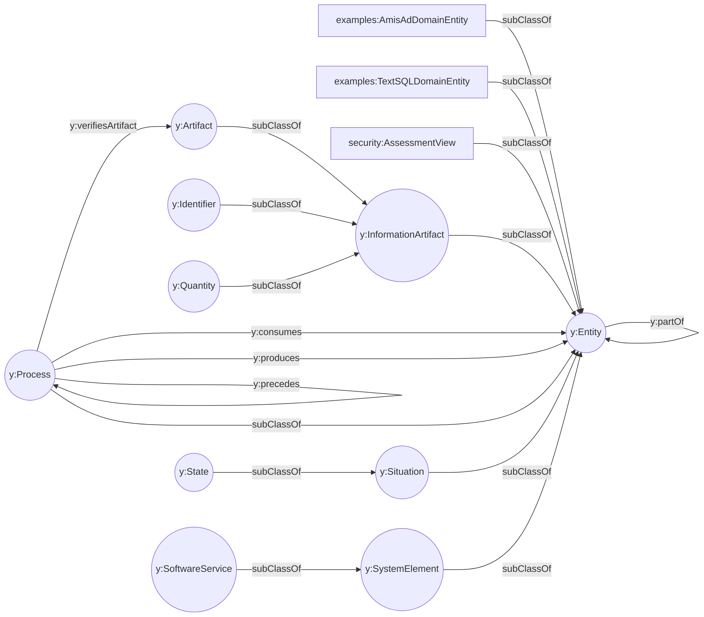

# Yuruna ontology

The Yuruna ontology is the English vocabulary of Yuruna for translation,
discovery, and configuration diagnosis. Each version is one self-contained OWL 2
file with its own version IRI and namespaces, so two versions can be loaded into
the same tools without their concepts merging. A concept in one version is not
the same resource as its namespace-twin in another.

| Version | Status | Guide | Ontology file | Version IRI |
| --- | --- | --- | --- | --- |
| 2026/10 | Current. Edits within the month are made in place. | [README](2026/10/README.md) | [yuruna.owl](2026/10/yuruna.owl) | `https://yuruna.com/ontology/2026/10/yuruna` |

The guide for each version explains the tools that open it (Protege, WebVOWL,
and rdflib) and gives a runnable query. Start with the current version above.

## Diagrams

The concepts of version 2026/10 are partitioned into namespaces under
`https://yuruna.com/ontology/2026/10/`, one per area of computing. The base
namespace `y:` holds the upper categories every area shares -- `y:Entity`, its
kinds `y:SystemElement`, `y:InformationArtifact`, `y:Process`, and
`y:Situation`, and the generic categories and relations under them -- and the
annotation vocabulary. Seven namespaces hold the framework's concepts, and the
`examples:` namespace holds the concepts of the example projects, which still
descend from and relate to the framework's categories. A class belongs to one
namespace; its parents and the ranges of its properties can be in another.

[OntoMermaid](https://github.com/floresbakker/OntoMermaid) drew these diagrams
from the subclass axioms, object properties, and existential restrictions of
the ontology. The overview below shows the base namespace, with the other
namespaces' direct children of `y:Entity` as boxes. Each other namespace has a
page of its own, or several for the largest: `network:` has a page per upper
category, `software:` separates localization and documentation from delivery
and configuration, and `examples:` has a page per example project. A class
drawn on another page appears as a box, and every page stays within Mermaid's
default limits of 500 edges and 50,000 characters.

| Namespace | Prefix | Classes | Holds | Diagrams |
| --- | --- | ---: | --- | --- |
| `https://yuruna.com/ontology/2026/10/yuruna#` | `y:` | 10 | The upper categories every area shares and the relations defined between them. | overview above |
| `https://yuruna.com/ontology/2026/10/compute#` | `compute:` | 81 | The computing vocabulary: physical and virtual machines, hypervisors, operating systems, firmware, processors, memory, disks, images, snapshots, and guest provisioning. | [Compute](2026/10/diagrams/compute.md) |
| `https://yuruna.com/ontology/2026/10/diagnostics#` | `diagnostics:` | 70 | The diagnostics vocabulary: incidents, failures and their classification, evidence, checks, recovery, telemetry, logs, metrics, dashboards, and alerts. | [Diagnostics](2026/10/diagrams/diagnostics.md) |
| `https://yuruna.com/ontology/2026/10/network#` | `network:` | 179 | The networking vocabulary: protocols, interfaces, links, addressing, name resolution, routing, proxies and caches, and the network conditions, failures, and checks. | [Network system elements](2026/10/diagrams/network-elements.md), [Network information artifacts](2026/10/diagrams/network-information.md), [Network processes and situations](2026/10/diagrams/network-processes.md) |
| `https://yuruna.com/ontology/2026/10/security#` | `security:` | 43 | The security vocabulary: credentials, secrets, authentication, certificates, trust, permissions, and the assessment views and conditions. | [Security](2026/10/diagrams/security.md) |
| `https://yuruna.com/ontology/2026/10/software#` | `software:` | 112 | The software engineering vocabulary: artifacts, releases, container images and registries, configuration, deployment, Kubernetes resources, packages, localization, and documentation. | [Software delivery and configuration](2026/10/diagrams/software-delivery.md), [Software localization and documentation](2026/10/diagrams/software-localization.md) |
| `https://yuruna.com/ontology/2026/10/storage#` | `storage:` | 44 | The storage vocabulary: filesystems, mounts, shares, pools, replication, archives, the stash, downloads, and content addressing. | [Storage](2026/10/diagrams/storage.md) |
| `https://yuruna.com/ontology/2026/10/testing#` | `testing:` | 87 | The test automation vocabulary: the runner, its cycles, plans, sequences, steps, pool, console input and recognition, retries, and sequence failures. | [Testing](2026/10/diagrams/testing.md) |
| `https://yuruna.com/ontology/2026/10/examples#` | `examples:` | 99 | The vocabulary of the example projects: the AmisAd matching and settlement example, and the yuruna-project examples with their Text-to-SQL agent and website. | [AmisAd example](2026/10/diagrams/examples-amisad.md), [yuruna-project examples](2026/10/diagrams/examples-yuruna-project.md) |

---

LICENSEURI https://yuruna.link/license

Copyright (c) 2019-2026 by Alisson Sol et al.

Last review: 2026.10.25

Back to [Yuruna documentation](../README.md)
