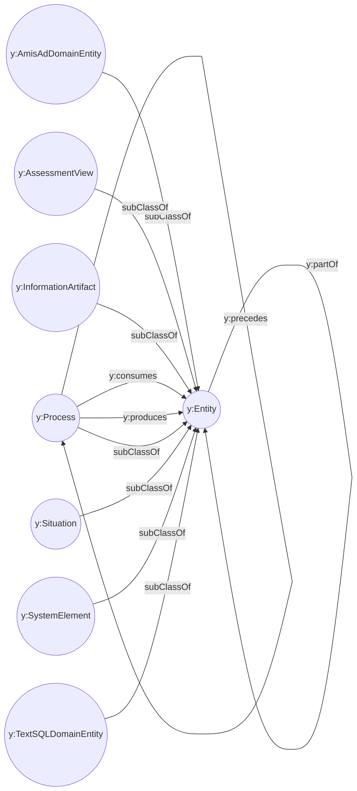

# Yuruna ontology

The Yuruna ontology is the English vocabulary of Yuruna for translation,
discovery, and configuration diagnosis. Each version is one self-contained OWL 2
file with its own namespace and version IRI, so two versions can be loaded into
the same tools without their concepts merging. A concept in one version is not
the same resource as its namespace-twin in another.

| Version | Status | Guide | Ontology file | Version IRI |
| --- | --- | --- | --- | --- |
| 2026/10 | Current. Edits within the month are made in place. | [README](2026/10/README.md) | [yuruna.owl](2026/10/yuruna.owl) | `https://yuruna.com/ontology/2026/10/yuruna` |

The guide for each version explains the tools that open it (Protege, WebVOWL,
and rdflib) and gives a runnable query. Start with the current version above.

## Diagrams

[OntoMermaid](https://github.com/floresbakker/OntoMermaid) drew these diagrams
of version 2026/10 from its subclass axioms, object properties, and existential
restrictions. Every class descends from `y:Entity` through one of seven
domains. The overview shows the domains and the properties defined between
them. Each domain has a page of its own, and a class with parents in two
domains is drawn on both pages. The information artifact domain draws its four
largest branches on separate pages, so every diagram stays within Mermaid's
default limits of 500 edges and 50,000 characters.

| Domain | Meaning | Diagram |
| --- | --- | --- |
| `y:AmisAdDomainEntity` | A concept specific to the AmisAd privacy-oriented matching and settlement example. | [AmisAd domain entity](2026/10/diagrams/amis-ad-domain-entity.md) |
| `y:AssessmentView` | One of four kinds of evidence compared in a security assessment of the same scope: the Baseline, the Configuration, the Implementation, or the Telemetry. | [Assessment view](2026/10/diagrams/assessment-view.md) |
| `y:InformationArtifact` | Recorded information with a role in configuration, execution, communication, or evidence. | [Information artifact](2026/10/diagrams/information-artifact.md), with branches [Artifact](2026/10/diagrams/artifact.md), [Identifier](2026/10/diagrams/identifier.md), [Quantity](2026/10/diagrams/quantity.md), [Protocol](2026/10/diagrams/protocol.md) |
| `y:Process` | An activity or execution that changes, checks, or observes system state. | [Process](2026/10/diagrams/process.md) |
| `y:Situation` | A state of affairs relevant to operation or diagnosis, including conditions and incidents. | [Situation](2026/10/diagrams/situation.md) |
| `y:SystemElement` | A hardware, software, or logical part of a computing installation that can participate in an operational relationship. | [System element](2026/10/diagrams/system-element.md) |
| `y:TextSQLDomainEntity` | A concept specific to the Yuruna Text-to-SQL example or its subscription demonstration schema. | [Text-to-SQL domain entity](2026/10/diagrams/text-sql-domain-entity.md) |

---

LICENSEURI https://yuruna.link/license

Copyright (c) 2019-2026 by Alisson Sol et al.

Last review: 2026.10.22

Back to [Yuruna documentation](../README.md)
